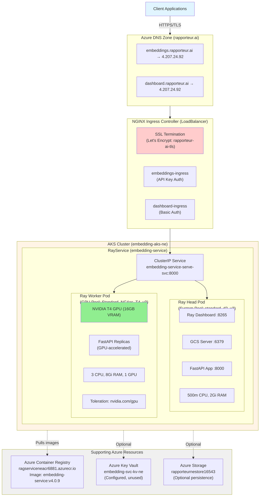
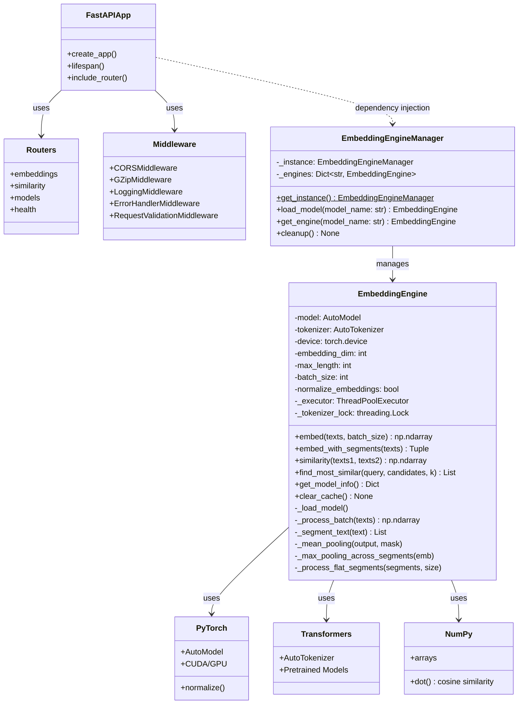
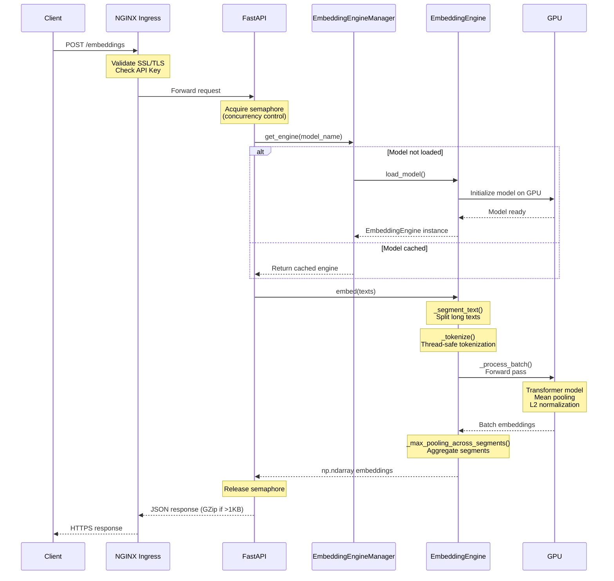
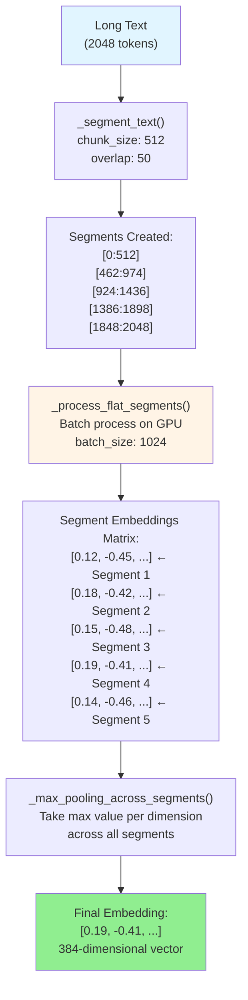

# EmbeddingService

A production-ready, GPU-accelerated text embedding service built with FastAPI, Ray Serve, and deployed on Azure Kubernetes Service (AKS). Provides high-performance semantic embeddings using transformer models with enterprise-grade features including authentication, SSL, monitoring, and scalability.

## Table of Contents

- [Overview](#overview)
- [Architecture](#architecture)
- [Features](#features)
- [Deployment Environment](#deployment-environment)
- [API Endpoints](#api-endpoints)
- [Installation & Setup](#installation--setup)
- [Configuration](#configuration)
- [Development](#development)
- [Monitoring & Health](#monitoring--health)
- [Performance](#performance)

---

## Overview

EmbeddingService transforms text into dense vector representations (embeddings) for semantic similarity, search, clustering, and AI applications. It leverages GPU acceleration for high throughput and uses Ray Serve for horizontal scaling.

**Key Capabilities:**
- Generate embeddings for single texts or batches (up to 1,024 texts)
- Automatic text segmentation for documents longer than 512 tokens
- Cosine similarity computation between text pairs
- Multiple pre-trained models (MiniLM, BERT variants, Legal-BERT)
- GPU-accelerated inference with T4/A4500 GPUs
- Production-ready with SSL, API key authentication, and monitoring

---

## Architecture

### System Architecture



### Component Architecture (UML Class Diagram)



### Request Flow Sequence Diagram



### Text Segmentation Flow

For texts longer than 512 tokens, the engine automatically segments and processes them:



---

## How It Works

EmbeddingService transforms natural language text into dense numerical vectors (embeddings) that capture semantic meaning. These embeddings enable AI applications to understand similarity between texts, perform semantic search, cluster documents, and power retrieval-augmented generation (RAG) systems.

### The Embedding Pipeline

When you send text to the service, it flows through several sophisticated layers:

**1. Request Handling (`src/service/routes/embeddings.py`)**

The FastAPI application receives your HTTP request at the `/embeddings` endpoint. The request is validated by `RequestValidationMiddleware` to ensure it doesn't exceed configured limits (8,192 characters per text, 1,024 texts per batch). The middleware stack also handles CORS, logging, error handling, and GZip compression for large responses.

**2. Concurrency Control (`src/service/core/dependencies.py`)**

Before processing begins, the request must acquire a semaphore from the global semaphore pool. This prevents the service from being overwhelmed by concurrent requests that could exhaust GPU memory. The `get_embedding_semaphore()` function provides access to a semaphore with a limit of 64 concurrent embedding operations (configurable in `src/config.py`). This ensures stable throughput even under burst traffic.

**3. Model Management (`src/service/core/engine_manager.py`)**

The `EmbeddingEngineManager` singleton manages the lifecycle of embedding models. When you request embeddings with a specific model (like "all-mini"), the manager checks if that model is already loaded in its internal cache (`_engines` dictionary). If not, it instantiates a new `EmbeddingEngine` and caches it for future requests. This lazy-loading strategy minimizes memory usage while maintaining fast response times for frequently-used models.

**4. Text Segmentation (`src/components/embedding_engine.py` - `_segment_text()`)**

If your text exceeds 512 tokens (the maximum sequence length for most BERT models), the `EmbeddingEngine` automatically segments it into overlapping chunks. The `_segment_text()` method tokenizes your text, then splits it into segments with 50-token overlaps (configurable). This overlap ensures that semantic information at chunk boundaries isn't lost. For example, a 2,048-token document becomes 5 segments: [0:512], [462:974], [924:1436], [1386:1898], [1848:2048].

**5. GPU-Accelerated Processing (`embedding_engine.py` - `_process_batch()` and `_process_flat_segments()`)**

The segmented texts (or original texts if segmentation isn't needed) are batched and sent to the GPU for processing. The `_process_batch()` method:
- Tokenizes texts using the HuggingFace `AutoTokenizer`
- Pads sequences to equal length for efficient batch processing
- Transfers tensors to the GPU (`torch.device('cuda')`)
- Runs a forward pass through the transformer model (`AutoModel`)
- Applies mean pooling across token embeddings to get sentence-level vectors
- Optionally normalizes embeddings for cosine similarity

For segmented texts, `_process_flat_segments()` batches all segments across all input texts together, maximizing GPU utilization. This is more efficient than processing each text's segments separately.

**6. Segment Aggregation (`embedding_engine.py` - `_max_pooling_across_segments()`)**

After generating embeddings for each segment, the engine aggregates them into a single embedding per text using max pooling. For each dimension in the embedding vector, it takes the maximum value across all segments. This preserves the strongest semantic signals from any part of the document while maintaining a fixed-size output regardless of input length.

**7. Response Formation (`src/service/routes/embeddings.py`)**

The NumPy array of embeddings is converted to a JSON-serializable format and wrapped in a response schema (`EmbeddingResponse` from `src/service/schemas/responses.py`). The response includes the embeddings, their shape, the model name, and processing time. If the response is large, the `GZipMiddleware` compresses it before sending.

### Model Loading and Caching

The `EmbeddingEngine` class (`src/components/embedding_engine.py`) uses HuggingFace Transformers to load pre-trained models. When initialized:

1. It resolves the model name using the `SMALL_MODELS` dictionary (e.g., "all-mini" → "sentence-transformers/all-MiniLM-L6-v2")
2. Downloads the model from HuggingFace Hub if not cached locally
3. Moves the model to the GPU and sets it to evaluation mode
4. Initializes a thread pool executor for async operations
5. Determines the embedding dimension by running a test input

Models are cached in `/root/.cache/huggingface` (controlled by the `TRANSFORMERS_CACHE` environment variable) and persist across container restarts if mounted to a persistent volume.

### Async Architecture

The service uses Python's `asyncio` for non-blocking request handling. While embedding computation itself is synchronous (PyTorch operations), the `EmbeddingEngine.embed()` method wraps synchronous calls with `loop.run_in_executor()`, allowing the event loop to handle other requests while embeddings are computed in a thread pool. This architecture, combined with semaphore-based concurrency control, enables the service to maintain high throughput without blocking.

### Ray Serve Integration

In production (`src/service/ray_deployment.py`), the FastAPI application is deployed using Ray Serve, a scalable serving framework. Ray Serve:
- Creates multiple replicas of the application across GPU workers
- Load-balances requests across replicas
- Provides health checks and auto-recovery
- Scales replicas based on resource availability
- Handles graceful shutdown and model cleanup

The RayService Kubernetes resource (`k8s/rayservice-aks-ne.yaml`) defines a Ray cluster with a head node (for coordination) and GPU worker nodes (for inference). Each worker runs replicas of the embedding service, allowing horizontal scaling.

---

## Features

### Core Features

- **GPU Acceleration**: Leverages NVIDIA T4/A4500 GPUs for high-throughput inference via PyTorch CUDA backend
- **Automatic Text Segmentation**: Handles documents up to 8,192 characters with intelligent chunking and overlap (`_segment_text()`)
- **Batch Processing**: Process up to 1,024 texts in a single request with GPU-optimized batching (`_process_flat_segments()`)
- **Multiple Models**: Support for MiniLM, BERT variants, Legal-BERT via HuggingFace Transformers (`SMALL_MODELS` dict)
- **Normalized Embeddings**: L2-normalized vectors for cosine similarity (`normalize_embeddings=True`)
- **Async Processing**: Non-blocking async/await with semaphore-based concurrency control (`get_embedding_semaphore()`)

### Enterprise Features

- **SSL/TLS Encryption**: Let's Encrypt certificates with automatic renewal via cert-manager
- **API Key Authentication**: Secure API access with X-API-Key header validation in middleware
- **Rate Limiting**: 600 requests/minute per IP (configurable in `service.rate_limit_per_minute`)
- **Health Checks**: Liveness (`/health/live`) and readiness (`/health/ready`) probes for Kubernetes
- **Monitoring**: Performance metrics endpoint (`/metrics`), request logging via `LoggingMiddleware`, GPU utilization tracking
- **Error Handling**: Structured error responses with retry logic (`ErrorHandlerMiddleware` and custom exceptions in `core/exceptions.py`)
- **GZip Compression**: Automatic response compression for large payloads via `GZipMiddleware` (>1KB threshold)

### Scalability

- **Ray Serve**: Horizontal scaling with multiple replicas (`ray_deployment.py` deploys FastAPI app across workers)
- **Auto-scaling**: Kubernetes HPA based on CPU/memory/GPU metrics
- **Resource Management**: Semaphore-based concurrency limits prevent GPU OOM (`embedding_concurrency_limit`, `gpu_ops_concurrency_limit`)
- **Graceful Shutdown**: Clean termination with 120s grace period (lifecycle hooks in `rayservice-aks-ne.yaml`)
- **PVC Support**: Persistent model caching across restarts (`TRANSFORMERS_CACHE` mounted to persistent volume)

### Advanced Processing Features

**Intelligent Text Segmentation**: The `_segment_text()` method in `EmbeddingEngine` handles long documents by splitting them into overlapping chunks. This is crucial for legal documents, research papers, or any text exceeding the model's 512-token limit. The overlap (default 50 tokens) ensures contextual information at boundaries is preserved.

**Max Pooling Aggregation**: When a text is segmented, each segment gets its own embedding. The `_max_pooling_across_segments()` method aggregates these into a single embedding by taking the maximum value for each dimension across all segments. This captures the strongest semantic signals from the entire document while maintaining a consistent output shape.

**Dynamic Batch Sizing with GPU Memory Management**: The `_process_flat_segments()` method includes automatic retry logic with exponentially decreasing batch sizes. If a CUDA out-of-memory error occurs, it halves the batch size and retries (up to 6 attempts). This ensures robustness even when processing unexpectedly large batches or complex texts that consume more GPU memory.

**Thread-Safe Tokenization**: HuggingFace tokenizers are not thread-safe by default. The `EmbeddingEngine` uses a `_tokenizer_lock` (threading.Lock) to guard all tokenizer operations, preventing race conditions when multiple requests are processed concurrently in the thread pool executor.

**Model Fallback**: If the requested model fails to load (e.g., network issues, invalid model name), the `_load_model()` method automatically falls back to a reliable default model (`distilbert-base-uncased` by default, configurable via `embedding.fallback_model`). This ensures the service remains available even if a specific model is unavailable.

---

## Deployment Environment

### Azure Infrastructure (North Europe)

| Resource | Type | Specifications |
|----------|------|----------------|
| **AKS Cluster** | embedding-aks-ne | Kubernetes v1.32 |
| **System Node Pool** | aks-ragpool | 1x standard_d2_v3 (2 vCPU, 8GB RAM) |
| **GPU Node Pool** | aks-t4pool | 1x Standard_NC4as_T4_v3 (4 vCPU, 28GB RAM, T4 GPU) |
| **Container Registry** | ragserviceneacr6881.azurecr.io | Premium SKU |
| **DNS Zone** | rapporteur.ai | Global |
| **Key Vault** | embedding-svc-kv-ne | Standard (configured, unused) |
| **Storage Account** | rapporteurnestore16543 | Standard LRS |

### Kubernetes Deployment

**Current Version**: v4.0.9
**Model**: sentence-transformers/all-MiniLM-L6-v2 (384 dimensions)
**Image**: `ragserviceneacr6881.azurecr.io/embedding-service:v4.0.9`

**Pods:**
- **Head Pod**:
  - Resources: 500m CPU, 2Gi memory
  - Node: system pool (standard_d2_v3)
  - Ports: 6379 (GCS), 8265 (Dashboard), 8000 (API)

- **Worker Pod**:
  - Resources: 3 CPU, 8Gi memory, 1 GPU
  - Node: T4 GPU pool (Standard_NC4as_T4_v3)
  - GPU: NVIDIA T4 (16GB VRAM)
  - Tolerations: `nvidia.com/gpu=present`

**Services:**
- `embedding-service-serve-svc` (ClusterIP on port 8000)

**Ingresses:**
- `embeddings-ingress`: https://embeddings.rapporteur.ai (API Key: `X-API-Key: H5J1Hd3P7HpJQ2YyGnEDtvz2wOuV5wSbIr4cVV/b/oU=`)
- `dashboard-ingress`: https://dashboard.rapporteur.ai (Basic Auth: `admin/RayDashboard2025!`)

**SSL Certificate:**
- Name: `rapporteur-ai-tls`
- Issuer: Let's Encrypt (cert-manager)
- Status: READY

---

## API Endpoints

All endpoints are defined in the `src/service/routes/` directory, with request/response schemas in `src/service/schemas/`. The routing is registered in `src/service/main.py` via FastAPI's `include_router()`.

### Embeddings

**POST /embeddings** (implemented in `src/service/routes/embeddings.py`)

Generate embeddings for single or multiple texts. The endpoint validates input via `EmbeddingRequest` schema, acquires a semaphore to control concurrency, retrieves or loads the requested model via `EmbeddingEngineManager.get_engine()`, calls `engine.embed()` for processing, and returns results wrapped in `EmbeddingResponse` schema.

```bash
curl -X POST https://embeddings.rapporteur.ai/embeddings \
  -H "Content-Type: application/json" \
  -H "X-API-Key: H5J1Hd3P7HpJQ2YyGnEDtvz2wOuV5wSbIr4cVV/b/oU=" \
  -d '{
    "texts": ["Hello world", "Semantic search"],
    "model_name": "all-mini",
    "use_segmentation": true
  }'
```

**Response:**
```json
{
  "embeddings": [[0.12, -0.45, ...], [0.18, -0.32, ...]],
  "shape": [2, 384],
  "model": "all-mini",
  "processing_time": 0.006
}
### Similarity

**POST /similarity** (implemented in `src/service/routes/similarity.py`)

Compute cosine similarity between text pairs. This endpoint generates embeddings for two sets of texts and computes their dot product (since embeddings are L2-normalized, dot product equals cosine similarity). The `similarity()` method in `EmbeddingEngine` handles this efficiently by normalizing embeddings if needed and using NumPy's `np.dot()` for the similarity matrix.

Compute cosine similarity between text pairs.

```bash
curl -X POST https://embeddings.rapporteur.ai/similarity \
  -H "Content-Type: application/json" \
  -H "X-API-Key: H5J1Hd3P7HpJQ2YyGnEDtvz2wOuV5wSbIr4cVV/b/oU=" \
  -d '{
    "texts1": ["cat on mat"],
    "texts2": ["feline on rug", "dog in park"]
  }'
```

**Response:**
```json
{
  "similarities": [[0.87, 0.23]],
  "shape": [1, 2],
  "processing_time": 0.012
}
```

### Health Checks

All health endpoints are implemented in `src/service/routes/health.py`.

**GET /health**

Service health status with detailed information including GPU availability, loaded models, and system resources.

```bash
curl https://embeddings.rapporteur.ai/health \
  -H "X-API-Key: H5J1Hd3P7HpJQ2YyGnEDtvz2wOuV5wSbIr4cVV/b/oU="
```

**GET /health/ready**

Readiness probe for Kubernetes. Returns 200 if the service is ready to accept traffic (checks that at least one model can be loaded successfully). Used by K8s readiness probes to determine when a pod should receive traffic.

**GET /health/live**

### Models

Endpoints for model management are in `src/service/routes/models.py`.

**GET /models**

List available models from the `SMALL_MODELS` dictionary in `EmbeddingEngine`, showing which models can be requested and their HuggingFace paths.

**POST /models/load**

Pre-load a specific model into memory. This is useful for warming up the service before receiving production traffic. The endpoint calls `EmbeddingEngineManager.load_model()` which instantiates an `EmbeddingEngine`, downloads the model if needed, and caches it in the manager's `_engines` dictionary.

**GET /models/info**

Get detailed information about a loaded model including device (CPU/GPU), embedding dimensions, batch size, and GPU memory statistics. This calls `engine.get_model_info()` which introspects the PyTorch model and device configuration.

Pre-load a specific model.

---

## Installation & Setup

### Local Development

```bash
# Clone repository
git clone <repository-url>
cd EmbeddingService

# Create virtual environment
python -m venv venv
source venv/bin/activate  # or `venv\Scripts\activate` on Windows

# Install dependencies
pip install -r requirements.txt
pip install -e .

# Run service locally
python -m src.service.main

# Or with uvicorn
uvicorn src.service.main:app --reload --host 0.0.0.0 --port 8000
```

### Docker Build

```bash
# Build base image (optional)
docker build -f Dockerfile.base -t embedding-service-base .

# Build main image
echo "4.0.9" > version
docker build -t embedding-service:v4.0.9 .

# Run locally
docker run -p 8000:8000 --gpus all embedding-service:v4.0.9
```

### Azure Deployment

```bash
# Login to Azure
az login
az account set --subscription <subscription-id>

# Build and push to ACR
az acr login --name ragserviceneacr6881
docker tag embedding-service:v4.0.9 ragserviceneacr6881.azurecr.io/embedding-service:v4.0.9
docker push ragserviceneacr6881.azurecr.io/embedding-service:v4.0.9

# Get AKS credentials
az aks get-credentials --resource-group rapporteur-ne-rg --name embedding-aks-ne

# Deploy to Kubernetes
kubectl apply -f k8s/rayservice-aks-ne.yaml

# Check deployment status
kubectl get pods
kubectl get rayservice embedding-service
```

---

## Configuration

### Model Configuration

Edit `src/config.py`:

```python
defaults = {
    "embedding": {
        "default_model": "all-mini",  # MiniLM (384 dim)
        "batch_size": 1024,
        "max_length": 512,
        "normalize_embeddings": True,
        "device": "cuda",
        "use_segmentation": True,
        "segment_overlap": 50,
        "fallback_model": "distilbert-base-uncased"
    },
    "service": {
        "max_text_length": 8192,
        "max_batch_size": 1024,
        "embedding_concurrency_limit": 64,
        "similarity_concurrency_limit": 16
    }
}
```

### Available Models

| Key | Model Path | Dimensions | Use Case |
|-----|-----------|------------|----------|
| `all-mini` | sentence-transformers/all-MiniLM-L6-v2 | 384 | General purpose (recommended) |
| `legal-bert` | nlpaueb/legal-bert-base-uncased | 768 | Legal documents |
| `distilbert` | distilbert-base-uncased | 768 | Fallback model |
| `bert-small` | google/bert_uncased_L-4_H-512_A-8 | 512 | Medium accuracy/speed |

### Environment Variables

```bash
# Model caching
TRANSFORMERS_CACHE=/root/.cache/huggingface

# Ray storage
RAY_STORAGE_PATH=/tmp/ray-storage

# GPU visibility
NVIDIA_VISIBLE_DEVICES=all
CUDA_VISIBLE_DEVICES=0

# API authentication
API_KEY=<your-api-key>
```

---

## Development

### Project Structure

```
EmbeddingService/
├── src/
│   ├── components/
│   │   └── embedding_engine.py      # Core embedding engine
│   ├── service/
│   │   ├── main.py                  # FastAPI application
│   │   ├── ray_deployment.py        # Ray Serve deployment
│   │   ├── core/
│   │   │   ├── engine_manager.py    # Singleton manager
│   │   │   ├── dependencies.py      # DI & semaphores
│   │   │   └── exceptions.py        # Custom exceptions
│   │   ├── routes/
│   │   │   ├── embeddings.py        # Embedding endpoints
│   │   │   ├── similarity.py        # Similarity endpoints
│   │   │   ├── models.py            # Model management
│   │   │   └── health.py            # Health checks
│   │   ├── schemas/
│   │   │   ├── requests.py          # Request models
│   │   │   └── responses.py         # Response models
│   │   └── middleware/
│   │       ├── error_handler.py     # Error handling
│   │       ├── logging.py           # Request logging
│   │       └── validation.py        # Input validation
│   ├── config.py                    # Configuration
│   └── config_handler.py            # Config helper
├── k8s/
│   └── rayservice-aks-ne.yaml       # K8s deployment
├── helm/
│   └── embedding-service/           # Helm charts
├── tests/                           # Unit tests
├── Dockerfile                       # Main image
├── Dockerfile.base                  # Base image
├── requirements.txt                 # Dependencies
└── setup.py                         # Package setup
```

### Running Tests

```bash
# Run all tests
pytest tests/
### Making Changes

1. **Change Model**: Update `src/config.py` → `defaults["embedding"]["default_model"]` to one of the keys in `EmbeddingEngine.SMALL_MODELS`
2. **Version Bump**: Update `version` file (e.g., `echo "4.0.10" > version`)
3. **Rebuild**: `docker build --no-cache -t <image>:<version> .`
4. **Push**: `docker push <image>:<version>`
5. **Update K8s**: Edit `k8s/rayservice-aks-ne.yaml` to update both head and worker container image tags
6. **Deploy**: `kubectl apply -f k8s/rayservice-aks-ne.yaml`
7. **Verify**: Check pods with `kubectl get pods` and test API to confirm model change

**Important**: When changing models, use `--no-cache` to avoid Docker layer caching of old model downloads. HuggingFace downloads models at runtime in `_load_model()`, but Docker may cache the layers where those downloads occurred, causing the old model to persist even with new configuration.

### Understanding the Configuration System

The configuration is managed by a custom `Configuration` class in `src/config_handler.py` and instantiated in `src/config.py`. The `CustConf` class extends `Configuration` and provides:

- **Nested Key Access**: Use dot notation like `app_conf.get("embedding.batch_size")` to access nested config values
- **Logging Configuration**: The `init_logger()` method sets up loggers with formats and handlers defined in config
- **Type Safety**: Configuration values have defaults, so `get()` always returns a valid value
- **Module-Level Access**: Import via `from src.config import app_conf` throughout the codebase

The `Base` class in `config_handler.py` is a mixin that provides `_app_config` and `_logger` to any class that inherits it. This is why `EmbeddingEngine(Base)` has access to configuration without explicitly passing it.

### Middleware Pipeline

Middleware executes in reverse order of registration (last added is first executed). The pipeline in `main.py` is:

1. **ErrorHandlerMiddleware** (outermost) - Catches all exceptions and converts to JSON responses
2. **LoggingMiddleware** - Logs request/response details with timing
3. **GZipMiddleware** - Compresses large responses (>1KB)
4. **RequestValidationMiddleware** - Validates request size and content
5. **CORSMiddleware** - Handles cross-origin requests (innermost, closest to routes)

This ordering ensures errors are caught and formatted properly, logging captures the full request lifecycle, and validation happens before processing.
1. **Change Model**: Update `src/config.py` → `default_model`
2. **Version Bump**: Update `version` file
3. **Rebuild**: `docker build --no-cache -t <image>:<version> .`
4. **Push**: `docker push <image>:<version>`
5. **Update K8s**: Edit `k8s/rayservice-aks-ne.yaml` image tags
6. **Deploy**: `kubectl apply -f k8s/rayservice-aks-ne.yaml`

**Important**: When changing models, use `--no-cache` to avoid Docker layer caching of old model downloads.

---

## Monitoring & Health

### Health Endpoints

- **Liveness**: `/health/live` - Pod is running
- **Readiness**: `/health/ready` - Pod can serve traffic (model loaded)
- **Detailed Health**: `/health` - Full status with GPU info

### Metrics

Access `/metrics` for:
- Request counts and error rates
- Average response times
- Per-endpoint statistics
- Semaphore usage

### Ray Dashboard

Access at https://dashboard.rapporteur.ai:
- Cluster status
- Resource utilization
- Serve deployment metrics
- Logs and traces

### Kubernetes Monitoring

```bash
# Pod status
kubectl get pods

# Logs
kubectl logs <pod-name>

# Resource usage
kubectl top pods

# Describe pod
kubectl describe pod <pod-name>

# Ray cluster status
kubectl get rayservice embedding-service
```

---

## Performance

### Benchmarks (v4.0.9 with MiniLM on T4 GPU)

| Metric | Value |
|--------|-------|
| **Embedding Dimensions** | 384 |
| **Processing Time** | ~6ms per text |
| **Throughput** | 7.32 requests/sec (50 requests, 5 workers) |
| **Batch Size** | 1,024 texts |
| **GPU Utilization** | ~80% during burst |
| **Success Rate** | 100% (load test) |

### Optimization Tips

1. **Batch Requests**: Send multiple texts in one request (up to 1,024)
2. **Use Segmentation**: Enable for long documents (>512 tokens)
3. **Model Selection**: MiniLM (384 dim) is 73% faster than Legal-BERT (768 dim)
4. **GPU Warmup**: First request takes longer due to model loading
5. **Connection Pooling**: Reuse HTTP connections for better throughput

### Scaling

To handle higher load:

```bash
# Scale GPU workers
kubectl patch rayservice embedding-service --type=json \
  -p='[{"op": "replace", "path": "/spec/rayClusterConfig/workerGroupSpecs/0/replicas", "value": 2}]'

# Or edit YAML and reapply
kubectl apply -f k8s/rayservice-aks-ne.yaml
```

---

## Ingress Configuration for Burst Resilience

The NGINX Ingress Controller is configured for optimal performance under load:

- **Proxy buffering**: Increased buffer sizes for large JSON responses
- **GZip compression**: Enabled for `application/json` (reduces bandwidth)
- **Timeouts**: Extended for long-running embedding requests
- **Retry logic**: Limited retries for transient 5xx errors

Additional GZip compression is enabled at the FastAPI application level for responses >1KB.

---

## License

[Specify your license]

---

## Support

For issues, questions, or contributions:
- GitHub Issues: [repository-url]/issues
- Documentation: [repository-url]/wiki
- Contact: [your-contact]
