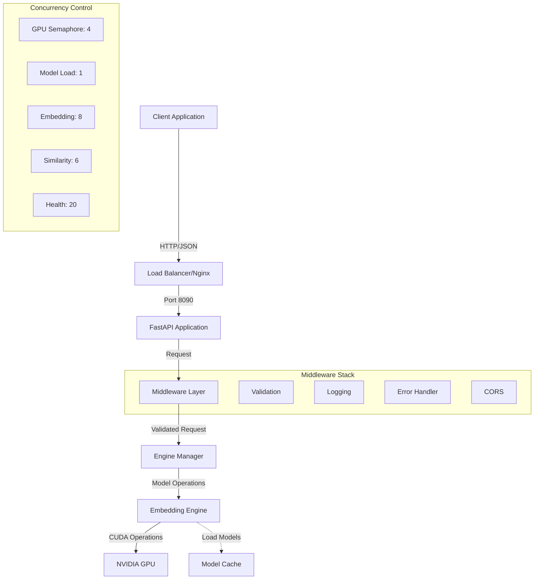
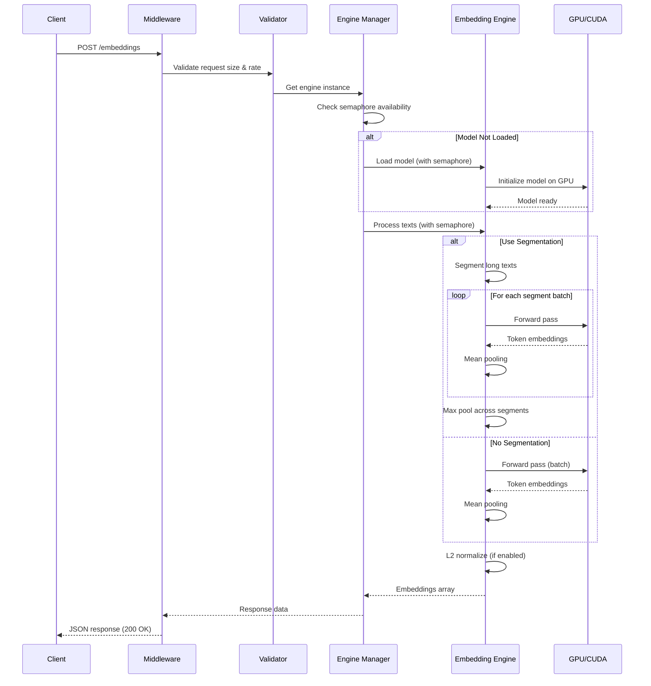
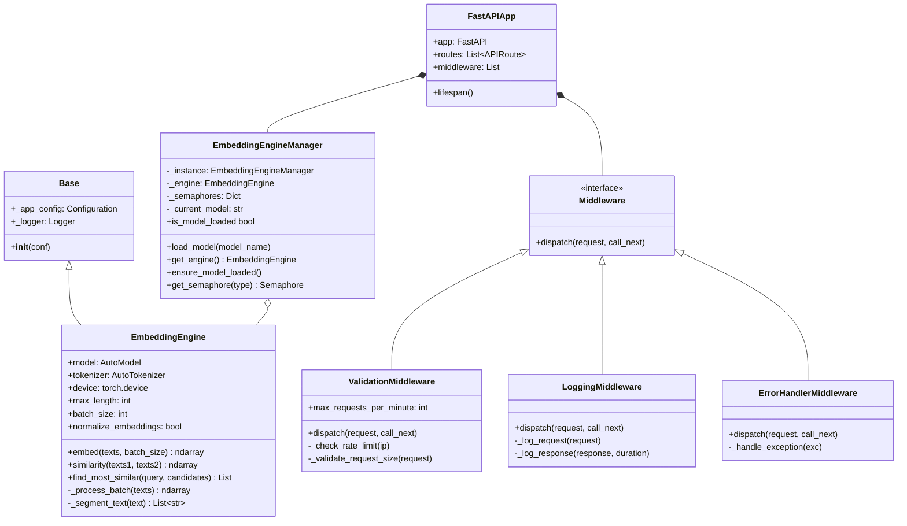
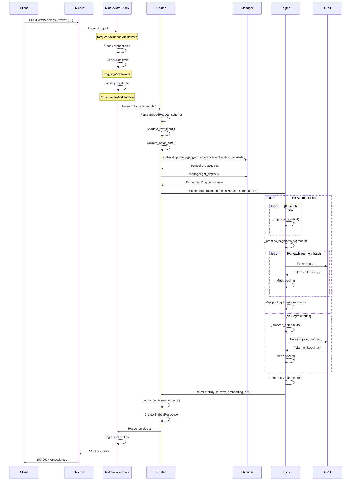

# Embedding Service Documentation

A production-ready GPU-accelerated text embedding service built with FastAPI, providing high-performance semantic embeddings using transformer models.

## Quick Start

```bash
# Start the service
docker run -d --name embedding-service --gpus device=0 -p 8090:8090 embedding-service:latest

# Generate embeddings
curl -X POST http://localhost:8090/embeddings \
  -H "Content-Type: application/json" \
  -d '{"texts": ["Hello world", "Another text"]}'

# Find similar texts
curl -X POST http://localhost:8090/similarity/search \
  -H "Content-Type: application/json" \
  -d '{"query": "machine learning", "candidates": ["AI research", "cooking recipes", "neural networks"]}'
```

## Table of Contents

- [Quick Start](#quick-start)
- [Overview](#overview)
- [Architecture](#architecture)
  - [System Architecture](#system-architecture)
  - [Request Flow](#request-flow)
  - [Core Components](#core-components)
- [Configuration](#configuration)
  - [Logging Configuration](#logging-configuration)
  - [Embedding Configuration](#embedding-configuration)
  - [Service Configuration](#service-configuration)
  - [Concurrency Control](#concurrency-control)
- [API Endpoints](#api-endpoints)
  - [Health Endpoints](#health-endpoints)
  - [Model Endpoints](#model-endpoints)
  - [Embedding Endpoints](#embedding-endpoints)
  - [Similarity Endpoints](#similarity-endpoints)
- [Request/Response Schemas](#requestresponse-schemas)
- [Middleware & Error Handling](#middleware--error-handling)
- [Complete Request Flow](#complete-request-flow)
- [Usage Guide](#usage-guide)
- [Developer Guide](#developer-guide)
- [Deployment](#deployment)
- [Best Practices](#best-practices)
- [Troubleshooting](#troubleshooting)

## Key Modules Reference

| Module | Class/Function | Purpose |
|--------|---------------|---------|
| `src/config.py` | `CustConf`, `app_conf` | Configuration management (two-level keys) |
| `src/components/embedding_engine.py` | `EmbeddingEngine` | Core embedding generation with GPU support |
| `src/service/core/engine_manager.py` | `EmbeddingEngineManager` | Singleton manager with semaphore control |
| `src/service/main.py` | `create_app()`, `lifespan()` | FastAPI app initialization and lifecycle |
| `src/service/routes/embeddings.py` | `generate_embeddings()` | Embedding generation endpoint |
| `src/service/routes/similarity.py` | `compute_similarity()`, `search_similar()` | Similarity computation endpoints |
| `src/service/routes/health.py` | `health_check()`, `readiness_check()` | Health monitoring endpoints |
| `src/service/middleware/validation.py` | `RequestValidationMiddleware` | Size limits and rate limiting |
| `src/service/schemas/requests.py` | Pydantic request models | Input validation |
| `src/service/schemas/responses.py` | Pydantic response models | Output serialization |

---

## Overview

The Embedding Service converts text into high-dimensional vector representations (embeddings) that capture semantic meaning. These embeddings enable:

- **Semantic Search**: Find similar documents or text passages
- **Clustering**: Group related content together
- **Classification**: Categorize text based on meaning
- **Recommendation**: Suggest similar items

### Key Features

- 🚀 **GPU Acceleration**: CUDA-enabled for high throughput
- 🔄 **Batch Processing**: Efficient handling of multiple texts
- 📊 **Text Segmentation**: Handles long texts via automatic chunking
- 🎯 **Multiple Models**: Supports various transformer models
- 🛡️ **Production Ready**: Rate limiting, validation, health checks
- 🐳 **Containerized**: Docker support with GPU passthrough

### Technical Stack

- **Framework**: FastAPI + Uvicorn
- **ML**: PyTorch + Transformers (Hugging Face)
- **GPU**: NVIDIA CUDA 12.0+
- **Python**: 3.12+

### Repository Structure

The service is organized into logical modules:

- **`src/config.py`**: Module-level configuration using the `pyconfs` library. Defines the `CustConf` class (extends `Configuration`) which provides configuration access via two-level keys (e.g., `"embedding.device"`). The `defaults` dictionary contains all service settings.

- **`src/components/embedding_engine.py`**: Core embedding generation logic. The `EmbeddingEngine` class handles model loading, tokenization, GPU operations, and text segmentation. It inherits from `Base` (defined in `config_handler.py`) which provides `_app_config` and `_logger` attributes.

- **`src/service/core/engine_manager.py`**: Singleton manager that wraps `EmbeddingEngine` instances. The `EmbeddingEngineManager` class provides thread-safe model loading/unloading, semaphore-based concurrency control, and lazy initialization. Access via `EmbeddingEngineManager.get_instance()`.

- **`src/service/main.py`**: FastAPI application entry point. Creates the `FastAPI` app instance with the `lifespan` context manager for startup/shutdown events. Registers all routers and middleware, and handles model pre-loading on startup.

- **`src/service/routes/`**: API endpoint definitions organized by functionality:
  - `embeddings.py`: Routes for generating embeddings (`/embeddings`, `/embeddings/quick`)
  - `similarity.py`: Routes for similarity computation (`/similarity/compute`, `/similarity/search`)
  - `health.py`: Health monitoring endpoints (`/health`, `/health/ready`, `/health/status`)
  - `models.py`: Model management endpoints (`/models/available`, `/models/load`)

- **`src/service/middleware/`**: Request processing middleware:
  - `validation.py`: `RequestValidationMiddleware` for size limits and rate limiting
  - `logging.py`: `LoggingMiddleware` for request/response logging with performance metrics
  - `error_handler.py`: `ErrorHandlerMiddleware` for unified exception handling

- **`src/service/schemas/`**: Pydantic models for request/response validation:
  - `requests.py`: Input schemas (`EmbedRequest`, `SimilarityRequest`, etc.)
  - `responses.py`: Output schemas (`EmbedResponse`, `HealthResponse`, etc.)

- **`src/service/core/exceptions.py`**: Custom exception classes for error handling (`ModelNotLoadedException`, `GPUMemoryException`, etc.)

---

## Architecture

### System Architecture



### Request Flow



### Core Components

#### EmbeddingEngine (`src/components/embedding_engine.py`)

The `EmbeddingEngine` class is the core ML component that handles model operations:

**Key Methods**:
- `__init__(model_name, device, ...)`: Initializes model and tokenizer using HuggingFace Transformers
  - Loads `AutoTokenizer` and `AutoModel` from `transformers` library
  - Moves model to specified device (GPU/CPU)
  - Sets model to evaluation mode: `self.model.eval()`

- `embed(texts, batch_size, use_segmentation, show_progress)`: Main embedding generation method
  - Converts string to list if needed
  - Routes to `_process_batch()` or `_process_segments()` based on `use_segmentation`
  - Returns NumPy array of shape `(n_texts, embedding_dim)`

- `_process_batch(texts)`: Processes a batch of texts through the model
  - Tokenizes inputs: `self.tokenizer(texts, padding=True, truncation=True, return_tensors='pt')`
  - Forward pass: `outputs = self.model(**inputs)`
  - Mean pooling over token dimension: `embeddings = outputs.last_hidden_state.mean(dim=1)`
  - Optional L2 normalization: `F.normalize(embeddings, p=2, dim=1)`
  - Returns tensor on CPU as NumPy array

- `_segment_text(text)`: Splits long text into overlapping segments
  - Tokenizes full text
  - Splits into chunks of `max_length` with `segment_overlap` tokens shared
  - Returns list of token ID lists

- `_process_segments(segments_list)`: Handles segmented texts
  - Processes each segment batch separately
  - Max-pools across segments: `segment_embeddings.max(dim=0)`
  - Returns aggregated embeddings

- `similarity(texts1, texts2)`: Computes cosine similarity matrix
  - Generates embeddings for both sets
  - Matrix multiplication: `torch.mm(emb1, emb2.T)` (works because embeddings are normalized)
  - Returns NumPy array of shape `(len(texts1), len(texts2))`

- `find_most_similar(query, candidates, top_k)`: Finds top-k similar texts
  - Computes similarities between query and all candidates
  - Uses `torch.topk(similarities, k=top_k)` for efficient selection
  - Returns sorted list of `(index, text, score)` tuples

**Inheritance**: Extends `Base` class from `src/config_handler.py`, which provides:
- `self._app_config`: Configuration access via `get()` method
- `self._logger`: Pre-configured logger instance

#### EmbeddingEngineManager (`src/service/core/engine_manager.py`)

Singleton manager that wraps `EmbeddingEngine` with lifecycle management:

**Key Methods**:
- `get_instance()`: Returns singleton instance (thread-safe with lock)
- `load_model(model_name, device, batch_size)`: Async method that:
  - Acquires `_model_lock` to prevent concurrent loads
  - Creates new `EmbeddingEngine` instance
  - Replaces `self._engine` with new instance
  - Updates `self._current_model` tracking

- `get_engine()`: Returns current engine instance
  - Raises `ModelNotLoadedException` if `self._engine is None`

- `ensure_model_loaded()`: Loads default model if none loaded
  - Called by route handlers before operations

- `get_semaphore(semaphore_type)`: Returns `asyncio.Semaphore` for concurrency control
  - Types: 'gpu_operations', 'model_loading', 'embedding_requests', 'similarity_requests', 'health_checks'

- `cleanup()`: Async cleanup method
  - Clears model from GPU memory
  - Sets `self._engine = None`
  - Calls `torch.cuda.empty_cache()` if CUDA available

**Properties**:
- `is_model_loaded`: Boolean indicating if model is available
- `current_model`: String identifier of loaded model
- `available_models`: Dict of model aliases from `EmbeddingEngine.SMALL_MODELS`

**Singleton Pattern**: Uses `__new__` override with class-level `_lock` and `_instance` to ensure only one manager exists per process.

#### FastAPI Application (`src/service/main.py`)

**Lifespan Management**:
```python
@asynccontextmanager
async def lifespan(app: FastAPI):
    # Startup
    initialize_semaphores()
    manager = EmbeddingEngineManager.get_instance()
    default_model = app_conf.get("embedding.default_model")
    await manager.load_model(default_model)

    yield  # Application runs

    # Shutdown
    await manager.cleanup()
```

**Application Creation**: The `create_app()` function:
1. Creates `FastAPI` instance with custom OpenAPI schema
2. Adds middleware stack (CORS, error handling, logging, validation)
3. Registers all routers with prefixes
4. Adds exception handlers for custom exceptions
5. Returns configured app instance

**Global Singleton**: Module exports `embedding_manager = EmbeddingEngineManager.get_instance()` which is imported by all route handlers.

### Component Architecture



---

## Configuration

The service uses a two-level configuration system via `src/config.py`. All configuration values are accessed as `section.key`.

### Configuration Architecture

Configuration is managed by the `CustConf` class in `src/config.py`, which extends the `pyconfs.Configuration` base class:

```python
class CustConf(Configuration):
    def get(self, key: str) -> Optional[None]:
        """Get value using two-level key format: 'first_level.second_level'"""
        return self.data[key.split(".")[0]][key.split(".")[1]]
```

**Important**: The configuration system **only supports two-level keys** by design. Keys like `"embedding.device"` work, but three-level keys like `"service.limits.batch_size"` will fail.

The global configuration instance `app_conf` is imported throughout the codebase:
```python
from src.config import app_conf
device = app_conf.get("embedding.device")  # Correct: two levels
```

### Configuration Structure

The `defaults` dictionary in `src/config.py` defines all settings:

```python
defaults = {
    "logging": {...},
    "embedding": {...},
    "service": {...}
}
```

This dictionary is passed to `CustConf` during initialization and becomes accessible via the `app_conf` singleton.

### Logging Configuration

```python
"logging": {
    "format": "| %(asctime)s | %(levelname)s - %(name)-10s - %(message)s",
    "level": 10,                          # DEBUG=10, INFO=20, WARNING=30
    "output_full_path": "./logs/logfile.log"
}
```

**Purpose**: Controls application logging behavior

**Used by**: `CustConf.init_logger()` method in `src/config.py` which creates loggers for all components. The `Base` class in `src/config_handler.py` calls this during initialization, providing the `_logger` attribute to all subclasses.

**Configuration**:
- `format`: Log message format string (used by `logging.Formatter`)
- `level`: Minimum log level (10=DEBUG shows all messages, 20=INFO, 30=WARNING)
- `output_full_path`: Path to log file (directory created automatically if missing)

**Access**: Components that inherit from `Base` (like `EmbeddingEngine`) automatically get `self._logger`:
```python
class EmbeddingEngine(Base):
    def __init__(self, ...):
        super().__init__()  # Initializes self._logger
        self._logger.info("Initializing EmbeddingEngine...")
```

### Embedding Configuration

```python
"embedding": {
    # Model Settings
    "default_model": "all-mini",          # Default model identifier
    "cache_dir": None,                    # Model cache (None = ~/.cache/huggingface)
    "fallback_model": "distilbert-base-uncased",  # Fallback if default fails

    # Performance
    "batch_size": 32,                     # Default batch size
    "max_length": 512,                    # Max sequence length (tokens)
    "normalize_embeddings": True,         # L2 normalize output vectors

    # Device
    "device": "cuda",                     # "cuda", "cpu", or None (auto-detect)
    "gpu_memory_fraction": 0.8,          # GPU memory limit (not enforced)

    # Text Processing
    "show_progress": False,               # Log processing progress
    "use_segmentation": True,             # Enable text segmentation
    "segment_overlap": 50                 # Token overlap between segments
}
```

**Purpose**: Controls embedding generation behavior

**Used by**:
- **`EmbeddingEngine` class** (`src/components/embedding_engine.py`): The constructor reads these values via `self._app_config.get()` to initialize model parameters
- **`EmbeddingEngineManager` class** (`src/service/core/engine_manager.py`): Reads `embedding.default_model` to determine which model to pre-load
- **Route handlers** in `src/service/routes/embeddings.py`: Default values for optional request parameters

#### Model Settings

Model identifiers are resolved via the `EmbeddingEngine.SMALL_MODELS` dictionary:

```python
SMALL_MODELS = {
    'all-mini': 'sentence-transformers/all-MiniLM-L6-v2',
    'distilbert': 'distilbert-base-uncased',
    'bert-tiny': 'google/bert_uncased_L-2_H-128_A-2',
    'bert-mini': 'google/bert_uncased_L-4_H-256_A-4',
    'bert-small': 'google/bert_uncased_L-4_H-512_A-8',
    'minibert': 'microsoft/DialoGPT-medium'
}
```

- `default_model`: Pre-loaded model on startup via the `lifespan()` function in `src/service/main.py`. The `EmbeddingEngineManager.load_model()` method resolves short names to full HuggingFace model paths using the `SMALL_MODELS` mapping. Options:
  - `"all-mini"` → `sentence-transformers/all-MiniLM-L6-v2` (384d, recommended)
  - `"distilbert"` → `distilbert-base-uncased` (768d)
  - `"bert-tiny"` → `google/bert_uncased_L-2_H-128_A-2` (128d, fastest)
  - `"bert-mini"` → `google/bert_uncased_L-4_H-256_A-4` (256d)
  - `"bert-small"` → `google/bert_uncased_L-4_H-512_A-8` (512d)
  - Custom HuggingFace model path (bypasses `SMALL_MODELS` lookup)

- `cache_dir`: Where to store downloaded models. Passed to `AutoTokenizer.from_pretrained()` and `AutoModel.from_pretrained()` in `EmbeddingEngine.__init__()`. If `None`, uses HuggingFace's default (`~/.cache/huggingface/hub/`)
- `fallback_model`: Used by `EmbeddingEngineManager` if the default model fails to load (not currently implemented in error handling)

#### Performance
- `batch_size`: Number of texts processed simultaneously on GPU by the `EmbeddingEngine._process_batch()` method. Used as `self.default_batch_size` within `EmbeddingEngine`.
  - Higher = faster but more memory
  - Recommended: 32-64 for consumer GPUs
  - Can be overridden per-request via the `batch_size` parameter in API requests
- `max_length`: Maximum tokens per text. Passed to `self.tokenizer()` as the `max_length` parameter in `EmbeddingEngine`. Longer texts are either:
  - Segmented (if `use_segmentation=True`) via `_segment_text()` method
  - Truncated (if `use_segmentation=False`) by the tokenizer
- `normalize_embeddings`: Apply L2 normalization using `torch.nn.functional.normalize()` in the `_process_batch()` method. Recommended for cosine similarity tasks.

#### Device
- `device`: GPU/CPU selection, resolved in `EmbeddingEngine.__init__()`:
  ```python
  if device is None:
      self.device = torch.device('cuda' if torch.cuda.is_available() else 'cpu')
  else:
      self.device = torch.device(device)
  ```
  - `"cuda"`: Force GPU (will fail if CUDA unavailable)
  - `"cpu"`: Force CPU
  - `None`: Auto-detect using `torch.cuda.is_available()` (prefers CUDA if available)

  The model and tokenizer are moved to this device via `self.model.to(self.device)`.

#### Text Processing
- `show_progress`: Log detailed processing information during `EmbeddingEngine.embed()` method execution. When `True`, logs batch progress like "Processing batch 3/10".
- `use_segmentation`: Handle texts longer than `max_length` in `EmbeddingEngine.embed()`:
  - `True`: Calls `_segment_text()` to split into overlapping segments, then `_process_segments()` to max-pool results
  - `False`: Tokenizer truncates to `max_length` with `truncation=True` parameter
- `segment_overlap`: Tokens shared between consecutive segments in the `_segment_text()` method. Used to calculate segment start positions:
  ```python
  for start in range(0, len(tokens), max_length - segment_overlap):
      segment = tokens[start:start + max_length]
  ```
  Higher overlap preserves more context but increases computation.

### Service Configuration

```python
"service": {
    "max_text_length": 8192,              # Max characters per text
    "max_batch_size": 100,                # Max texts per request
    "max_candidates": 1000,               # Max similarity comparisons
    "max_request_size": 10485760,         # Max request size (10MB)
    "rate_limit_per_minute": 600          # Requests per IP per minute
}
```

**Purpose**: Protects service from abuse and resource exhaustion

**Used by**: Validation utilities and middleware:

- `max_text_length`: Used by `validate_text_input()` in `src/service/utils/validation.py` to check individual text lengths:
  ```python
  def validate_text_input(text: str, max_length: int = 8192):
      if len(text) > max_length:
          raise ValidationException(f"Text exceeds maximum length of {max_length}")
  ```

- `max_batch_size`: Used by `validate_batch_size()` in `src/service/utils/validation.py` to limit the number of texts per request:
  ```python
  def validate_batch_size(batch_size: int, max_size: int = 100):
      if batch_size > max_size:
          raise ValidationException(f"Batch size {batch_size} exceeds maximum {max_size}")
  ```

- `max_candidates`: Used by `validate_similarity_inputs()` to prevent large similarity matrices that could exhaust memory.

- `max_request_size`: Used by `RequestValidationMiddleware.dispatch()` in `src/service/middleware/validation.py` to check request body size before processing:
  ```python
  await validate_request_size(request, max_size=app_conf.get('service.max_request_size'))
  ```

- `rate_limit_per_minute`: Used by `RequestValidationMiddleware.__init__()` to initialize the `self.max_requests_per_minute` attribute, enforced in the `dispatch()` method using timestamp tracking per client IP.

### Concurrency Control

Hardcoded semaphore limits in `EmbeddingEngineManager.__init__()` (`src/service/core/engine_manager.py`):

```python
self._semaphore_config = {
    'gpu_operations': 2,        # Concurrent GPU-intensive operations
    'model_loading': 1,         # Only one model operation at a time
    'embedding_requests': 4,    # Concurrent embedding requests
    'similarity_requests': 3,   # Concurrent similarity computations
    'health_checks': 20         # Lightweight health operations
}

# Create asyncio.Semaphore instances
self._semaphores = {
    'gpu_operations': asyncio.Semaphore(2),
    'model_loading': asyncio.Semaphore(1),
    'embedding_requests': asyncio.Semaphore(4),
    'similarity_requests': asyncio.Semaphore(3),
    'health_checks': asyncio.Semaphore(20),
}
```

**Purpose**: Prevents GPU memory exhaustion and coordinates concurrent access

**Usage**: Route handlers acquire semaphores before processing:

```python
# In src/service/routes/embeddings.py
async def generate_embeddings(request: EmbedRequest):
    async with embedding_manager.get_semaphore('embedding_requests'):
        # Process embedding request
        pass
```

Access semaphores via `EmbeddingEngineManager.get_semaphore(semaphore_type)` which returns the `asyncio.Semaphore` instance. If the semaphore is at capacity, the request waits until a slot becomes available.

**Note**: These limits are hardcoded because the config system only supports two-level keys. Three-level keys like `"service.semaphore_limits.gpu_operations"` would fail. To modify these values, edit `EmbeddingEngineManager.__init__()` directly.

---

## API Endpoints

All endpoints are registered in `src/service/main.py` via the `create_app()` function:

```python
app.include_router(health.router, prefix="/health", tags=["Health & Status"])
app.include_router(models.router, prefix="/models", tags=["Model Management"])
app.include_router(embeddings.router, prefix="/embeddings", tags=["Embedding Generation"])
app.include_router(similarity.router, prefix="/similarity", tags=["Similarity Operations"])
```

Each router is defined in its respective module under `src/service/routes/`. Route handlers are async functions decorated with `@router.get()` or `@router.post()`.

### Health Endpoints

Defined in `src/service/routes/health.py`

#### `GET /health/live`

**Purpose**: Liveness probe for container orchestration

**Implementation**: The `health_check()` function in `health.py` simply returns a timestamp, requiring no model or GPU access.

**Response**:
```json
{
  "status": "alive",
  "timestamp": 1761132858.735309
}
```

**Use Case**: Kubernetes/Docker liveness checks

---

#### `GET /health/ready`

**Purpose**: Readiness probe - indicates service can handle requests

**Implementation**: The `readiness_check()` function checks if a model is loaded:
```python
async def readiness_check():
    manager = EmbeddingEngineManager.get_instance()
    if not manager.is_model_loaded:
        # Return 503 with details
        raise HTTPException(status_code=503, detail={...})
    return {"status": "ready", ...}
```

**Response** (Ready):
```json
{
  "status": "ready",
  "timestamp": "2025-10-22T11:34:28.252358+00:00",
  "model_loaded": true,
  "auto_load_enabled": true,
  "uptime_seconds": 18.707
}
```

**Response** (Not Ready):
```json
{
  "detail": {
    "status": "not_ready",
    "timestamp": "2025-10-22T11:19:42.084793+00:00",
    "model_loaded": false,
    "auto_load_enabled": true,
    "uptime_seconds": 19.60,
    "message": "Failed to load default model: ..."
  }
}
```

**Use Case**: Wait for service initialization before routing traffic

---

#### `GET /health/status`

**Purpose**: Detailed service information including GPU stats

**Implementation**: The `detailed_status()` function in `health.py` calls multiple methods:
- `manager.get_engine().get_model_info()` - Returns model configuration from `EmbeddingEngine`
- `torch.cuda.is_available()`, `torch.cuda.memory_allocated()`, `torch.cuda.get_device_properties()` - GPU information
- Tracks uptime using `time.time() - manager._startup_time`

**Response**:
```json
{
  "status": "healthy",
  "model_loaded": true,
  "model_info": {
    "model_path": "sentence-transformers/all-MiniLM-L6-v2",
    "device": "cuda",
    "embedding_dim": 384,
    "max_length": 512,
    "default_batch_size": 32,
    "normalize_embeddings": true,
    "gpu_available": true,
    "gpu_memory": 21158428672
  },
  "gpu_available": true,
  "gpu_memory_used": 109997568,
  "gpu_memory_total": 21158428672,
  "uptime_seconds": 51.78,
  "timestamp": "2025-10-22T11:35:01.326940+00:00"
}
```

**Use Case**: Monitoring, debugging, capacity planning

---

### Model Endpoints

Defined in `src/service/routes/models.py`

#### `GET /models/available`

**Purpose**: List all available models

**Implementation**: The `list_available_models()` function retrieves models from the manager:
```python
async def list_available_models():
    manager = EmbeddingEngineManager.get_instance()
    return {
        "available_models": manager.available_models,  # From EmbeddingEngine.SMALL_MODELS
        "current_model": manager.current_model
    }
```

**Response**:
```json
{
  "available_models": {
    "distilbert": "distilbert-base-uncased",
    "minibert": "microsoft/DialoGPT-medium",
    "bert-tiny": "google/bert_uncased_L-2_H-128_A-2",
    "bert-mini": "google/bert_uncased_L-4_H-256_A-4",
    "bert-small": "google/bert_uncased_L-4_H-512_A-8",
    "all-mini": "sentence-transformers/all-MiniLM-L6-v2"
  },
  "current_model": "all-mini"
}
```

---

#### `POST /models/load`

**Purpose**: Load a different model

**Implementation**: The `load_model()` function in `models.py` acquires the model loading semaphore and calls manager methods:
```python
async def load_model(request: LoadModelRequest):
    manager = EmbeddingEngineManager.get_instance()
    async with manager.get_semaphore('model_loading'):
        await manager.load_model(
            model_name=request.model_name,
            device=request.device,
            batch_size=request.batch_size
        )
```

The `EmbeddingEngineManager.load_model()` method creates a new `EmbeddingEngine` instance, replacing the previous one.

**Request**:
```json
{
  "model_name": "bert-small",
  "device": "cuda",          // optional
  "batch_size": 32          // optional
}
```

**Response**:
```json
{
  "status": "success",
  "message": "Model loaded successfully",
  "model_info": {
    "model_name": "bert-small",
    "model_path": "google/bert_uncased_L-4_H-512_A-8",
    "embedding_dim": 512,
    "device": "cuda"
  }
}
```

**Use Case**: Switch models without restarting service

---

### Embedding Endpoints

Defined in `src/service/routes/embeddings.py`

#### `POST /embeddings`

**Purpose**: Generate embeddings for one or more texts

**Implementation**: The `generate_embeddings()` function:
1. Validates input using `validate_text_input()` and `validate_batch_size()` from `src/service/utils/validation.py`
2. Acquires the `embedding_requests` semaphore
3. Gets the engine: `manager.get_engine()` (raises `ModelNotLoadedException` if no model loaded)
4. Calls `engine.embed(texts, batch_size, use_segmentation, show_progress)` which returns a NumPy array
5. Converts to JSON-serializable list using `numpy_to_list()` from `src/service/utils/serialization.py`
6. Returns `EmbedResponse` Pydantic model

**Request**:
```json
{
  "texts": ["Hello world", "Another text"],
  "batch_size": 32,           // optional
  "use_segmentation": true,   // optional
  "show_progress": false      // optional
}
```

**Parameters**:
- `texts`: String or array of strings to embed
- `batch_size`: Override default batch size
- `use_segmentation`: Enable/disable text segmentation for long texts
- `show_progress`: Log processing progress

**Response**:
```json
{
  "embeddings": [
    [0.0342, -0.0156, 0.0891, ...],  // 384 dimensions
    [0.0123, 0.0445, -0.0234, ...]
  ],
  "model": "all-mini",
  "embedding_dim": 384,
  "count": 2
}
```

**Example**:
```bash
curl -X POST http://localhost:8090/embeddings \
  -H "Content-Type: application/json" \
  -d '{
    "texts": ["The cat sat on the mat", "A dog in the park"],
    "use_segmentation": false
  }'
```

---

#### `POST /embeddings/quick`

**Purpose**: Quick embedding generation with minimal options

**Implementation**: The `quick_embeddings()` function is a simplified wrapper:
```python
async def quick_embeddings(request: QuickEmbedRequest):
    # Uses quick_embed() utility from src/utils/convenience.py
    embeddings = quick_embed(request.texts, model_name=request.model_name)
    return EmbedResponse(embeddings=embeddings, ...)
```

The `quick_embed()` convenience function handles model loading and embedding generation in one call.

**Request**:
```json
{
  "texts": ["Quick text"],
  "model_name": "all-mini"    // optional
}
```

**Response**: Same as `/embeddings`

**Use Case**: Simple embedding requests without configuration

---

### Similarity Endpoints

Defined in `src/service/routes/similarity.py`

#### `POST /similarity/compute`

**Purpose**: Compute pairwise cosine similarity between two sets of texts

**Implementation**: The `compute_similarity()` function:
1. Validates inputs using `validate_similarity_inputs()` which checks for reasonable sizes
2. Acquires the `similarity_requests` semaphore
3. Gets embeddings: `engine.embed(texts1)` and `engine.embed(texts2)`
4. Computes similarity: `engine.similarity(texts1, texts2)` which internally:
   - Generates embeddings for both sets
   - Computes cosine similarity using `torch.mm(emb1, emb2.T)` (embeddings are already normalized)
   - Returns NumPy array of shape `(len(texts1), len(texts2))`
5. Serializes matrix using `numpy_matrix_to_list()` from `src/service/utils/serialization.py`

**Request**:
```json
{
  "texts1": ["First set text 1", "First set text 2"],
  "texts2": ["Second set text 1", "Second set text 2"],
  "return_embeddings": false  // optional
}
```

**Response**:
```json
{
  "similarity_matrix": [
    [0.9234, 0.1234],  // texts1[0] vs texts2[0], texts2[1]
    [0.2345, 0.8765]   // texts1[1] vs texts2[0], texts2[1]
  ],
  "shape": [2, 2],
  "model": "all-mini"
}
```

**Similarity Matrix Interpretation**:
- Row `i`, Column `j` = similarity between `texts1[i]` and `texts2[j]`
- Values range from -1 (opposite) to 1 (identical)
- Cosine similarity: 1 - angular distance

---

#### `POST /similarity/search`

**Purpose**: Find most similar texts to a query

**Implementation**: The `search_similar()` function:
1. Validates candidate count against `service.max_candidates` config
2. Acquires the `similarity_requests` semaphore
3. Calls `engine.find_most_similar(query, candidates, top_k)` which:
   - Generates embeddings for query and all candidates
   - Computes similarity scores
   - Uses `torch.topk()` to find highest scoring candidates
   - Returns list of `(index, text, similarity)` tuples sorted by score
4. Wraps results in `SearchResult` Pydantic models and returns `SearchResponse`

**Request**:
```json
{
  "query": "machine learning algorithms",
  "candidates": [
    "neural networks and deep learning",
    "cooking recipes for dinner",
    "supervised learning methods"
  ],
  "top_k": 2  // optional, default 5
}
```

**Response**:
```json
{
  "results": [
    {
      "index": 0,
      "text": "neural networks and deep learning",
      "similarity": 0.8234
    },
    {
      "index": 2,
      "text": "supervised learning methods",
      "similarity": 0.7891
    }
  ],
  "query": "machine learning algorithms",
  "model": "all-mini"
}
```

**Use Case**: Semantic search, recommendation, nearest neighbor lookup

---

## Request/Response Schemas

The service uses Pydantic models for request validation and response serialization.

### Request Schemas (`src/service/schemas/requests.py`)

**EmbedRequest**:
```python
class EmbedRequest(BaseModel):
    texts: Union[str, List[str]]
    batch_size: Optional[int] = None
    use_segmentation: Optional[bool] = None
    show_progress: Optional[bool] = False
```
Used by `/embeddings` endpoint. Validates input texts and optional parameters.

**QuickEmbedRequest**:
```python
class QuickEmbedRequest(BaseModel):
    texts: Union[str, List[str]]
    model_name: Optional[str] = None
```
Simplified request for `/embeddings/quick` with minimal options.

**SimilarityRequest**:
```python
class SimilarityRequest(BaseModel):
    texts1: Union[str, List[str]]
    texts2: Union[str, List[str]]
    return_embeddings: Optional[bool] = False
```
Used by `/similarity/compute`. Can optionally return embeddings alongside similarity scores.

**SearchRequest**:
```python
class SearchRequest(BaseModel):
    query: str
    candidates: List[str]
    top_k: Optional[int] = 5
```
Used by `/similarity/search` for finding most similar texts.

**LoadModelRequest**:
```python
class LoadModelRequest(BaseModel):
    model_name: str
    device: Optional[str] = None
    batch_size: Optional[int] = None
```
Used by `/models/load` to switch models with optional device/batch size override.

### Response Schemas (`src/service/schemas/responses.py`)

**EmbedResponse**:
```python
class EmbedResponse(BaseModel):
    embeddings: List[List[float]]
    model: str
    embedding_dim: int
    count: int
    processing_time: Optional[float] = None
```
Returns embedding vectors with metadata about model and dimensions.

**SimilarityResponse**:
```python
class SimilarityResponse(BaseModel):
    similarity_matrix: List[List[float]]
    shape: Tuple[int, int]
    model: str
    processing_time: Optional[float] = None
```
Returns similarity matrix with shape information.

**SearchResult**:
```python
class SearchResult(BaseModel):
    index: int
    text: str
    similarity: float
```

**SearchResponse**:
```python
class SearchResponse(BaseModel):
    results: List[SearchResult]
    query: str
    model: str
    processing_time: Optional[float] = None
```
Returns ranked search results with query context.

**HealthResponse**:
```python
class HealthResponse(BaseModel):
    status: str
    timestamp: str
```
Simple health check response.

**ModelInfoResponse**:
```python
class ModelInfoResponse(BaseModel):
    model_path: str
    device: str
    embedding_dim: int
    max_length: int
    default_batch_size: int
    normalize_embeddings: bool
    gpu_available: bool
    gpu_memory: Optional[int] = None
```
Detailed model configuration returned by `/health/status`.

**StatusResponse**:
```python
class StatusResponse(BaseModel):
    status: str
    model_loaded: bool
    model_info: Optional[ModelInfoResponse] = None
    gpu_available: bool
    gpu_memory_used: Optional[int] = None
    gpu_memory_total: Optional[int] = None
    uptime_seconds: float
    timestamp: str
```
Comprehensive service status with GPU metrics.

### Utility Modules

**Serialization** (`src/service/utils/serialization.py`):
- `numpy_to_list(array)`: Converts NumPy arrays to nested Python lists for JSON
- `numpy_matrix_to_list(matrix)`: Specialized for 2D arrays
- `validate_embedding_shape(embeddings)`: Checks embedding dimensions

**Validation** (`src/service/utils/validation.py`):
- `validate_text_input(text, max_length)`: Checks text length against config
- `validate_batch_size(size, max_size)`: Ensures batch size is reasonable
- `validate_similarity_inputs(texts1, texts2, max_candidates)`: Validates similarity request sizes
- `validate_request_size(request, max_size)`: Async function to check HTTP body size

**Convenience** (`src/utils/convenience.py`):
- `quick_embed(texts, model_name)`: Synchronous wrapper for simple embedding
- `quick_embed_with_segments(texts, ...)`: Handles segmentation transparently

---

## Middleware & Error Handling

The service uses a middleware stack for cross-cutting concerns. Middleware is registered in `src/service/main.py`:

```python
app.add_middleware(CORSMiddleware, ...)
app.add_middleware(ErrorHandlerMiddleware)
app.add_middleware(LoggingMiddleware)
app.add_middleware(RequestValidationMiddleware)
```

Middleware is executed in reverse order of registration (validation → logging → error handling → CORS).

### Request Validation Middleware

**Module**: `src/service/middleware/validation.py`

**Class**: `RequestValidationMiddleware(BaseHTTPMiddleware)`

**Responsibilities**:
- Request size validation using `validate_request_size()` utility
- Per-IP rate limiting with timestamp tracking
- Cleanup of stale rate limit entries

**Key Methods**:
- `dispatch(request, call_next)`: Main middleware handler
- `_check_rate_limit(client_ip)`: Validates request count for IP
- `_cleanup_old_entries()`: Removes expired rate limit records

**Configuration**: Reads `service.max_request_size` and `service.rate_limit_per_minute` from config

**Error Responses**: Returns HTTP 429 (Too Many Requests) or 413 (Payload Too Large)

### Logging Middleware

**Module**: `src/service/middleware/logging.py`

**Class**: `LoggingMiddleware(BaseHTTPMiddleware)`

**Responsibilities**:
- Request logging (method, path, client IP, user agent)
- Response logging (status code, duration)
- Performance metrics collection
- Request/response correlation

**Key Methods**:
- `dispatch(request, call_next)`: Wraps request execution with timing
- `get_performance_metrics()`: Returns aggregated metrics

**Output**: Logs to both stdout and file (configured via `logging.output_full_path`)

### Error Handler Middleware

**Module**: `src/service/middleware/error_handler.py`

**Class**: `ErrorHandlerMiddleware(BaseHTTPMiddleware)`

**Responsibilities**:
- Catches all unhandled exceptions
- Converts custom exceptions to appropriate HTTP responses
- Logs exception details with stack traces
- Returns consistent error response format

**Key Methods**:
- `dispatch(request, call_next)`: Wraps execution in try/except
- `add_exception_handlers(app)`: Registers specific exception handlers with FastAPI

**Exception Mapping** (defined in `src/service/core/exceptions.py`):
- `ModelNotLoadedException` → 503 Service Unavailable
- `GPUMemoryException` → 507 Insufficient Storage
- `ConcurrencyLimitException` → 429 Too Many Requests
- `ValidationException` → 422 Unprocessable Entity
- `InvalidModelException` → 400 Bad Request

### Custom Exceptions

**Module**: `src/service/core/exceptions.py`

All custom exceptions inherit from `ServiceException`:

```python
class ServiceException(Exception):
    """Base exception for all service errors"""

class ModelNotLoadedException(ServiceException):
    """Raised when operation requires a loaded model"""

class GPUMemoryException(ServiceException):
    """Raised when GPU runs out of memory"""

class ConcurrencyLimitException(ServiceException):
    """Raised when semaphore limit is reached"""
```

**Decorators**: The module provides `@handle_model_error` and `@handle_gpu_error` decorators that wrap functions and convert PyTorch errors into service exceptions.

---

## Complete Request Flow

Understanding how a request flows through the system helps with debugging and optimization.

### Example: `/embeddings` Request Flow



### Step-by-Step Breakdown

**1. Request Reception** (`src/service/main.py`)
- Uvicorn ASGI server receives HTTP request
- Creates FastAPI `Request` object
- Enters middleware stack (executed in reverse registration order)

**2. Validation** (`src/service/middleware/validation.py`)
- `RequestValidationMiddleware.dispatch()` is called
- Checks request body size against `service.max_request_size`
- Checks client IP against rate limit using `self.request_counts` dict
- If validation fails, returns 413 or 429 response immediately
- If successful, calls `await call_next(request)`

**3. Logging** (`src/service/middleware/logging.py`)
- `LoggingMiddleware.dispatch()` logs request details
- Records start time: `start_time = time.time()`
- Calls `await call_next(request)`
- Logs response status and duration on completion

**4. Error Handling** (`src/service/middleware/error_handler.py`)
- `ErrorHandlerMiddleware.dispatch()` wraps execution in try/except
- If exception occurs, maps to appropriate HTTP status
- Logs exception with stack trace
- Returns formatted error response

**5. Route Matching** (`src/service/routes/embeddings.py`)
- FastAPI matches `/embeddings` to `generate_embeddings()` function
- Pydantic validates request body against `EmbedRequest` schema
- If validation fails, returns 422 with error details

**6. Input Validation**
- Route handler calls validation utilities:
  - `validate_text_input()` checks each text length
  - `validate_batch_size()` checks total count
- Raises `ValidationException` if limits exceeded

**7. Semaphore Acquisition**
- `async with embedding_manager.get_semaphore('embedding_requests'):`
- If 4 requests already processing, waits here
- Prevents GPU memory exhaustion from too many concurrent operations

**8. Engine Retrieval**
- `engine = embedding_manager.get_engine()`
- If no model loaded, raises `ModelNotLoadedException`
- Returns the singleton `EmbeddingEngine` instance

**9. Embedding Generation** (`src/components/embedding_engine.py`)
- `engine.embed(texts, batch_size, use_segmentation, show_progress)` called
- Converts single string to list if needed
- Routes to appropriate processing method

**10. Batch Processing** (no segmentation)
- `_process_batch(texts)` tokenizes all texts:
  ```python
  inputs = self.tokenizer(
      texts,
      padding=True,
      truncation=True,
      max_length=self.max_length,
      return_tensors='pt'
  ).to(self.device)
  ```
- Splits into GPU batches of size `self.default_batch_size`
- Forward pass: `outputs = self.model(**inputs)`
- Mean pooling: `embeddings = outputs.last_hidden_state.mean(dim=1)`
- Normalize: `embeddings = F.normalize(embeddings, p=2, dim=1)` (if enabled)
- Move to CPU: `embeddings.cpu().numpy()`

**11. Segmented Processing** (long texts)
- `_segment_text(text)` splits each text into overlapping token chunks
- `_process_segments(segments_list)` processes each segment batch
- Max-pools across segments: `segment_embeddings.max(dim=0)`
- Ensures consistent output shape regardless of input length

**12. Response Serialization**
- `numpy_to_list(embeddings)` converts to nested Python lists
- Creates `EmbedResponse` Pydantic model with metadata
- FastAPI serializes to JSON
- Returns through middleware stack (logging adds timing info)

**13. Response Delivery**
- Uvicorn sends HTTP response to client
- Semaphore released automatically (`async with` context exit)
- Request complete

### Configuration Resolution Order

When a parameter can come from multiple sources, the order of precedence is:

1. **Request parameter** (highest priority)
2. **Function argument**
3. **Configuration value** (`app_conf.get()`)
4. **Hardcoded default** (lowest priority)

Example in `EmbeddingEngine.__init__()`:
```python
self.max_length = (
    max_length                           # 1. Constructor argument
    if max_length is not None
    else (config_max_length or 512)     # 2. Config, 3. Default
)
```

---

## Usage Guide

### Basic Embedding Generation

```python
import requests
import numpy as np

API_URL = "http://localhost:8090"

# Single text
response = requests.post(
    f"{API_URL}/embeddings",
    json={"texts": "Hello, world!"}
)
embedding = np.array(response.json()["embeddings"][0])
print(f"Embedding shape: {embedding.shape}")  # (384,)

# Multiple texts (batched)
texts = ["First text", "Second text", "Third text"]
response = requests.post(
    f"{API_URL}/embeddings",
    json={"texts": texts}
)
embeddings = np.array(response.json()["embeddings"])
print(f"Embeddings shape: {embeddings.shape}")  # (3, 384)
```

### Semantic Search

```python
import requests
import numpy as np

def semantic_search(query: str, documents: list[str], top_k: int = 5):
    """Find most similar documents to query."""
    response = requests.post(
        "http://localhost:8090/similarity/search",
        json={
            "query": query,
            "candidates": documents,
            "top_k": top_k
        }
    )
    return response.json()["results"]

# Example usage
documents = [
    "Python is a programming language",
    "The cat sat on the mat",
    "Machine learning uses neural networks",
    "JavaScript runs in browsers"
]

results = semantic_search("coding languages", documents, top_k=2)
for result in results:
    print(f"Score: {result['similarity']:.3f} - {result['text']}")
```

### Similarity Matrix

```python
import requests
import numpy as np

def compute_similarity_matrix(texts1: list[str], texts2: list[str]):
    """Compute full similarity matrix between two text sets."""
    response = requests.post(
        "http://localhost:8090/similarity",
        json={
            "texts1": texts1,
            "texts2": texts2
        }
    )
    return np.array(response.json()["similarity_matrix"])

# Example: Compare questions to answers
questions = [
    "What is Python?",
    "How does machine learning work?"
]

answers = [
    "Python is a high-level programming language",
    "ML algorithms learn from data patterns",
    "JavaScript is used for web development"
]

sim_matrix = compute_similarity_matrix(questions, answers)
print("Similarity Matrix:")
print(sim_matrix)
# [[0.92, 0.15, 0.23],   # Q1 vs A1, A2, A3
#  [0.18, 0.87, 0.12]]   # Q2 vs A1, A2, A3
```

### Long Text Handling

```python
import requests

# Automatic segmentation for long texts
long_text = "Lorem ipsum..." * 1000  # Very long text

response = requests.post(
    "http://localhost:8090/embeddings",
    json={
        "texts": long_text,
        "use_segmentation": True  # Splits into chunks, max-pools results
    }
)

embedding = response.json()["embeddings"][0]
print(f"Got embedding despite long text: {len(embedding)} dimensions")
```

### Model Switching

```python
import requests

# Load a different model
response = requests.post(
    "http://localhost:8090/models/load",
    json={"model_name": "bert-small"}
)
print(response.json())

# Use the new model
response = requests.post(
    "http://localhost:8090/embeddings",
    json={"texts": "Test with new model"}
)
print(f"Embedding dim: {response.json()['embedding_dim']}")  # 512 for bert-small
```

### Error Handling

```python
import requests
from requests.exceptions import RequestException

def safe_embed(texts: list[str], max_retries: int = 3):
    """Embed texts with retry logic."""
    for attempt in range(max_retries):
        try:
            response = requests.post(
                "http://localhost:8090/embeddings",
                json={"texts": texts},
                timeout=30
            )
            response.raise_for_status()
            return response.json()["embeddings"]
        except RequestException as e:
            if attempt == max_retries - 1:
                raise
            print(f"Attempt {attempt + 1} failed: {e}")
            time.sleep(2 ** attempt)  # Exponential backoff
```

### Batch Processing Large Datasets

```python
import requests
import numpy as np
from tqdm import tqdm

def embed_large_dataset(texts: list[str], batch_size: int = 100):
    """Efficiently embed large dataset in batches."""
    all_embeddings = []

    for i in tqdm(range(0, len(texts), batch_size)):
        batch = texts[i:i + batch_size]

        response = requests.post(
            "http://localhost:8090/embeddings",
            json={
                "texts": batch,
                "batch_size": 32  # GPU batch size
            }
        )

        embeddings = response.json()["embeddings"]
        all_embeddings.extend(embeddings)

    return np.array(all_embeddings)

# Process 10,000 documents
documents = ["Document " + str(i) for i in range(10000)]
embeddings = embed_large_dataset(documents)
print(f"Embedded {len(embeddings)} documents")
```

---

## Deployment

### Docker Deployment

```bash
# Build
docker build -t embedding-service:latest .

# Run with GPU
docker run -d \
  --name embedding-service \
  --gpus device=0 \
  -p 8090:8090 \
  -v $(pwd)/logs:/app/logs \
  embedding-service:latest

# Check logs
docker logs -f embedding-service

# Health check
curl http://localhost:8090/health/ready
```

### Docker Compose

```yaml
version: '3.8'
services:
  embedding-service:
    image: embedding-service:latest
    ports:
      - "8090:8090"
    environment:
      - CUDA_VISIBLE_DEVICES=0
    deploy:
      resources:
        reservations:
          devices:
            - driver: nvidia
              device_ids: ['0']
              capabilities: [gpu]
```

```bash
docker-compose up -d
```

### Multiple Instances (Load Balancing)

Run multiple instances on different GPUs:

```bash
# Instance 1 (GPU 0, Port 8090)
docker run -d --name embed-1 --gpus device=0 -p 8090:8090 embedding-service:latest

# Instance 2 (GPU 1, Port 8091)
docker run -d --name embed-2 --gpus device=1 -p 8091:8090 embedding-service:latest

# Instance 3 (GPU 2, Port 8092)
docker run -d --name embed-3 --gpus device=2 -p 8092:8090 embedding-service:latest
```

### Nginx Load Balancer

```nginx
upstream embedding_backend {
    least_conn;
    server localhost:8090 max_fails=3 fail_timeout=30s;
    server localhost:8091 max_fails=3 fail_timeout=30s;
    server localhost:8092 max_fails=3 fail_timeout=30s;
}

server {
    listen 80;

    location / {
        proxy_pass http://embedding_backend;
        proxy_set_header Host $host;
        proxy_set_header X-Real-IP $remote_addr;
        proxy_connect_timeout 30s;
        proxy_send_timeout 90s;
        proxy_read_timeout 90s;
    }

    location /health {
        proxy_pass http://embedding_backend;
        proxy_connect_timeout 5s;
    }
}
```

---

## Troubleshooting

### Common Issues

#### 1. Model Not Loading

**Symptom**: `/health/ready` returns `not_ready`, logs show model load error

**Solutions**:
- Check internet connection (first-time model download)
- Verify `~/.cache/huggingface/` has write permissions
- Check GPU memory: `nvidia-smi`
- Try fallback model: restart with `embedding.fallback_model`

#### 2. CUDA Out of Memory

**Symptom**:
```
RuntimeError: CUDA out of memory
```

**Solutions**:
- Reduce `embedding.batch_size` in config
- Use smaller model (`bert-tiny`, `bert-mini`)
- Check for memory leaks: restart container
- Reduce concurrent requests (semaphore limits)

#### 3. Slow Embedding Generation

**Symptom**: Requests take >5 seconds

**Possible Causes**:
- Very long texts with segmentation enabled
- Large batch size on small GPU
- CPU mode instead of GPU

**Solutions**:
- Disable segmentation for short texts: `"use_segmentation": false`
- Verify GPU is being used: check `/health/status`
- Optimize batch size for your GPU
- Use smaller model for faster inference

#### 4. Rate Limit Errors

**Symptom**: HTTP 429 Too Many Requests

**Solution**:
- Increase `service.rate_limit_per_minute` in config
- Implement client-side rate limiting
- Use multiple service instances

#### 5. Request Too Large

**Symptom**: HTTP 413 Request Entity Too Large

**Solution**:
- Increase `service.max_request_size` in config
- Split large requests into smaller batches
- Check `max_text_length` and `max_batch_size`

### Debug Mode

Enable detailed logging:

1. Edit `src/config.py`:
```python
"logging": {
    "level": 10,  # DEBUG level
    ...
}
```

2. Restart service and check logs:
```bash
docker logs -f embedding-service
```

### Performance Monitoring

```python
import requests
import time

# Measure latency
start = time.time()
response = requests.post(
    "http://localhost:8090/embeddings",
    json={"texts": ["test"] * 10}
)
latency = time.time() - start
print(f"Latency: {latency:.3f}s for 10 texts")

# Check GPU utilization
status = requests.get("http://localhost:8090/health/status").json()
gpu_used = status["gpu_memory_used"] / 1e9
gpu_total = status["gpu_memory_total"] / 1e9
print(f"GPU Memory: {gpu_used:.2f}/{gpu_total:.2f} GB")
```

---

## Developer Guide

### Repository File Structure

```
EmbeddingService/
├── src/
│   ├── __init__.py
│   ├── config.py                          # Configuration defaults and CustConf class
│   ├── config_handler.py                  # Base class providing _app_config and _logger
│   │
│   ├── components/
│   │   ├── __init__.py
│   │   └── embedding_engine.py            # Core EmbeddingEngine class
│   │
│   ├── service/
│   │   ├── __init__.py
│   │   ├── main.py                        # FastAPI app creation and startup
│   │   │
│   │   ├── core/
│   │   │   ├── __init__.py
│   │   │   ├── engine_manager.py          # EmbeddingEngineManager singleton
│   │   │   ├── dependencies.py            # FastAPI dependency injection
│   │   │   └── exceptions.py              # Custom exception classes
│   │   │
│   │   ├── middleware/
│   │   │   ├── __init__.py
│   │   │   ├── validation.py              # Request validation and rate limiting
│   │   │   ├── logging.py                 # Request/response logging
│   │   │   └── error_handler.py           # Exception handling
│   │   │
│   │   ├── routes/
│   │   │   ├── __init__.py
│   │   │   ├── embeddings.py              # /embeddings endpoints
│   │   │   ├── similarity.py              # /similarity endpoints
│   │   │   ├── health.py                  # /health endpoints
│   │   │   └── models.py                  # /models endpoints
│   │   │
│   │   ├── schemas/
│   │   │   ├── __init__.py
│   │   │   ├── requests.py                # Pydantic request models
│   │   │   └── responses.py               # Pydantic response models
│   │   │
│   │   └── utils/
│   │       ├── serialization.py           # NumPy to JSON conversion
│   │       └── validation.py              # Input validation utilities
│   │
│   └── utils/
│       ├── __init__.py
│       └── convenience.py                 # High-level convenience functions
│
├── tests/
│   └── README.md
│
├── Dockerfile                             # Container definition
├── docker-compose.yml                     # Compose configuration
├── requirements.txt                       # Python dependencies
├── requirements.in                        # Unpinned dependencies
├── dev-requirements.txt                   # Development dependencies
├── pyproject.toml                         # Project metadata
├── setup.py                              # Package installation
├── Makefile                              # Build automation
├── README.md                             # Project overview
├── DOCKER.md                             # Docker deployment guide
└── EMBEDDING_SERVICE.md                  # This documentation
```

### Adding a New Endpoint

**1. Define Request/Response Schemas** (`src/service/schemas/`)

Create Pydantic models in `requests.py` and `responses.py`:
```python
# requests.py
class MyNewRequest(BaseModel):
    input_data: str
    options: Optional[Dict[str, Any]] = None

# responses.py
class MyNewResponse(BaseModel):
    result: List[float]
    metadata: Dict[str, Any]
```

**2. Create Route Handler** (`src/service/routes/`)

Create new file or add to existing router:
```python
# routes/my_new_feature.py
from fastapi import APIRouter
from src.service.core.engine_manager import embedding_manager
from src.service.schemas.requests import MyNewRequest
from src.service.schemas.responses import MyNewResponse

router = APIRouter(tags=["My Feature"])

@router.post("/my-endpoint", response_model=MyNewResponse)
async def my_new_endpoint(request: MyNewRequest) -> MyNewResponse:
    # 1. Input validation
    # 2. Acquire semaphore if needed
    # 3. Process with engine
    # 4. Return response
    pass
```

**3. Register Router** (`src/service/main.py`)

Add router to application:
```python
from src.service.routes import my_new_feature

def create_app() -> FastAPI:
    app = FastAPI(...)
    app.include_router(my_new_feature.router, prefix="/my-feature")
    return app
```

**4. Add Tests** (`tests/`)

Create test file following existing patterns.

### Adding a New Model

**1. Add to SMALL_MODELS** (`src/components/embedding_engine.py`)

```python
SMALL_MODELS = {
    'my-model': 'organization/model-name-on-huggingface',
    # ... existing models
}
```

**2. Test Loading**

```python
from src.components.embedding_engine import EmbeddingEngine

engine = EmbeddingEngine(model_name='my-model')
embeddings = engine.embed(["test text"])
print(f"Embedding dimension: {embeddings.shape[1]}")
```

**3. Update Configuration**

Set as default in `src/config.py`:
```python
"embedding": {
    "default_model": "my-model",
    # ...
}
```

### Modifying Configuration

**Remember**: Only two-level keys work! `"section.key"` format.

**To add a new config value**:

1. Add to `defaults` dict in `src/config.py`:
```python
defaults = {
    "my_section": {
        "my_setting": "default_value"
    }
}
```

2. Access in code:
```python
from src.config import app_conf
value = app_conf.get("my_section.my_setting")
```

**Invalid** (three levels):
```python
# DON'T DO THIS - will fail
value = app_conf.get("section.subsection.key")  # ❌
```

### Debugging Tips

**1. Enable Debug Logging**

Edit `src/config.py`:
```python
"logging": {
    "level": 10,  # DEBUG
}
```

**2. Check Logs**

```bash
# Container logs
docker logs -f embedding-service

# File logs
tail -f ./logs/logfile.log
```

**3. Inspect Model State**

```bash
curl http://localhost:8090/health/status | jq .
```

**4. Test Engine Directly**

```python
from src.components.embedding_engine import EmbeddingEngine
import torch

engine = EmbeddingEngine(model_name='all-mini')
print(f"Device: {engine.device}")
print(f"Model: {engine.model_path}")

embeddings = engine.embed(["test"], show_progress=True)
print(f"Shape: {embeddings.shape}")
```

**5. Check GPU Memory**

```bash
nvidia-smi
```

Or via API:
```bash
curl http://localhost:8090/health/status | jq '.gpu_memory_used, .gpu_memory_total'
```

---

## Best Practices

### 1. Model Selection

- **General Purpose**: `all-mini` (384d) - Best balance of speed/quality
- **High Quality**: `bert-small` (512d) - Better semantic understanding
- **Speed Critical**: `bert-tiny` (128d) - 5x faster, acceptable quality
- **Domain-Specific**: Load custom fine-tuned models

### 2. Batch Processing

- Use batch requests instead of individual calls
- Recommended batch size: 50-100 texts per request
- GPU batch size: 32-64 (set in config)

### 3. Text Preprocessing

- Remove excessive whitespace
- Consider language-specific tokenization
- Handle special characters appropriately
- Truncate extremely long texts before sending

### 4. Caching

Implement client-side caching for frequently embedded texts:

```python
from functools import lru_cache

@lru_cache(maxsize=10000)
def cached_embed(text: str) -> tuple:
    response = requests.post(
        "http://localhost:8090/embeddings",
        json={"texts": text}
    )
    return tuple(response.json()["embeddings"][0])
```

### 5. Production Deployment

- Run multiple instances with load balancing
- Use Docker health checks for orchestration
- Monitor GPU memory and temperature
- Set up logging aggregation (e.g., ELK stack)
- Implement request timeouts client-side
- Use connection pooling for high throughput

---

## Support & Resources

- **GitHub**: [Repository Link]
- **Documentation**: This file
- **API Reference**: OpenAPI/Swagger at `/docs`
- **Configuration**: `src/config.py`
- **Logs**: `./logs/logfile.log` or Docker logs

For issues or questions, check the logs first, then consult this documentation.
