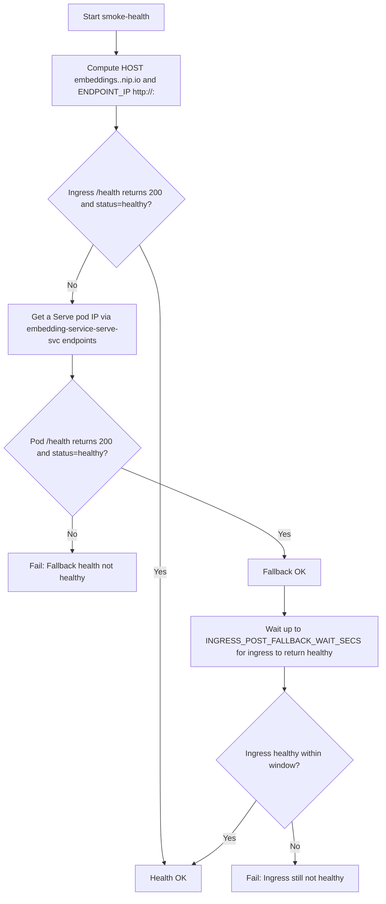
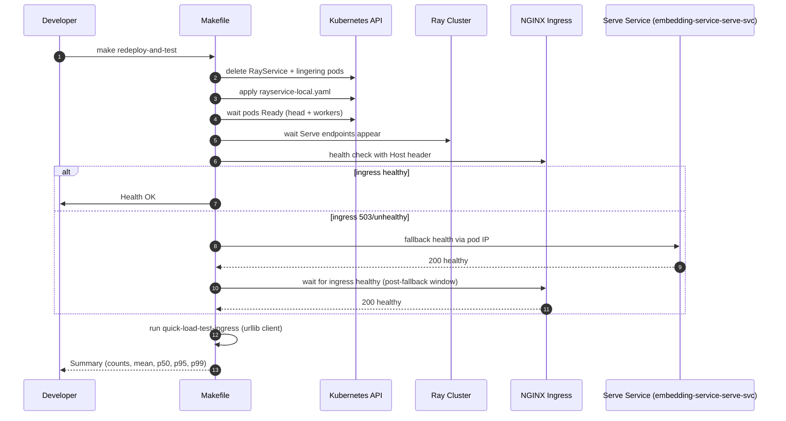
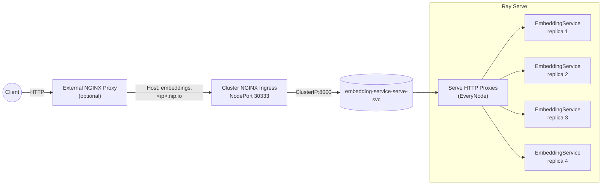

## Build → Redeploy → Test: Make-driven playbook

This guide explains how to build, redeploy, and test the Embedding Service using the Makefile, with clear options, parameterization, and visual diagrams of the flow. It covers ingress health behavior, fallback logic, and verification tools (like replica counts and dashboard access).

### What you’ll get
- One-command build-and-push of the Docker image
- One-command redeploy with ingress health checks and load testing
- Tunable parameters for concurrency, ingress behavior, and timeouts
- Diagrams: sequence, flowchart (health/fallback), and component topology (UML-style)


## Targets at a glance

| Target | Purpose |
|---|---|
| `build-and-push-optimized` | Bump version (pinned), build Docker image, push `:version` and `:latest` tags. |
| `redeploy` | Clean RayService + pods, apply manifest, wait Ready, verify health (ingress with fallback+stabilization). |
| `redeploy-and-test` | Redeploy then run ingress-only load test. |
| `redeploy-and-test-ingress` | Same as above, explicit name. |
| `redeploy-and-test-fallback` | Redeploy then run load test allowing fallback to direct pod URL. |
| `smoke-health` | Health probe: tries ingress first, falls back to a pod, then waits for ingress to become healthy. |
| `quick-load-test-ingress` | Ingress-only load test (depends on `smoke-health`). |
| `quick-load-test` | Load test preferring ingress; optionally falls back to pod if configured. |
| `serve-status` | Prints Ray Serve application/deployment status (including replica counts) from the head pod. |
| `port-forward-dashboard` | Starts Ray dashboard port-forward on 8265 in background; prints PID and log. |
| `port-forward-dashboard-stop` | Stops the background dashboard port-forward. |


## Key parameters

Override at invocation: `make <target> KEY=value`

| Variable | Default | Notes |
|---|---:|---|
| `REGISTRY` | `192.168.1.3:5000` | Local registry for pushing images |
| `IMAGE_NAME` | `embedding-service` | Image repo name |
| `VERSION_FILE` | `version` | Read tag from this file |
| `SERVICE_NAME` | `embedding-service` | K8s RayService name |
| `RAYSERVICE_FILE` | `k8s/rayservice-local.yaml` | RayService manifest path |
| `NAMESPACE` | `default` | K8s namespace |
| `NODE_PORT` | `30333` | NodePort that the ingress listens on |
| `TEST_REQUESTS` | `200` | Total number of requests for load tests |
| `TEST_CONCURRENCY` | `10` | Concurrent workers for load tests |
| `TEST_SEGMENTATION` | `false` | Enable request segmentation in load tester |
| `USE_INGRESS_ONLY` | `true` | If true, abort tests when ingress isn’t healthy (no fallback) |
| `INGRESS_WAIT_SECS` | `60` | Wait time for ingress to become healthy in quick load test |
| `INGRESS_POST_FALLBACK_WAIT_SECS` | `90` | Additional wait for ingress after a successful pod fallback in `smoke-health` |


## Typical flows

### Build and push image
- `make build-and-push-optimized`
  - Bumps the pinned version file (stays the same if already set)
  - Builds the Docker image and pushes both `:version` and `:latest`

### Redeploy and test via ingress
- `make redeploy-and-test` (same as `redeploy-and-test-ingress`)
  - Cleans prior RayService + pods; reapplies manifest
  - Waits for Ray pods Ready and Serve endpoints to appear
  - Runs `smoke-health` which:
    1) Checks ingress `GET /health` with Host header
    2) If 503/unhealthy, falls back to one Serve pod `GET /health`
    3) If fallback is healthy, waits up to `INGRESS_POST_FALLBACK_WAIT_SECS` for ingress to become healthy
  - Runs a small ingress-only load test using `working_dir/load_test.py`

### Redeploy and test with fallback allowed
- `make redeploy-and-test-fallback`
  - Same redeploy steps as above
  - Runs `quick-load-test` with `USE_INGRESS_ONLY=false` and `SKIP_HEALTH_WAIT=true`
  - If ingress isn't ready, it falls back to a direct pod URL


## Health and fallback logic (flowchart)




## End-to-end sequence (redeploy-and-test)




## Component topology (UML-style)




## Practical tips and parametrization

- Use ingress-only tests for steady-state verification:
  - `make quick-load-test-ingress TEST_REQUESTS=50 TEST_CONCURRENCY=5`
- Use fallback tests during bring-up or when iterating cluster config:
  - `make redeploy-and-test-fallback`
- Tweak ingress stabilization time if your ingress is slower to attach routes:
  - `make smoke-health INGRESS_POST_FALLBACK_WAIT_SECS=120`
- Control load intensity:
  - `make quick-load-test-ingress TEST_REQUESTS=500 TEST_CONCURRENCY=50`
- Check Serve replicas and proxy health quickly:
  - `make serve-status`
- Ray dashboard (optional):
  - Start: `make port-forward-dashboard`
  - Stop: `make port-forward-dashboard-stop`
  - Then browse `http://127.0.0.1:8265`


## Hands-on recipes by target (with directives and examples)

  Below are practical, copyable examples tied to specific Makefile targets and variables.

  ### build-and-push-optimized
  - What it does
    - Sequences `version-bump` → `docker-build` → `docker-push`.
    - Produces and pushes `$(REGISTRY)/$(IMAGE_NAME):$(VERSION)` and `:latest`.
  - Key directives and variables
    - Targets: `version-bump`, `docker-build`, `docker-push`
    - Vars: `REGISTRY`, `IMAGE_NAME`, `VERSION_FILE`, `FULL_IMAGE_TAG`
  - Examples
  ```bash
  # Build and push with defaults
  make build-and-push-optimized

  # One-off registry override
  make build-and-push-optimized REGISTRY=10.0.0.5:5000
  ```

  ### smoke-health
  - What it does
    - Checks ingress `GET /health` with Host header, falls back to a Serve pod if needed,
      then waits up to `INGRESS_POST_FALLBACK_WAIT_SECS` for ingress to become healthy.
  - Key directives and variables
    - Strict shell: `set -euo pipefail`
    - Vars: `NODE_PORT`, `NAMESPACE`, `INGRESS_POST_FALLBACK_WAIT_SECS`
  - Examples
  ```bash
  # Basic health check
  make smoke-health

  # Extend the post-fallback wait window
  make smoke-health INGRESS_POST_FALLBACK_WAIT_SECS=120
  ```

  ### quick-load-test-ingress
  - What it does
    - Depends on `smoke-health`; runs urllib client to ingress URL only.
  - Key variables
    - `TEST_REQUESTS`, `TEST_CONCURRENCY`, `TEST_SEGMENTATION`
  - Examples
  ```bash
  # Sanity run
  make quick-load-test-ingress TEST_REQUESTS=50 TEST_CONCURRENCY=5

  # Heavier run
  make quick-load-test-ingress TEST_REQUESTS=1000 TEST_CONCURRENCY=50
  ```

  ### quick-load-test
  - What it does
    - Prefers ingress; can fall back to a direct pod URL when `USE_INGRESS_ONLY=false`.
  - Key variables
    - `USE_INGRESS_ONLY`, `INGRESS_WAIT_SECS`, `SKIP_HEALTH_WAIT`
  - Examples
  ```bash
  # Allow fallback to direct pod URL
  make quick-load-test USE_INGRESS_ONLY=false TEST_REQUESTS=200 TEST_CONCURRENCY=20

  # Skip pre-test health wait (useful during active iteration)
  make quick-load-test SKIP_HEALTH_WAIT=true TEST_REQUESTS=100 TEST_CONCURRENCY=10
  ```

  ### redeploy
  - What it does
    - `redeploy-clean` → `deploy-apply` → `smoke-health`.
  - Key variables
    - `RAYSERVICE_FILE`, `NAMESPACE`, `SERVICE_NAME`
  - Examples
  ```bash
  # Standard redeploy
  make redeploy

  # Custom namespace + manifest
  make redeploy NAMESPACE=staging RAYSERVICE_FILE=k8s/rayservice-staging.yaml
  ```

  ### redeploy-and-test / redeploy-and-test-ingress
  - What it does
    - `redeploy` then `quick-load-test-ingress` (ingress-only test).
  - Example
  ```bash
  make redeploy-and-test TEST_REQUESTS=100 TEST_CONCURRENCY=10
  ```

  ### redeploy-and-test-fallback
  - What it does
    - `redeploy` then `quick-load-test` with `USE_INGRESS_ONLY=false SKIP_HEALTH_WAIT=true`.
  - Example
  ```bash
  make redeploy-and-test-fallback TEST_REQUESTS=200 TEST_CONCURRENCY=20
  ```

  ### serve-status
  - What it does
    - Queries the Ray head pod to print Serve status (including `replica_states`).
  - Example
  ```bash
  make serve-status
  ```

  ### port-forward-dashboard / port-forward-dashboard-stop
  - What they do
    - Start/stop a background port-forward to the Ray dashboard (port 8265), with PID and log management.
  - Examples
  ```bash
  make port-forward-dashboard
  # open http://127.0.0.1:8265
  make port-forward-dashboard-stop
  ```


  ## Host header routing and manual checks

  Your ingress matches on the Host `embeddings.<ip>.nip.io`. Even when you hit the ingress by Node IP and port, you must send the Host header for routing.

  ### Quick curl checks
  ```bash
  # Substitute your NODE_IP and NODE_PORT if different
  NODE_IP=192.168.1.3
  NODE_PORT=30333
  HOST=embeddings.${NODE_IP//./-}.nip.io

  # Health via ingress (Host header required)
  curl -s -H "Host: $HOST" http://$NODE_IP:$NODE_PORT/health

  # Direct pod (bypasses ingress) — pick one IP from Serve endpoints
  POD_IP=$(kubectl get endpoints embedding-service-serve-svc -o jsonpath='{.subsets[0].addresses[0].ip}')
  curl -s http://$POD_IP:8000/health
  ```


  ## External proxy in front of ingress (optional)

  If you run an external NGINX proxy in front of Kubernetes ingress, preserve the Host header to match the ingress rule and forward to NodePort.

  ```nginx
  server {
    listen 80;
    server_name embeddings-proxy.local; # your proxy host

    client_max_body_size 20m;

    location / {
      # Upstream ingress
      proxy_pass http://192.168.1.3:30333;  # NODE_IP:NODE_PORT

      # Host header used by ingress routing
      proxy_set_header Host embeddings.192-168-1-3.nip.io;

      proxy_set_header X-Real-IP $remote_addr;
      proxy_set_header X-Forwarded-For $proxy_add_x_forwarded_for;
      proxy_set_header X-Forwarded-Proto $scheme;

      proxy_http_version 1.1;
      proxy_set_header Connection "";
      proxy_buffering on;
      proxy_buffers 16 64k;
      proxy_buffer_size 64k;
      proxy_read_timeout 180s;
      proxy_send_timeout 180s;
      proxy_next_upstream error timeout http_500 http_502 http_503 http_504 invalid_header;
      proxy_next_upstream_tries 2;
    }
  }
  ```

  Tip: parameterize the upstream and Host if you deploy this across environments.


  ## Parameter quick reference by target

  | Target | Primary variables |
  |---|---|
  | build-and-push-optimized | REGISTRY, IMAGE_NAME, VERSION_FILE |
  | smoke-health | NODE_PORT, NAMESPACE, INGRESS_POST_FALLBACK_WAIT_SECS |
  | quick-load-test-ingress | TEST_REQUESTS, TEST_CONCURRENCY, TEST_SEGMENTATION |
  | quick-load-test | USE_INGRESS_ONLY, INGRESS_WAIT_SECS, SKIP_HEALTH_WAIT, TEST_* |
  | redeploy | RAYSERVICE_FILE, NAMESPACE, SERVICE_NAME |
  | redeploy-and-test(-ingress) | TEST_REQUESTS, TEST_CONCURRENCY |
  | redeploy-and-test-fallback | TEST_REQUESTS, TEST_CONCURRENCY (and uses USE_INGRESS_ONLY=false, SKIP_HEALTH_WAIT=true) |
  | serve-status | NAMESPACE |
  | port-forward-dashboard(-stop) | DASHBOARD_PORT (fixed in Makefile), NAMESPACE |


  ## CI/CD quick examples

  ```bash
  # Build and push (pre-deploy job)
  make build-and-push-optimized REGISTRY=$CI_REGISTRY

  # Apply manifest then ingress-only test
  make redeploy-and-test TEST_REQUESTS=100 TEST_CONCURRENCY=10

  # Faster smoke-only check without load
  make smoke-health INGRESS_POST_FALLBACK_WAIT_SECS=60
  ```


  ## Troubleshooting

  - 503 after deploy:
    - This is typically ingress warm-up. `smoke-health` now waits for ingress to become healthy after verifying a pod fallback, preventing immediate test failures. If it persists, check ingress controller logs and service endpoints.
  - nip.io mismatch:
    - The Makefile warns if `embeddings.<ip>.nip.io` resolves to a different IP than expected. Ensure the Host header and Node IP align with your ingress rule.
  - Pending worker pods:
    - If you raise worker replicas beyond available GPUs, pods may stay Pending. Keep `workerGroupSpecs.replicas` ≤ GPU count, or adjust scheduling/resources.
  - Serve replicas vs. autoscaling:
    - You can fix replicas (e.g., 4) or use autoscaling. If you prefer autoscaling, ensure `min_replicas` and `initial_replicas` are set appropriately in the deployment configuration and the cluster has resources to scale.


## Reference: what the health check verifies

- HTTP 200
- JSON body includes `{"status": "healthy"}` (case-insensitive check)
- Host header routing via `embeddings.<ip>.nip.io` against NodeIP:NodePort
- Fallback to a live Serve pod, then a timed wait for ingress to become healthy


## Appendix: file pointers

- Makefile targets and variables: `Makefile`
- RayService manifest: `k8s/rayservice-local.yaml`
- Load test client: `working_dir/load_test.py`
- Serve deployment wrapper: `src/service/ray_deployment.py`
