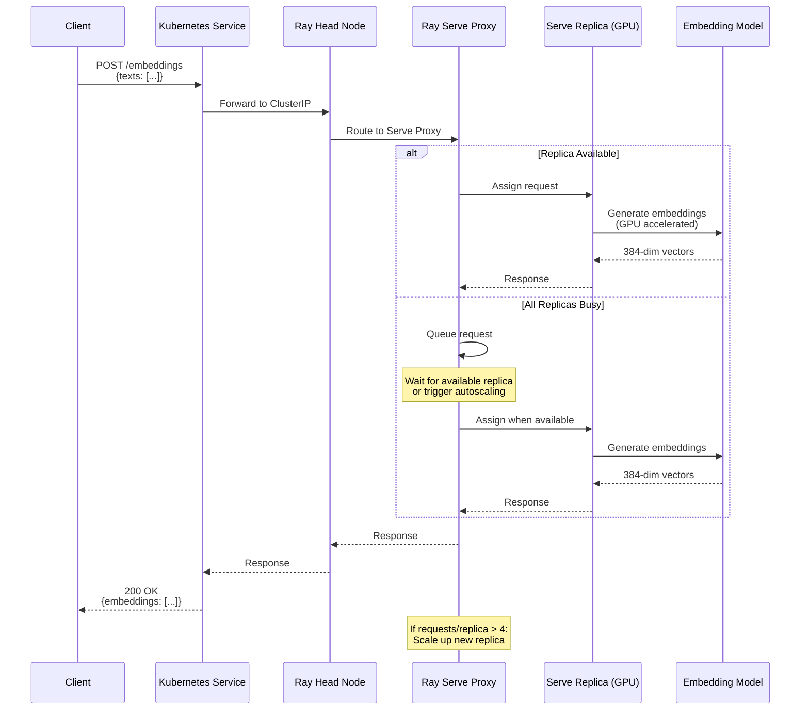
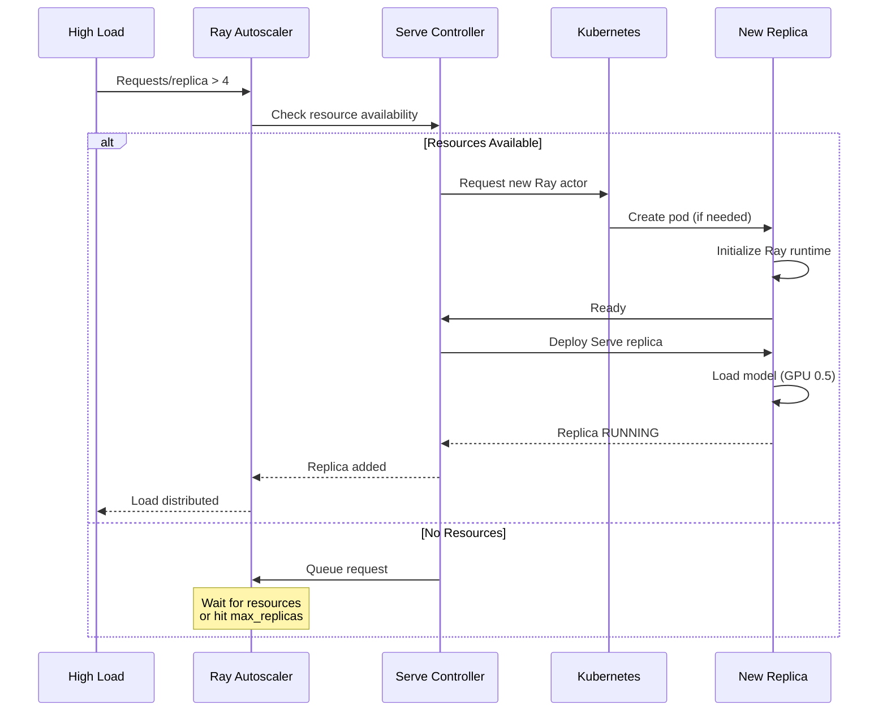
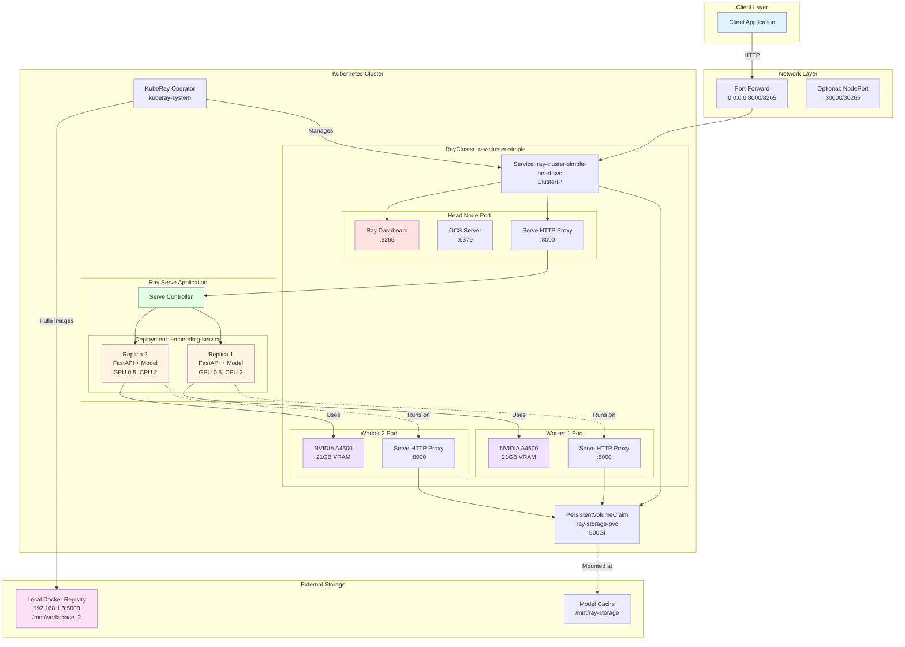
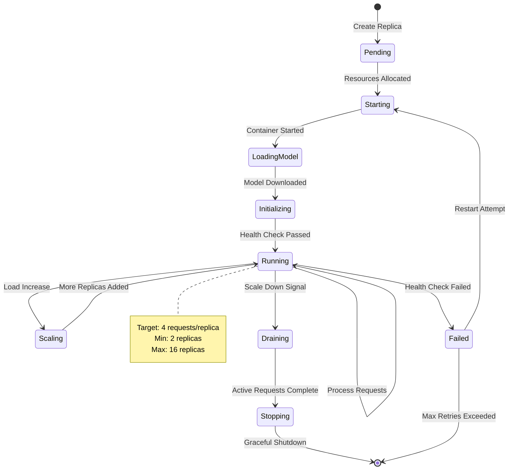

# EmbeddingService on Ray Serve + Kubernetes

## 📋 Table of Contents

- [Overview](#overview)
- [Architecture](#architecture)
- [System Diagrams](#system-diagrams)
- [Prerequisites](#prerequisites)
- [Quick Start](#quick-start)
- [Local Docker Registry Setup](#local-docker-registry-setup)
- [Deployment Guide](#deployment-guide)
- [Access & Testing](#access--testing)
- [Monitoring & Operations](#monitoring--operations)
- [Scaling & Performance](#scaling--performance)
- [Troubleshooting](#troubleshooting)
- [Production Considerations](#production-considerations)

---

## Overview

This deployment runs the **EmbeddingService** as a distributed, GPU-accelerated service using:

- **Ray Serve 2.39.0**: Distributed serving framework with autoscaling
- **Kubernetes**: Container orchestration with KubeRay operator
- **Local Docker Registry**: Custom image storage to overcome disk constraints
- **NVIDIA GPUs**: 2x A4500 (21GB each) for parallel embedding generation

### What is EmbeddingService?

EmbeddingService is a FastAPI-based microservice that transforms text into high-dimensional vector representations (embeddings) using pre-trained BERT models. These embeddings enable semantic similarity computation, clustering, and retrieval tasks. The service is built around the `EmbeddingEngine` class (`src/components/embedding_engine.py`), which provides GPU-accelerated inference with automatic batching and memory management.

**Core Capabilities**:
- **Text Embedding Generation**: Convert text strings into 384-dimensional vectors using sentence-transformers models
- **Similarity Computation**: Calculate cosine similarity between text pairs for semantic matching
- **Model Management**: Hot-swap between multiple BERT variants (distilbert, all-MiniLM-L6-v2, etc.) without service restart
- **Batch Processing**: Automatic batching for improved GPU utilization and throughput
- **Long Text Handling**: Sliding window segmentation for texts exceeding model max length (512 tokens)

### Why Ray Serve on Kubernetes?

The original EmbeddingService was designed as a single-process FastAPI application (`src/service/main.py`). While functional, this architecture has limitations:

1. **GPU Underutilization**: A single process can't fully saturate modern GPUs with 21GB VRAM
2. **No Horizontal Scaling**: Can't distribute load across multiple GPUs or nodes
3. **Manual Load Balancing**: No automatic request distribution
4. **Fixed Capacity**: Can't scale up/down based on traffic patterns

Ray Serve solves these problems by:
- **Distributed Serving**: Deploy multiple replicas across GPU workers (controlled by `src/service/ray_deployment.py`)
- **Automatic Load Balancing**: Ray's HTTP proxy distributes requests to healthy replicas
- **Autoscaling**: Dynamically adjust replica count based on request queue depth (min: 2, max: 16)
- **GPU Sharing**: Fractional GPU allocation (0.5 GPU per replica) allows 2 replicas per physical GPU
- **Zero-Code Migration**: The `@serve.ingress(app)` decorator wraps the existing FastAPI app without modifications

### Key Features

✅ **Autoscaling**: 2-16 replicas based on load (see `EmbeddingServiceDeployment` autoscaling_config)
✅ **GPU Acceleration**: 0.5 GPU per replica via `ray_actor_options` (2 replicas per physical GPU)
✅ **High Availability**: Distributed across multiple worker nodes with health checks
✅ **Zero Downtime**: Rolling updates preserve existing FastAPI endpoints and middleware
✅ **Production Ready**: Prometheus metrics via `/metrics` endpoint, Ray Dashboard monitoring

### Current Status

```
📊 Cluster:    3 nodes (1 head + 2 GPU workers)
🖥️  Resources:  16 CPUs, 2 GPUs, 32GB Memory
🚀 Replicas:   2/2 RUNNING (HEALTHY)
🌐 Endpoints:  http://192.168.1.3:8000 (API)
               http://192.168.1.3:8265 (Dashboard)
```

---

## Architecture

### High-Level Architecture

```
┌─────────────────────────────────────────────────────────────────┐
│                        Client Applications                       │
└───────────────────────────┬─────────────────────────────────────┘
                            │
                            ▼
┌─────────────────────────────────────────────────────────────────┐
│                      Load Balancer / Ingress                     │
│                    (192.168.1.3:8000/8265)                      │
└───────────────────────────┬─────────────────────────────────────┘
                            │
                            ▼
┌─────────────────────────────────────────────────────────────────┐
│                      Kubernetes Cluster                          │
│  ┌───────────────────────────────────────────────────────────┐  │
│  │               KubeRay Operator (kuberay-system)           │  │
│  └───────────────────────────────────────────────────────────┘  │
│                            │                                     │
│                            ▼                                     │
│  ┌───────────────────────────────────────────────────────────┐  │
│  │                   RayCluster: ray-cluster-simple          │  │
│  │  ┌─────────────────────────────────────────────────────┐  │  │
│  │  │              Ray Head Node (10.244.0.74)            │  │  │
│  │  │  • Dashboard (8265)                                 │  │  │
│  │  │  • GCS Server (6379)                                │  │  │
│  │  │  • Client Port (10001)                              │  │  │
│  │  │  • Serve Proxy (8000)                               │  │  │
│  │  └─────────────────────────────────────────────────────┘  │  │
│  │                            │                               │  │
│  │              ┌─────────────┴─────────────┐                │  │
│  │              ▼                           ▼                │  │
│  │  ┌──────────────────────┐    ┌──────────────────────┐    │  │
│  │  │ GPU Worker 1         │    │ GPU Worker 2         │    │  │
│  │  │ (10.244.0.75)        │    │ (10.244.0.76)        │    │  │
│  │  │ • 1x NVIDIA A4500    │    │ • 1x NVIDIA A4500    │    │  │
│  │  │ • Serve Proxy (8000) │    │ • Serve Proxy (8000) │    │  │
│  │  └──────────────────────┘    └──────────────────────┘    │  │
│  └───────────────────────────────────────────────────────────┘  │
│                            │                                     │
│                            ▼                                     │
│  ┌───────────────────────────────────────────────────────────┐  │
│  │         Ray Serve Application: embedding-service          │  │
│  │  ┌─────────────────────────┬─────────────────────────┐    │  │
│  │  │   Replica 1 (GPU 0.5)   │   Replica 2 (GPU 0.5)   │    │  │
│  │  │   FastAPI + Model       │   FastAPI + Model       │    │  │
│  │  │   all-MiniLM-L6-v2      │   all-MiniLM-L6-v2      │    │  │
│  │  └─────────────────────────┴─────────────────────────┘    │  │
│  └───────────────────────────────────────────────────────────┘  │
└─────────────────────────────────────────────────────────────────┘
                            │
                            ▼
┌─────────────────────────────────────────────────────────────────┐
│               Local Docker Registry (192.168.1.3:5000)          │
│               Storage: /mnt/workspace_2/docker-registry         │
│               Image: embedding-service:ray-latest (7.96GB)      │
└─────────────────────────────────────────────────────────────────┘
```

### Component Breakdown

#### 1. **Kubernetes Layer**

Kubernetes provides the orchestration foundation for our Ray cluster. The KubeRay operator (`kuberay-system` namespace) watches for `RayCluster` custom resources and automatically provisions the necessary pods, services, and configurations.

**Key Components**:
- **KubeRay Operator**: Custom resource controller that translates `RayCluster` specs into Kubernetes primitives
- **Services**:
  - `ray-cluster-simple-head-svc` (ClusterIP): Internal cluster communication on ports 6379 (GCS), 8265 (Dashboard), 8000 (HTTP)
  - Port-forward or NodePort: External access to Dashboard and API
- **Persistent Storage**: `ray-storage-pvc` (500Gi) mounted at `/mnt/ray-storage` on all pods
  - Purpose: Cache downloaded models (sentence-transformers downloads ~90MB per model)
  - Shared across replicas to avoid redundant downloads
  - Configured in `ray-cluster-dual-workers.yaml` under `volumeMounts`

#### 2. **Ray Cluster**

The Ray cluster is the compute foundation, consisting of one head node and multiple worker nodes.

**Head Node Responsibilities**:
- **Global Control Service (GCS)**: Cluster metadata and coordination (port 6379)
- **Dashboard**: Web UI for monitoring (port 8265)
- **Autoscaler**: Decides when to scale replicas up/down based on queue depth
- **Serve Controller**: Manages Serve application lifecycle and replica health

**Worker Node Responsibilities**:
- **Ray Actors**: Execute Serve replicas (instances of `EmbeddingServiceDeployment`)
- **GPU Compute**: Run `EmbeddingEngine.encode()` inference on NVIDIA hardware
- **HTTP Proxies**: Each worker runs a proxy (port 8000) that routes requests to local replicas

**Resource Allocation** (defined in `ray-cluster-dual-workers.yaml`):
```yaml
Head:
  CPU: 4 cores (limit), 2 cores (request)
  Memory: 8Gi (limit), 4Gi (request)
  GPU: None (head doesn't do inference)

Workers (2x):
  CPU: 6 cores (limit), 3 cores (request)
  Memory: 12Gi (limit), 6Gi (request)
  GPU: 1x nvidia.com/gpu per worker (NVIDIA A4500, 21GB VRAM)
```

#### 3. **Ray Serve**

Ray Serve is the serving layer that wraps our FastAPI application for distributed execution.

**Application Structure** (`src/service/ray_deployment.py`):
```python
@serve.deployment(
    name="embedding-service",
    ray_actor_options={"num_cpus": 2, "num_gpus": 0.5},
    autoscaling_config={
        "min_replicas": 2,
        "max_replicas": 16,
        "target_num_ongoing_requests_per_replica": 4,
    },
)
@serve.ingress(app)  # app = FastAPI instance from src.service.main
class EmbeddingServiceDeployment:
    pass
```

**How This Works**:
1. `@serve.deployment`: Marks the class as a Ray Serve deployment with resource requirements
2. `@serve.ingress(app)`: Wraps the FastAPI app, preserving all routes, middleware, and dependencies
3. Ray creates multiple instances (replicas) of this class across worker nodes
4. Each replica runs its own FastAPI server with the complete application logic

**Autoscaling Logic**:
- Monitor: Queue depth per replica (requests waiting + in-progress)
- Target: 4 requests per replica (configurable via `target_num_ongoing_requests_per_replica`)
- Scale Up: If queue depth > 4, add replicas until max (16)
- Scale Down: If queue depth < 4 for sustained period, remove replicas until min (2)
- Cooldown: 30 seconds between scaling decisions to prevent thrashing

**Why 0.5 GPU per replica?**
- Most embedding models (all-MiniLM-L6-v2: 22M parameters) don't saturate a 21GB GPU
- Running 2 replicas per GPU improves utilization and throughput
- Each replica gets ~10GB VRAM, sufficient for model weights + batching
- Alternative: 0.25 GPU (4 replicas per GPU) for smaller models, 1.0 GPU for large models

#### 4. **Local Registry**

**Problem**: Kubernetes disk-pressure taints prevented pod scheduling when importing the 7.96GB embedding-service Docker image.

**Root Cause**: Ephemeral storage exhaustion during containerd image layer extraction, NOT overall disk usage percentage. Kubelet monitors ephemeral storage separately; extracting an 8GB image requires significant temporary space even if disk is only 65% full.

**Solution Architecture**:
```
┌─────────────────────────────────────────────┐
│ /mnt/workspace_2 (exFAT, 2.3TB available)  │
│   └─ docker-registry/                      │
│       └─ docker/registry/v2/               │
│           └─ repositories/                 │
│               └─ embedding-service/        │
│                   ├─ _manifests/           │
│                   └─ _layers/              │  ← Image layers stored here
└─────────────────────────────────────────────┘
                    ▼
┌─────────────────────────────────────────────┐
│ Docker Registry (registry:2)                │
│   • Port: 5000                              │
│   • Protocol: HTTP (insecure)               │
│   • Endpoint: http://192.168.1.3:5000      │
└─────────────────────────────────────────────┘
                    ▼
┌─────────────────────────────────────────────┐
│ Containerd (configured via config.toml)    │
│   • Mirror: 192.168.1.3:5000                │
│   • insecure_skip_verify: true             │
│   • Pulls layers incrementally             │
└─────────────────────────────────────────────┘
                    ▼
┌─────────────────────────────────────────────┐
│ Kubernetes Pods                              │
│   • imagePullPolicy: Always                 │
│   • Avoids ephemeral storage exhaustion    │
└─────────────────────────────────────────────┘
```

**How Incremental Pull Works**:
1. Containerd requests image manifest from `192.168.1.3:5000`
2. Registry returns layer list (12 layers for embedding-service)
3. Containerd pulls each layer separately, extracting directly to content-addressable storage
4. No temporary full-image extraction, minimal ephemeral storage usage
5. Layers are shared across pods (if same base image)

**Benefits**:
- Eliminates disk-pressure taints on nodes with limited root filesystem
- Faster subsequent pulls (layers already cached)
- Control over image storage location (can use large external volumes)
- No dependency on external registries (Docker Hub rate limits, network issues)

---

## Application Architecture Deep Dive

Understanding how the EmbeddingService works internally is crucial for tuning performance and troubleshooting issues in the Ray Serve deployment.

### Core Components

#### 1. EmbeddingEngine (`src/components/embedding_engine.py`)

The heart of the service - handles model loading, tokenization, and GPU inference.

**Initialization**:

```python
class EmbeddingEngine(Base):
    """GPU-accelerated text embedding engine with batching support."""

    SMALL_MODELS = {
        'all-mini': 'sentence-transformers/all-MiniLM-L6-v2',  # 384-dim
        'distilbert': 'distilbert-base-uncased',                # 768-dim
        'bert-tiny': 'google/bert_uncased_L-2_H-128_A-2',      # 128-dim
    }

    def __init__(self, model_name="all-mini", device="cuda", max_length=512):
        # Auto-detects GPU via torch.cuda.is_available()
        # Loads model from HuggingFace (cached to /mnt/ray-storage)
        # Configures tokenizer with max_length limit
```

**encode() Method** - Core functionality:

```python
async def encode(texts: List[str]) -> np.ndarray:
    """
    1. Handle long texts: Split into overlapping segments (512 tokens, 50 overlap)
    2. Tokenize: Convert text → BERT token IDs
    3. Batch processing: Process 32 texts at once on GPU
    4. Mean pooling: Average transformer layer outputs
    5. L2 normalization: Unit vectors for cosine similarity

    Returns: (num_texts, embedding_dim) numpy array
    """
```

**GPU Memory**: ~500MB (all-MiniLM-L6-v2) + ~50MB per batch of 32 texts = ~550MB total per replica

#### 2. EmbeddingEngineManager (`src/service/core/engine_manager.py`)

Singleton manager providing thread-safe model lifecycle and concurrency control.

**Singleton Pattern**:
```python
class EmbeddingEngineManager:
    _instance = None  # One instance per replica process

    def __new__(cls):
        if cls._instance is None:
            cls._instance = super().__new__(cls)
        return cls._instance
```

**Semaphore Configuration** - Prevents GPU OOM:

```python
self._semaphores = {
    'gpu_operations': Semaphore(2),        # Max 2 parallel GPU ops
    'embedding_requests': Semaphore(4),    # Max 4 concurrent requests
    'model_loading': Semaphore(1),         # Serialize model loads
}

# Usage in endpoint:
async with manager.acquire_semaphore('embedding_requests'):  # Wait if 4 active
    async with manager.acquire_semaphore('gpu_operations'):  # Wait if 2 on GPU
        embeddings = await engine.encode(texts)  # GPU inference
```

**Model Hot-Swapping**:
```python
await manager.load_model("distilbert")
# 1. Acquire lock (blocks requests)
# 2. Unload old model, free GPU memory
# 3. Load new model to GPU
# 4. Release lock
# Note: Only affects THIS replica!
```

#### 3. FastAPI Application (`src/service/main.py`)

**Lifespan Management** - Runs once per replica:

```python
@asynccontextmanager
async def lifespan(app: FastAPI):
    # Startup
    initialize_semaphores()  # Create asyncio.Semaphore objects
    manager = EmbeddingEngineManager.get_instance()
    await manager.load_model("all-mini")  # Pre-load default model

    yield  # Replica serves requests

    # Shutdown
    await manager.cleanup()  # Free GPU memory
```

**Middleware Stack** (executes bottom→top):

```python
app.add_middleware(ErrorHandlerMiddleware)        # 4. Catch exceptions
app.add_middleware(LoggingMiddleware)             # 3. Log timing
app.add_middleware(RequestValidationMiddleware)   # 2. Validate input
app.add_middleware(CORSMiddleware)                # 1. Add CORS headers
```

#### 4. API Endpoints

**POST /embeddings** (`src/service/routes/embeddings.py`):

```python
async def generate_embeddings(request: EmbeddingRequest):
    # Pydantic validates: texts=List[str], model_name=str
    async with manager.acquire_semaphore('embedding_requests'):  # Max 4
        async with manager.acquire_semaphore('gpu_operations'):  # Max 2 on GPU
            embeddings = await manager.generate_embeddings(texts)

    return {
        "embeddings": embeddings.tolist(),  # 384-dim vectors
        "model": "all-MiniLM-L6-v2",
        "dimension": 384
    }
```

**GET /health/ready** (`src/service/routes/health.py`):

```python
async def ready():
    # Kubernetes readiness probe
    # Checks: manager exists, model loaded, GPU accessible
    if not manager.is_model_loaded:
        raise HTTPException(503, "Model not loaded")
    return {"status": "ready"}
```

### Request Flow Example

**Scenario**: Client sends 2 texts for embedding

```
1. Client → POST http://192.168.1.3:8000/embeddings
   {"texts": ["machine learning", "deep learning"], "model_name": "all-mini"}

2. Ray HTTP Proxy → Selects Replica 2 (least loaded)

3. Replica 2 Middleware:
   CORS → Validation → Logging → ErrorHandler → Endpoint

4. Pydantic Validation:
   texts: List[str] ✓
   model_name: "all-mini" ✓

5. Semaphore Acquisition:
   embedding_requests: 1/4 acquired
   gpu_operations: 1/2 acquired

6. EmbeddingEngine.encode():
   a. Tokenize: "machine learning" → [101, 3698, 2344, 102]
   b. Tokenize: "deep learning" → [101, 2784, 2344, 102]
   c. GPU inference: 6 transformer layers
   d. Mean pooling + L2 normalization
   e. Return: (2, 384) numpy array

7. Response:
   {
     "embeddings": [[0.123, -0.456, ...], [0.234, -0.567, ...]],
     "dimension": 384,
     "processing_time": 0.045
   }

8. Semaphores released: 0/4, 0/2
```

**Concurrent Request Handling**:

```
Time: 0ms
- Req 1,2 → Replicas 1,2 (embedding_sem: 1/4 each, gpu_sem: 1/2 each)

Time: 5ms
- Req 3,4 → Replicas 1,2 (embedding_sem: 2/4 each, gpu_sem: 2/2 FULL!)

Time: 10ms
- Req 5,6,7,8 → Queued (embedding_sem: 4/4 each, waiting for gpu_sem)

Time: 20ms
- Req 9+ → Ray autoscaler detects avg 4 requests/replica
  → Triggers scale-up: creates Replica 3

Time: 45ms
- Req 1 completes → Releases semaphores
- Req 5 acquires gpu_sem → Starts processing

Time: 60s
- Replica 3 ready (model loaded)
- Requests distributed across 3 replicas (avg 2.67/replica)
```

---

## System Diagrams

### Sequence Diagram: Request Flow



### Sequence Diagram: Autoscaling



### UML: Component Diagram



### UML: Deployment Diagram

```mermaid
graph LR
    subgraph "Development Machine"
        Code[Source Code<br/>src/service/]
        Dockerfile[Dockerfile]
        Requirements[requirements.txt<br/>ray[serve]==2.39.0]
    end

    subgraph "Build & Registry"
        Build[Docker Build]
        LocalReg[Local Registry<br/>192.168.1.3:5000]
    end

    subgraph "Kubernetes Node: server (192.168.1.3)"
        Containerd[Containerd Runtime<br/>+insecure registry config]

        subgraph "Pods"
            HeadPod[ray-cluster-simple-head<br/>Image: embedding-service:ray-latest]
            Worker1Pod[ray-cluster-simple-worker-1<br/>Image: embedding-service:ray-latest<br/>GPU: nvidia.com/gpu=1]
            Worker2Pod[ray-cluster-simple-worker-2<br/>Image: embedding-service:ray-latest<br/>GPU: nvidia.com/gpu=1]
        end

        NVCT[NVIDIA Container Toolkit]
    end

    subgraph "External Access"
        RemoteClient[Remote Computer<br/>Browser/curl]
    end

    Code --> Build
    Dockerfile --> Build
    Requirements --> Build
    Build -->|Push| LocalReg
    LocalReg -->|Pull| Containerd
    Containerd --> HeadPod
    Containerd --> Worker1Pod
    Containerd --> Worker2Pod

    NVCT -.->|Provides GPU| Worker1Pod
    NVCT -.->|Provides GPU| Worker2Pod

    RemoteClient -->|http://192.168.1.3:8000| HeadPod
    RemoteClient -->|http://192.168.1.3:8265| HeadPod

    style LocalReg fill:#ffe1e1
    style HeadPod fill:#e1ffe1
    style Worker1Pod fill:#e1f5ff
    style Worker2Pod fill:#e1f5ff
    style RemoteClient fill:#fff4e1
```

### State Diagram: Replica Lifecycle



---

## Prerequisites

### Hardware Requirements

- **CPU**: 16+ cores recommended
- **GPU**: 2x NVIDIA GPUs (A4500 or similar)
  - VRAM: 21GB+ per GPU
  - CUDA Capability: 7.0+
- **Memory**: 32GB+ RAM
- **Storage**:
  - Root: 50GB+ free (after cleanup)
  - Additional: 2TB+ for Docker registry

### Software Requirements

```bash
# Kubernetes
kubectl >= 1.24
kubeadm >= 1.24

# Container Runtime
containerd >= 1.6
docker >= 20.10 (for building images)

# NVIDIA
nvidia-driver >= 525
nvidia-container-toolkit >= 1.11

# KubeRay
KubeRay Operator >= 1.0
```

### Network Configuration

- **Node IP**: 192.168.1.3 (example)
- **Pod Network**: 10.244.0.0/16 (Flannel/Calico)
- **Service Network**: 10.96.0.0/12
- **Ports**: 8000, 8265 open for external access

---

## Quick Start

### 1. Clone and Prepare

```bash
cd /home/electric/workspace/EmbeddingService

# Verify dependencies
cat requirements.txt | grep ray
# Should show: ray[serve]==2.39.0
```

### 2. Set Up Local Docker Registry

```bash
# Create storage directory
mkdir -p /mnt/workspace_2/docker-registry

# Start registry
docker run -d \
  -p 5000:5000 \
  --restart=always \
  --name local-registry \
  -v /mnt/workspace_2/docker-registry:/var/lib/registry \
  registry:2

# Verify
curl http://192.168.1.3:5000/v2/_catalog
# Should return: {"repositories":[]}
```

### 3. Configure Containerd for Insecure Registry

```bash
sudo nano /etc/containerd/config.toml
```

Add this configuration:

```toml
[plugins."io.containerd.grpc.v1.cri".registry.mirrors."192.168.1.3:5000"]
  endpoint = ["http://192.168.1.3:5000"]

[plugins."io.containerd.grpc.v1.cri".registry.configs."192.168.1.3:5000".tls]
  insecure_skip_verify = true
```

Restart containerd:

```bash
sudo systemctl restart containerd
sudo systemctl status containerd
```

### 4. Build and Push Docker Image

```bash
# Build image
docker build -t embedding-service:ray-latest .

# Tag for local registry
docker tag embedding-service:ray-latest 192.168.1.3:5000/embedding-service:ray-latest

# Push to local registry
docker push 192.168.1.3:5000/embedding-service:ray-latest

# Verify
curl http://192.168.1.3:5000/v2/embedding-service/tags/list
# Should return: {"name":"embedding-service","tags":["ray-latest"]}
```

### 5. Install KubeRay Operator

```bash
# Add Helm repo
helm repo add kuberay https://ray-project.github.io/kuberay-helm/
helm repo update

# Install operator
helm install kuberay-operator kuberay/kuberay-operator \
  --namespace kuberay-system \
  --create-namespace

# Verify
kubectl get pods -n kuberay-system
```

### 6. Create Persistent Volume for Model Storage

```bash
kubectl apply -f - <<EOF
apiVersion: v1
kind: PersistentVolumeClaim
metadata:
  name: ray-storage-pvc
  namespace: default
spec:
  accessModes:
    - ReadWriteMany
  resources:
    requests:
      storage: 500Gi
  storageClassName: local-path
EOF

kubectl get pvc ray-storage-pvc
```

### 7. Deploy Ray Cluster

```bash
# Deploy cluster
kubectl apply -f ray-cluster-dual-workers.yaml

# Wait for pods to be Running
kubectl get pods -l ray.io/cluster=ray-cluster-simple -w

# Verify cluster status (Ctrl+C after pods are Running)
kubectl exec <head-pod-name> -- ray status
```

### 8. Deploy Ray Serve Application

Create deployment script in the head pod:

```bash
HEAD_POD=$(kubectl get pod -l ray.io/node-type=head -o jsonpath='{.items[0].metadata.name}')

kubectl exec $HEAD_POD -- bash -c "cat > /app/serve_deploy.py << 'EOF'
import ray
from ray import serve

# Initialize Ray
ray.init(address='auto')

# Import the FastAPI app
from src.service.main import app

@serve.deployment(
    name='embedding-service',
    ray_actor_options={
        'num_cpus': 2,
        'num_gpus': 0.5,
    },
    autoscaling_config={
        'min_replicas': 2,
        'max_replicas': 16,
        'target_num_ongoing_requests_per_replica': 4,
    },
)
@serve.ingress(app)
class EmbeddingServiceDeployment:
    pass

# Deploy
deployment = EmbeddingServiceDeployment.bind()
handle = serve.run(deployment, name='embedding-service', route_prefix='/')
print(f'✓ Serve application deployed: {handle}')
EOF
"

# Run deployment
kubectl exec $HEAD_POD -- python /app/serve_deploy.py
```

### 9. Expose Services Externally

```bash
# Kill any existing port-forwards
pkill -f "port-forward.*8000"
pkill -f "port-forward.*8265"

# Port-forward API (accessible from other computers)
kubectl port-forward --address 0.0.0.0 svc/ray-cluster-simple-head-svc 8000:8000 &

# Port-forward Dashboard (accessible from other computers)
kubectl port-forward --address 0.0.0.0 svc/ray-cluster-simple-head-svc 8265:8265 &
```

### 10. Verify Deployment

```bash
# Check health
curl http://192.168.1.3:8000/health/ready | jq .

# Test embeddings
curl -X POST http://192.168.1.3:8000/embeddings \
  -H "Content-Type: application/json" \
  -d '{"texts": ["Hello world"], "model_name": "all-mini"}' | jq '.embeddings[0] | length'

# Should return: 384

# Access Dashboard from browser
# Navigate to: http://192.168.1.3:8265
```

---

## Local Docker Registry Setup

### Why Local Registry?

**Problem**: Kubernetes disk-pressure taints prevented pod scheduling when importing large Docker images (7.96GB). The root cause was **ephemeral storage exhaustion** during image layer extraction, not overall disk usage.

**Solution**: Local Docker registry enables incremental image pulls instead of full imports, avoiding ephemeral storage limits.

### Registry Architecture

```
┌─────────────────────────────────────────────────────────┐
│ /mnt/workspace_2 (exFAT, 2.3TB available)              │
│  └── docker-registry/                                   │
│       ├── docker/                                       │
│       │   └── registry/                                 │
│       │       └── v2/                                   │
│       │           └── repositories/                     │
│       │               └── embedding-service/            │
│       │                   ├── _manifests/               │
│       │                   └── _layers/                  │
│       └── [Image layers stored here]                   │
└─────────────────────────────────────────────────────────┘
                        │
                        ▼
┌─────────────────────────────────────────────────────────┐
│ Docker Registry Container (registry:2)                  │
│  • Port: 5000                                           │
│  • Protocol: HTTP (insecure)                            │
│  • Volume: /mnt/workspace_2/docker-registry             │
│  • Restart: always                                      │
└─────────────────────────────────────────────────────────┘
                        │
                        ▼
┌─────────────────────────────────────────────────────────┐
│ Containerd (Kubernetes CRI)                             │
│  • Mirror: 192.168.1.3:5000                             │
│  • TLS: insecure_skip_verify = true                     │
│  • Endpoint: http://192.168.1.3:5000                    │
└─────────────────────────────────────────────────────────┘
                        │
                        ▼
┌─────────────────────────────────────────────────────────┐
│ Kubernetes Pods                                          │
│  • Pull images incrementally (layer by layer)           │
│  • No full image import to containerd                   │
│  • Avoids ephemeral storage exhaustion                  │
└─────────────────────────────────────────────────────────┘
```

### Registry Operations

#### List Images

```bash
curl http://192.168.1.3:5000/v2/_catalog
```

#### List Tags

```bash
curl http://192.168.1.3:5000/v2/embedding-service/tags/list
```

#### Get Manifest

```bash
curl http://192.168.1.3:5000/v2/embedding-service/manifests/ray-latest
```

#### Delete Image (if needed)

```bash
# Get digest
DIGEST=$(curl -I -H "Accept: application/vnd.docker.distribution.manifest.v2+json" \
  http://192.168.1.3:5000/v2/embedding-service/manifests/ray-latest 2>&1 | \
  grep Docker-Content-Digest | awk '{print $2}' | tr -d '\r')

# Delete
curl -X DELETE http://192.168.1.3:5000/v2/embedding-service/manifests/$DIGEST
```

#### Registry Cleanup (garbage collection)

```bash
docker exec local-registry bin/registry garbage-collect /etc/docker/registry/config.yml
```

### Registry Backup

```bash
# Backup registry data
sudo tar -czf registry-backup-$(date +%Y%m%d).tar.gz \
  /mnt/workspace_2/docker-registry

# Restore
sudo tar -xzf registry-backup-YYYYMMDD.tar.gz -C /
```

---

## Deployment Guide

### Ray Cluster Configuration

**File**: `ray-cluster-dual-workers.yaml`

```yaml
apiVersion: ray.io/v1
kind: RayCluster
metadata:
  name: ray-cluster-simple
  namespace: default
spec:
  rayVersion: '2.39.0'

  # Head node configuration
  headGroupSpec:
    serviceType: ClusterIP
    template:
      spec:
        containers:
        - name: ray-head
          image: 192.168.1.3:5000/embedding-service:ray-latest
          imagePullPolicy: Always
          ports:
          - containerPort: 6379
            name: gcs
          - containerPort: 8265
            name: dashboard
          - containerPort: 10001
            name: client
          - containerPort: 8000
            name: serve
          resources:
            limits:
              cpu: "4"
              memory: "8Gi"
            requests:
              cpu: "2"
              memory: "4Gi"
          volumeMounts:
          - name: ray-storage
            mountPath: /mnt/ray-storage
          env:
          - name: RAY_STORAGE_PATH
            value: "/mnt/ray-storage"
        volumes:
        - name: ray-storage
          persistentVolumeClaim:
            claimName: ray-storage-pvc

  # GPU worker nodes
  workerGroupSpecs:
  - groupName: worker-gpu
    replicas: 2
    minReplicas: 1
    maxReplicas: 4
    template:
      spec:
        containers:
        - name: ray-worker
          image: 192.168.1.3:5000/embedding-service:ray-latest
          imagePullPolicy: Always
          resources:
            limits:
              cpu: "6"
              memory: "12Gi"
              nvidia.com/gpu: "1"
            requests:
              cpu: "3"
              memory: "6Gi"
              nvidia.com/gpu: "1"
          volumeMounts:
          - name: ray-storage
            mountPath: /mnt/ray-storage
          env:
          - name: RAY_STORAGE_PATH
            value: "/mnt/ray-storage"
          - name: NVIDIA_VISIBLE_DEVICES
            value: "all"
          - name: CUDA_VISIBLE_DEVICES
            value: "0"
        volumes:
        - name: ray-storage
          persistentVolumeClaim:
            claimName: ray-storage-pvc
```

### Ray Serve Configuration

**File**: `src/service/ray_deployment.py`

This file bridges the existing FastAPI application with Ray Serve's distributed serving capabilities. The design preserves 100% of the original application logic while adding scalability.

```python
from ray import serve
from src.service.main import app  # Import existing FastAPI app

@serve.deployment(
    name="embedding-service",
    ray_actor_options={
        "num_cpus": 2,        # CPU cores per replica
        "num_gpus": 0.5,      # GPU fraction per replica
    },
    autoscaling_config={
        "min_replicas": 2,                              # Always-on replicas
        "max_replicas": 16,                             # Maximum scale
        "target_num_ongoing_requests_per_replica": 4,   # Scale trigger threshold
    },
)
@serve.ingress(app)  # Wrap FastAPI app
class EmbeddingServiceDeployment:
    """
    Deployment wrapper - no code needed!
    Ray Serve handles instantiation and request routing.
    """
    pass

# Binding creates the deployable unit
deployment = EmbeddingServiceDeployment.bind()
```

**Key Configuration Explained**:

**1. `ray_actor_options`**: Resource requirements for each replica

```python
"num_cpus": 2
```
- Each replica reserves 2 CPU cores from the Ray cluster
- Used for tokenization, text preprocessing, and non-GPU operations
- Worker nodes have 6 cores, so max 3 replicas per worker if all were CPU-bound
- Recommendation: Match to your application's CPU usage pattern
  - CPU-heavy preprocessing → increase to 3-4
  - GPU-bottlenecked → decrease to 1-2 to fit more replicas

```python
"num_gpus": 0.5
```
- Each replica gets half a physical GPU (fractional allocation)
- Enables 2 replicas per A4500 (21GB VRAM each)
- Ray ensures replicas on same GPU don't interfere via CUDA_VISIBLE_DEVICES
- Model memory footprint: ~500MB (all-MiniLM-L6-v2), leaving plenty for batching
- Tuning options:
  - 0.25 GPU: 4 replicas per GPU (smaller models, higher concurrency)
  - 1.0 GPU: 1 replica per GPU (larger models, max throughput per replica)

**2. `autoscaling_config`**: Dynamic scaling behavior

```python
"min_replicas": 2
```
- Baseline replicas always running, even with zero traffic
- Ensures instant response to first requests (no cold-start delay)
- Uses 1 full GPU continuously (2 replicas × 0.5 GPU each)
- Leaves 1 GPU available for scale-up headroom

```python
"max_replicas": 16
```
- Upper limit on replica count (prevents runaway scaling)
- With 2 GPUs and 0.5 GPU/replica: only 4 replicas can use GPU
- Replicas 5-16 would be CPU-only (slower, fallback mode)
- Set to 4 if you want to enforce GPU-only replicas:
  ```python
  "max_replicas": 4,  # 2 GPUs × 2 replicas/GPU
  ```

```python
"target_num_ongoing_requests_per_replica": 4
```
- Target queue depth per replica (requests processing + waiting)
- Example scaling scenarios:
  - 8 concurrent requests → 2 replicas (4 requests each) ✓ Target met
  - 12 concurrent requests → 3 replicas needed (12/4 = 3)
  - 20 concurrent requests → 5 replicas needed (20/4 = 5)
- Lower value = faster scale-up but more resource churn
- Higher value = fewer replicas but higher latency under load
- Recommendation: Set based on 95th percentile response time
  - If requests take 100ms → 4 means up to 400ms queue time
  - If requests take 500ms → reduce to 2 for better latency

**3. `@serve.ingress(app)`**: FastAPI Integration

This decorator is the magic that makes zero-code migration possible. It:

1. **Preserves All Routes**: Every endpoint defined in `src/service/routes/` works unchanged:
   - `GET /health/ready` → `src/service/routes/health.py:ready()`
   - `POST /embeddings` → `src/service/routes/embeddings.py:generate_embeddings()`
   - `GET /models` → `src/service/routes/models.py:list_models()`

2. **Maintains Middleware Stack** (order defined in `src/service/main.py:create_app()`):
   ```python
   # Middleware execution order (bottom-up):
   ErrorHandlerMiddleware      # Catches all exceptions
   LoggingMiddleware           # Logs requests/responses
   RequestValidationMiddleware # Validates input schemas
   CORSMiddleware              # Handles CORS headers
   ```

3. **Preserves Dependency Injection**: FastAPI dependencies still work:
   ```python
   # src/service/routes/embeddings.py
   async def generate_embeddings(
       request: EmbeddingRequest,
       manager: EmbeddingEngineManager = Depends(get_engine_manager)  # Still injected!
   ):
       ...
   ```

4. **Lifespan Events Respected**: Startup/shutdown hooks in `src/service/main.py` run per replica:
   ```python
   @asynccontextmanager
   async def lifespan(app: FastAPI):
       # Startup: Each replica loads its own model
       manager = EmbeddingEngineManager.get_instance()
       await manager.load_model("all-mini")

       yield  # Replica serves requests

       # Shutdown: Each replica cleans up
       await manager.cleanup()
   ```

**What Changes at Runtime**:

| Aspect | Single Process (uvicorn) | Ray Serve (distributed) |
|--------|-------------------------|------------------------|
| Model Loading | Once, shared by all requests | Once per replica (2-16 times) |
| Memory Usage | Single process memory | 2-16 processes, isolated |
| GPU Access | Exclusive GPU ownership | Fractional via CUDA_VISIBLE_DEVICES |
| Request Routing | Direct to process | Ray HTTP Proxy → Replica |
| Scaling | Manual (restart with more workers) | Automatic (Ray Autoscaler) |
| Failure Handling | Process crash = downtime | Replica crash = redistribute requests |

**Performance Implications**:

- **Latency**: +2-5ms overhead from Ray proxy routing (negligible for 50-200ms embedding generation)
- **Throughput**: Near-linear scaling up to GPU saturation (2x replicas ≈ 1.9x throughput)
- **Memory**: Each replica holds full model (2 replicas = 2× model memory)
- **GPU Utilization**: Improved via fractional allocation and batching

**Debugging Tips**:

```bash
# Check replica count and status
kubectl exec <head-pod> -- python -c "
from ray import serve
import ray
ray.init(address='auto')
status = serve.status()
print(status.applications['embedding-service'].deployments['embedding-service'].replica_states)
"

# View individual replica logs (from Dashboard)
# http://192.168.1.3:8265 > Serve > embedding-service > Logs

# Test autoscaling with load
hey -n 1000 -c 20 -m POST \
  -H 'Content-Type: application/json' \
  -d '{"texts":["test"],"model_name":"all-mini"}' \
  http://192.168.1.3:8000/embeddings
```

### Deployment Commands Reference

```bash
# Deploy cluster
kubectl apply -f ray-cluster-dual-workers.yaml

# Check cluster status
kubectl get raycluster
kubectl get pods -l ray.io/cluster=ray-cluster-simple

# Deploy Serve application
HEAD_POD=$(kubectl get pod -l ray.io/node-type=head -o jsonpath='{.items[0].metadata.name}')
kubectl exec $HEAD_POD -- python /app/serve_deploy.py

# Check Serve status
kubectl exec $HEAD_POD -- python -c "
import ray
from ray import serve
ray.init(address='auto')
print(serve.status())
"

# Delete cluster
kubectl delete raycluster ray-cluster-simple

# Force delete stuck pods
kubectl get pods -l ray.io/cluster=ray-cluster-simple --no-headers | \
  awk '{print $1}' | xargs -r kubectl delete pod --force --grace-period=0
```

---

## Access & Testing

### External Access Setup

#### Method 1: Port-Forward (Recommended for Development)

```bash
# API access (from any computer on network)
kubectl port-forward --address 0.0.0.0 svc/ray-cluster-simple-head-svc 8000:8000 &

# Dashboard access (from any computer on network)
kubectl port-forward --address 0.0.0.0 svc/ray-cluster-simple-head-svc 8265:8265 &

# Access from remote computer:
# http://192.168.1.3:8000  (API)
# http://192.168.1.3:8265  (Dashboard)
```

#### Method 2: NodePort (Production)

```yaml
apiVersion: v1
kind: Service
metadata:
  name: ray-dashboard-external
spec:
  type: NodePort
  selector:
    ray.io/cluster: ray-cluster-simple
    ray.io/node-type: head
  ports:
    - name: dashboard
      port: 8265
      targetPort: 8265
      nodePort: 30265
    - name: serve
      port: 8000
      targetPort: 8000
      nodePort: 30000
```

Apply:

```bash
kubectl apply -f ray-external-service.yaml

# Access:
# http://192.168.1.3:30000  (API)
# http://192.168.1.3:30265  (Dashboard)
```

### API Testing

#### Health Check

```bash
curl http://192.168.1.3:8000/health/ready | jq .
```

**Expected Response**:
```json
{
  "status": "ready",
  "timestamp": "2025-10-22T14:28:36.245034+00:00",
  "model_loaded": true,
  "auto_load_enabled": true,
  "uptime_seconds": 54.94
}
```

#### Generate Embeddings

```bash
curl -X POST http://192.168.1.3:8000/embeddings \
  -H "Content-Type: application/json" \
  -d '{
    "texts": [
      "Machine learning is fascinating",
      "Deep learning uses neural networks"
    ],
    "model_name": "all-mini"
  }' | jq .
```

**Expected Response**:
```json
{
  "embeddings": [
    [0.123, -0.456, 0.789, ...],  // 384 dimensions
    [0.234, -0.567, 0.890, ...]   // 384 dimensions
  ],
  "model": "sentence-transformers/all-MiniLM-L6-v2",
  "dimension": 384,
  "processing_time": 0.045
}
```

#### Get Models

```bash
curl http://192.168.1.3:8000/models | jq .
```

#### Compute Similarity

```bash
curl -X POST http://192.168.1.3:8000/similarity \
  -H "Content-Type: application/json" \
  -d '{
    "text1": "artificial intelligence",
    "text2": "machine learning",
    "model_name": "all-mini"
  }' | jq .
```

#### Metrics

```bash
curl http://192.168.1.3:8000/metrics
```

### Dashboard Access

Navigate to: **http://192.168.1.3:8265**

**Dashboard Features**:
- **Overview**: Cluster health, resource usage
- **Jobs**: Active Ray jobs and tasks
- **Serve**: Deployment status, replica health, autoscaling
- **Metrics**: Request latency, throughput, error rates
- **Logs**: Real-time log streaming from replicas

**Key Metrics to Monitor**:
- Replica count (should be 2+ under load)
- GPU utilization (should be balanced across workers)
- Request queue depth (should be < 4 per replica)
- Error rate (should be near 0%)

---

## Monitoring & Operations

### Cluster Health Checks

```bash
# Ray cluster status
HEAD_POD=$(kubectl get pod -l ray.io/node-type=head -o jsonpath='{.items[0].metadata.name}')
kubectl exec $HEAD_POD -- ray status

# Serve application status
kubectl exec $HEAD_POD -- python -c "
import ray
from ray import serve
ray.init(address='auto')
status = serve.status()
for app_name, app_status in status.applications.items():
    print(f'App: {app_name}')
    print(f'  Status: {app_status.status}')
    for dep_name, dep_status in app_status.deployments.items():
        print(f'  {dep_name}: {dep_status.status} ({dep_status.replica_states})')
"

# Kubernetes pod status
kubectl get pods -l ray.io/cluster=ray-cluster-simple

# Resource usage
kubectl top nodes
kubectl top pods -l ray.io/cluster=ray-cluster-simple
```

### Viewing Logs

```bash
# Head node logs
kubectl logs -f $HEAD_POD

# Worker logs
kubectl logs -f <worker-pod-name>

# Serve replica logs (from Dashboard)
# Navigate to: http://192.168.1.3:8265 > Serve > Logs

# All cluster logs
kubectl logs -l ray.io/cluster=ray-cluster-simple --tail=100 -f

# Filter logs
kubectl logs $HEAD_POD | grep -i error
kubectl logs $HEAD_POD | grep -i serve
```

### Performance Monitoring

```bash
# GPU utilization (on host)
nvidia-smi -l 1

# GPU utilization (in pods)
kubectl exec <worker-pod-name> -- nvidia-smi

# Ray metrics
kubectl exec $HEAD_POD -- python -c "
import ray
ray.init(address='auto')
print(ray.cluster_resources())
print(ray.available_resources())
"

# Prometheus metrics
curl http://192.168.1.3:8000/metrics | grep -E "^(embedding_|http_requests)"
```

### Debugging

```bash
# Exec into head pod
kubectl exec -it $HEAD_POD -- /bin/bash

# Exec into worker pod
kubectl exec -it <worker-pod-name> -- /bin/bash

# Check Ray processes
kubectl exec $HEAD_POD -- ps aux | grep ray

# Check network connectivity
kubectl exec $HEAD_POD -- ping -c 3 <worker-pod-ip>

# Check DNS resolution
kubectl exec $HEAD_POD -- nslookup ray-cluster-simple-head-svc

# Check GPU access (in worker)
kubectl exec <worker-pod-name> -- python -c "import torch; print(f'CUDA: {torch.cuda.is_available()}, Devices: {torch.cuda.device_count()}')"
```

---

## Scaling & Performance

### Autoscaling Configuration

**Current Settings**:
- **Min Replicas**: 2 (always running for fast response)
- **Max Replicas**: 16 (upper limit)
- **Target Requests**: 4 per replica
- **Scale-up Trigger**: When avg requests/replica > 4
- **Scale-down Trigger**: When avg requests/replica < 4 for sustained period
- **Cooldown**: 30 seconds between scaling events

### Scaling Behavior

| Concurrent Requests | Expected Replicas | Notes |
|---------------------|-------------------|-------|
| 0-8 | 2 | Min replicas |
| 9-16 | 3-4 | Scale up |
| 17-32 | 5-8 | Moderate load |
| 33-64 | 9-16 | High load, max replicas |
| 65+ | 16 | Queue requests |

### Resource Utilization

**With 2 GPUs (21GB each)**:

| Replicas | GPU per Replica | Total GPU Used | GPU Headroom |
|----------|-----------------|----------------|--------------|
| 2 | 0.5 | 1 GPU | 1 GPU (50%) |
| 4 | 0.5 | 2 GPUs | 0 GPU (0%) |
| 5+ | 0.5 | 2 GPUs (saturated) | CPU fallback |

**Optimization Strategies**:

1. **Increase GPU per replica**: 1.0 GPU = higher throughput, max 2 replicas
2. **Decrease GPU per replica**: 0.25 GPU = max 8 GPU replicas
3. **Add more worker nodes**: Scale horizontally with more GPUs
4. **Batch requests**: Client-side batching for better GPU utilization

### Manual Scaling

```bash
# Scale workers via RayCluster manifest
kubectl edit raycluster ray-cluster-simple
# Change: spec.workerGroupSpecs[0].replicas: 4

# Or update YAML and reapply
kubectl apply -f ray-cluster-dual-workers.yaml

# Scale Serve replicas programmatically
kubectl exec $HEAD_POD -- python -c "
import ray
from ray import serve
ray.init(address='auto')

# Get current deployment
deployment = serve.get_deployment('embedding-service')

# Update autoscaling config
deployment.options(
    autoscaling_config={
        'min_replicas': 4,
        'max_replicas': 20,
        'target_num_ongoing_requests_per_replica': 6,
    }
).deploy()
"
```

### Load Testing

```bash
# Install hey (HTTP load testing tool)
go install github.com/rakyll/hey@latest

# Test with 100 concurrent requests
hey -n 1000 -c 100 -m POST \
  -H "Content-Type: application/json" \
  -d '{"texts": ["test sentence for load testing"], "model_name": "all-mini"}' \
  http://192.168.1.3:8000/embeddings

# Monitor scaling in Dashboard
# http://192.168.1.3:8265 > Serve > embedding-service

# Check replica count during load
watch -n 1 'kubectl exec $HEAD_POD -- python -c "
import ray
from ray import serve
ray.init(address=\"auto\")
status = serve.status()
print(status.applications[\"embedding-service\"].deployments[\"embedding-service\"].replica_states)
"'
```

### Performance Tuning

**Semaphore Limits** (in `src/service/main.py`):

```python
# Current configuration
semaphores = {
    "gpu_operations": 4,      # Max parallel GPU ops per replica
    "embedding_requests": 8,  # Max concurrent embedding requests
    "similarity_requests": 6, # Max concurrent similarity requests
}

# Tuning recommendations:
# - High GPU memory: Increase gpu_operations to 8-16
# - High CPU: Increase embedding_requests to 16-32
# - Low latency priority: Decrease all values
# - High throughput priority: Increase all values
```

**Ray Actor Options**:

```python
# src/service/ray_deployment.py
ray_actor_options={
    "num_cpus": 2,        # CPUs per replica (2-4 recommended)
    "num_gpus": 0.5,      # GPU fraction (0.25-1.0)
    "memory": 4 * 1024**3,  # Optional: 4GB per replica
}
```

---

## Troubleshooting

### Common Issues

#### 1. Pods Stuck in Pending

**Symptoms**:
```bash
kubectl get pods -l ray.io/cluster=ray-cluster-simple
# NAME                                    READY   STATUS    RESTARTS   AGE
# ray-cluster-simple-head-xxxxx           0/1     Pending   0          5m
```

**Check**:
```bash
kubectl describe pod <pod-name> | grep -A 10 Events
```

**Common Causes**:

**A. Disk Pressure**
```
Events:
  Warning  FailedScheduling  node(s) had untolerated taint {node.kubernetes.io/disk-pressure}
```

**Solution**:
```bash
# Check disk usage
df -h /

# Clean Docker
docker system prune -a -f

# Clean containerd
sudo crictl rmi --prune

# Use local registry (already configured)
```

**B. Insufficient Resources**
```
Events:
  Warning  FailedScheduling  Insufficient nvidia.com/gpu
```

**Solution**:
```bash
# Check GPU availability
kubectl describe node | grep -A 10 "Allocated resources"

# Reduce GPU request in ray-cluster-dual-workers.yaml
# Or scale down other GPU workloads
```

#### 2. Image Pull Errors

**Symptoms**:
```bash
kubectl describe pod <pod-name>
# Events:
#   Warning  Failed  Failed to pull image "192.168.1.3:5000/embedding-service:ray-latest"
```

**Solution**:
```bash
# Verify registry accessibility
curl http://192.168.1.3:5000/v2/embedding-service/tags/list

# Check containerd config
sudo cat /etc/containerd/config.toml | grep -A 5 "192.168.1.3:5000"

# Restart containerd
sudo systemctl restart containerd

# Re-push image
docker push 192.168.1.3:5000/embedding-service:ray-latest
```

#### 3. Serve Deployment Failed

**Symptoms**:
```bash
kubectl exec $HEAD_POD -- python -c "from ray import serve; import ray; ray.init(address='auto'); print(serve.status())"
# Status: ApplicationStatus.DEPLOY_FAILED
```

**Check Logs**:
```bash
kubectl logs $HEAD_POD | grep -i error
kubectl logs $HEAD_POD | grep -i serve
```

**Common Causes**:

**A. Import Error**
```
ImportError: cannot import name 'app' from 'src.service.main'
```

**Solution**: Verify application code is in the image:
```bash
kubectl exec $HEAD_POD -- ls -la /app/src/service/
kubectl exec $HEAD_POD -- python -c "from src.service.main import app; print(app)"
```

**B. GPU Not Available**
```
RuntimeError: CUDA out of memory
```

**Solution**: Reduce `num_gpus` or scale down replicas:
```python
ray_actor_options={
    "num_gpus": 0.25,  # Reduce from 0.5
}
```

#### 4. Dashboard Not Accessible

**Symptoms**: `curl http://192.168.1.3:8265` times out

**Check**:
```bash
# Verify port-forward is running
ps aux | grep "port-forward.*8265"

# Check service
kubectl get svc ray-cluster-simple-head-svc

# Check pod IP
kubectl get pod $HEAD_POD -o jsonpath='{.status.podIP}'

# Test from inside cluster
kubectl exec $HEAD_POD -- curl -s http://localhost:8265 | head -1
```

**Solution**:
```bash
# Restart port-forward
pkill -f "port-forward.*8265"
kubectl port-forward --address 0.0.0.0 svc/ray-cluster-simple-head-svc 8265:8265 &

# Or use NodePort (see External Access section)
```

#### 5. Slow Response Times

**Symptoms**: Requests taking >5 seconds

**Check**:
```bash
# Check replica count
kubectl exec $HEAD_POD -- python -c "
import ray
from ray import serve
ray.init(address='auto')
print(serve.status().applications['embedding-service'].deployments['embedding-service'].replica_states)
"

# Check GPU utilization
kubectl exec <worker-pod-name> -- nvidia-smi

# Check logs for queuing
kubectl logs $HEAD_POD | grep -i queue
```

**Solution**:
```bash
# Increase min replicas
# Edit src/service/ray_deployment.py:
autoscaling_config={
    "min_replicas": 4,  # Increase from 2
    ...
}

# Redeploy Serve application
```

#### 6. Memory Issues

**Symptoms**: Pods being OOMKilled

**Check**:
```bash
kubectl describe pod <pod-name> | grep -A 5 "Last State"
# Last State: Terminated
#   Reason: OOMKilled

kubectl top pod <pod-name>
```

**Solution**:
```bash
# Increase memory limits in ray-cluster-dual-workers.yaml
resources:
  limits:
    memory: "16Gi"  # Increase from 12Gi

# Or reduce model size / batch size in application
```

### Diagnostic Commands

```bash
# Full cluster diagnosis
kubectl get all -l ray.io/cluster=ray-cluster-simple
kubectl describe raycluster ray-cluster-simple
kubectl get events --sort-by='.lastTimestamp' | grep ray-cluster-simple

# Ray internal state
kubectl exec $HEAD_POD -- python -c "
import ray
ray.init(address='auto')
print('Nodes:', ray.nodes())
print('Resources:', ray.cluster_resources())
print('Available:', ray.available_resources())
"

# Network debugging
kubectl exec $HEAD_POD -- curl -v http://ray-cluster-simple-head-svc:8000/health/ready
kubectl exec $HEAD_POD -- nc -zv <worker-pod-ip> 8000

# File system check
kubectl exec $HEAD_POD -- df -h
kubectl exec $HEAD_POD -- ls -la /mnt/ray-storage
```

---

## Production Considerations

### High Availability

**Current Setup**: Single-node Kubernetes cluster (development)

**Production Recommendations**:

1. **Multi-Node Cluster**:
   - 3+ control plane nodes (HA Kubernetes)
   - 3+ worker nodes with GPUs
   - External etcd cluster

2. **Ray Cluster HA**:
   - Enable GCS fault tolerance
   - Use external Redis for GCS storage
   - Configure autoscaler for node failures

3. **Storage**:
   - Use distributed storage (NFS, Ceph, or cloud provider)
   - Replicate model cache across zones
   - Backup registry to S3/GCS

### Security

**Current**: Insecure HTTP registry, no authentication

**Production Hardening**:

1. **TLS/HTTPS**:
   ```bash
   # Generate certificates
   openssl req -newkey rsa:4096 -nodes -sha256 \
     -keyout registry.key -x509 -days 365 -out registry.crt

   # Configure registry with TLS
   docker run -d \
     -p 5000:5000 \
     -v /path/to/certs:/certs \
     -e REGISTRY_HTTP_TLS_CERTIFICATE=/certs/registry.crt \
     -e REGISTRY_HTTP_TLS_KEY=/certs/registry.key \
     registry:2
   ```

2. **Authentication**:
   ```bash
   # Basic auth
   docker run --entrypoint htpasswd httpd:2 -Bbn user password > htpasswd

   # Configure registry
   -e REGISTRY_AUTH=htpasswd \
   -e REGISTRY_AUTH_HTPASSWD_PATH=/auth/htpasswd \
   -e REGISTRY_AUTH_HTPASSWD_REALM="Registry Realm"
   ```

3. **Network Policies**:
   ```yaml
   apiVersion: networking.k8s.io/v1
   kind: NetworkPolicy
   metadata:
     name: ray-cluster-policy
   spec:
     podSelector:
       matchLabels:
         ray.io/cluster: ray-cluster-simple
     policyTypes:
     - Ingress
     - Egress
     ingress:
     - from:
       - podSelector:
           matchLabels:
             ray.io/cluster: ray-cluster-simple
       ports:
       - protocol: TCP
         port: 8000
       - protocol: TCP
         port: 6379
     egress:
     - to:
       - podSelector: {}
   ```

4. **RBAC**:
   ```yaml
   apiVersion: v1
   kind: ServiceAccount
   metadata:
     name: ray-service-account
   ---
   apiVersion: rbac.authorization.k8s.io/v1
   kind: Role
   metadata:
     name: ray-role
   rules:
   - apiGroups: [""]
     resources: ["pods", "services"]
     verbs: ["get", "list", "watch"]
   ---
   apiVersion: rbac.authorization.k8s.io/v1
   kind: RoleBinding
   metadata:
     name: ray-rolebinding
   subjects:
   - kind: ServiceAccount
     name: ray-service-account
   roleRef:
     kind: Role
     name: ray-role
     apiGroup: rbac.authorization.k8s.io
   ```

### Monitoring & Alerting

**Integrate with Observability Stack**:

1. **Prometheus + Grafana**:
   ```bash
   # Install Prometheus Operator
   helm install prometheus prometheus-community/kube-prometheus-stack

   # Configure ServiceMonitor for Ray
   kubectl apply -f - <<EOF
   apiVersion: monitoring.coreos.com/v1
   kind: ServiceMonitor
   metadata:
     name: ray-cluster-metrics
   spec:
     selector:
       matchLabels:
         ray.io/cluster: ray-cluster-simple
     endpoints:
     - port: metrics
       interval: 30s
   EOF
   ```

2. **Logging (ELK/Loki)**:
   ```bash
   # Install Loki
   helm install loki grafana/loki-stack

   # Configure log aggregation
   kubectl label namespace default logging=enabled
   ```

3. **Alerting Rules**:
   ```yaml
   apiVersion: monitoring.coreos.com/v1
   kind: PrometheusRule
   metadata:
     name: ray-alerts
   spec:
     groups:
     - name: ray-serve
       interval: 30s
       rules:
       - alert: RayServeHighErrorRate
         expr: rate(serve_deployment_error_total[5m]) > 0.05
         for: 2m
         labels:
           severity: warning
         annotations:
           summary: "High error rate in Ray Serve"

       - alert: RayServeReplicaDown
         expr: serve_deployment_replica_healthy < 2
         for: 5m
         labels:
           severity: critical
         annotations:
           summary: "Ray Serve replicas below minimum"
   ```

### Backup & Disaster Recovery

1. **Cluster State**:
   ```bash
   # Backup Ray cluster manifests
   kubectl get raycluster ray-cluster-simple -o yaml > ray-cluster-backup.yaml

   # Backup PVC data
   kubectl exec $HEAD_POD -- tar -czf - /mnt/ray-storage | \
     gzip > ray-storage-backup.tar.gz
   ```

2. **Registry Backup** (automated):
   ```bash
   # Cron job for daily backups
   0 2 * * * tar -czf /backups/registry-$(date +\%Y\%m\%d).tar.gz \
     /mnt/workspace_2/docker-registry
   ```

3. **Disaster Recovery Plan**:
   - Document cluster recreation steps
   - Test recovery quarterly
   - Maintain runbooks for common failures
   - Keep offline copies of critical images

### Cost Optimization

1. **GPU Sharing**: Already implemented (0.5 GPU per replica)
2. **Autoscaling**: Configured (scales down to 2 replicas when idle)
3. **Spot Instances**: Use preemptible VMs for worker nodes (cloud)
4. **Model Caching**: Shared PVC reduces duplicate downloads
5. **Request Batching**: Implement client-side batching for efficiency

### Compliance & Governance

- **Data Privacy**: No PII in logs, encrypt embeddings at rest
- **Audit Logging**: Enable Kubernetes audit logs
- **Resource Quotas**: Set namespace quotas to prevent resource exhaustion
- **Pod Security Standards**: Enforce restricted PSS

---

## Additional Resources

### Documentation

- [Ray Documentation](https://docs.ray.io/)
- [Ray Serve Guide](https://docs.ray.io/en/latest/serve/index.html)
- [KubeRay Documentation](https://docs.ray.io/en/latest/cluster/kubernetes/index.html)
- [Kubernetes Documentation](https://kubernetes.io/docs/)

### Related Files in Repository

- `requirements.txt` - Python dependencies including Ray
- `Dockerfile` - Container image definition
- `ray-cluster-dual-workers.yaml` - Ray cluster manifest
- `src/service/ray_deployment.py` - Serve deployment wrapper
- `src/service/main.py` - FastAPI application
- `EMBEDDING_SERVICE.md` - Service documentation (2,105 lines)

### Support & Community

- [Ray GitHub](https://github.com/ray-project/ray)
- [Ray Slack](https://forms.gle/9TSdDYUgxYs8SA9e8)
- [KubeRay GitHub](https://github.com/ray-project/kuberay)
- [Stack Overflow - Ray](https://stackoverflow.com/questions/tagged/ray)

---

## Changelog

### 2025-10-22 - Initial Deployment

- ✅ Created local Docker registry at 192.168.1.3:5000
- ✅ Configured containerd for insecure registry access
- ✅ Built and pushed embedding-service:ray-latest (7.96GB)
- ✅ Deployed Ray cluster with 1 head + 2 GPU workers
- ✅ Deployed Ray Serve application with autoscaling
- ✅ Configured external access via port-forward (8000, 8265)
- ✅ Verified health checks and embedding generation
- ✅ Confirmed 2 replicas RUNNING and HEALTHY

**Cluster**: ray-cluster-simple
**Replicas**: 2/2 RUNNING
**Resources**: 16 CPU, 2 GPU, 32GB Memory
**Status**: ✅ OPERATIONAL

---

**Author**: EmbeddingService Team
**Last Updated**: 2025-10-22
**Version**: 1.0.0
**License**: MIT
