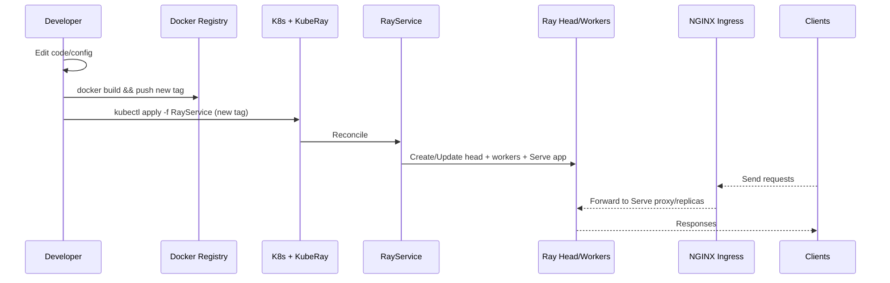
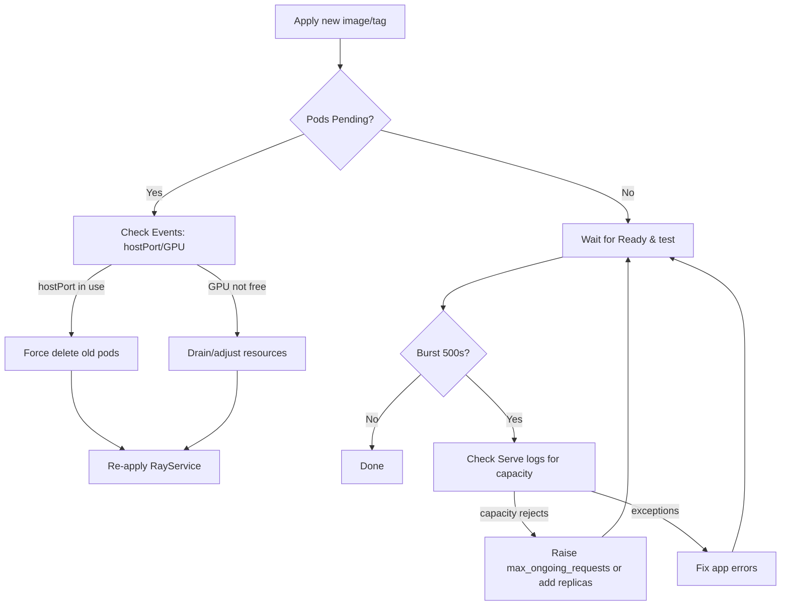

# Service Update & Deployment Guide

This guide walks you through rolling out a code/config change to the Embedding Service on Ray/Kubernetes, validating the rollout, and monitoring for regressions. It includes runnable command snippets and a couple of Mermaid sequence/flow diagrams for the big picture.

Links to related docs:
- `docs/headnode-log-discovery.md` — where to find Ray logs on head/worker nodes
- `docs/forceful-redeploy.md` — force a clean redeploy if needed
- `docs/ingress-nginx.md` — exposing the service externally via NGINX Ingress

---

## What changed (example)

In this rollout, we increased the per-replica concurrency to absorb bursts without Serve overload rejections and aligned app-level semaphores with Serve concurrency.

File: `src/service/ray_deployment.py`

```python
@serve.deployment(
    name="embedding-service",
  ray_actor_options={
    "num_cpus": 2,
    "num_gpus": 0.2,
  },
  # Raised from default (5) to 100 to reduce overload 500s during bursts
  max_ongoing_requests=100,
    autoscaling_config={
        "min_replicas": 2,
        "max_replicas": 16,
        "target_num_ongoing_requests_per_replica": 4,
    },
)
@serve.ingress(app)
class EmbeddingServiceDeployment:
    pass
```

You can adapt these values to your traffic profile and resource budget.

Additionally, the service-level semaphores were updated to be configurable in `src/config.py` under `service.*_concurrency_limit` keys. Default embedding concurrency is now 32.

```python
# src/config.py (snippet)
defaults = {
  "service": {
    # ...
    "embedding_concurrency_limit": 32,
    "similarity_concurrency_limit": 8,
    "gpu_ops_concurrency_limit": 2,
    "model_loading_concurrency_limit": 1,
    "health_checks_concurrency_limit": 50,
  }
}
```

Ray Serve concurrency governs how many requests a replica will accept concurrently, while the app-level semaphore bounds in-flight work inside your handlers. Keep these in the same ballpark to avoid fast 500s at the proxy or unnecessary queuing inside the app.

---

## High-level rollout path



---

## Prerequisites

- kubectl context points to the right cluster/namespace (RayService lives in `default` by default)
- Access to your container registry (example below uses a local registry: `192.168.1.3:5000`)
- The RayService manifest at `ray-cluster-dual-workers.yaml`

---

## Step 1 — Build and push the image

Update the image tag as needed. Example uses `ray-latest-v2`.

```bash
docker build -t 192.168.1.3:5000/embedding-service:ray-latest-v2 .
docker push 192.168.1.3:5000/embedding-service:ray-latest-v2
```

If you version with a file (like `version`), bump it before the build.

---

## Step 2 — Point the RayService to the new image

Confirm your RayService uses the updated image (both head and workers). Example: `ray-cluster-dual-workers.yaml` (snippet):

```yaml
spec:
  rayClusterConfig:
    headGroupSpec:
      template:
        spec:
          containers:
          - name: ray-head
            image: "192.168.1.3:5000/embedding-service:ray-latest-v2"
            imagePullPolicy: Always
    workerGroupSpecs:
    - groupName: worker-gpu
      template:
        spec:
          containers:
          - name: ray-worker
            image: 192.168.1.3:5000/embedding-service:ray-latest-v2
            imagePullPolicy: Always
```

Apply the manifest:

```bash
kubectl apply -f ray-cluster-dual-workers.yaml
kubectl get rayservice -A -o wide
```

Note: A simple `apply` often triggers a rolling update. If ports/GPU reservations are stuck on the node, use a forceful redeploy (next section).

---

## Step 3 — Forceful redeploy (when in doubt)

If you see pods Pending due to hostPort collisions or GPU scheduling, follow `docs/forceful-redeploy.md`. Quick reference:

```bash
# Remove existing RayService (operator will clean up the cluster)
kubectl delete rayservice ray-cluster-simple --wait=true

# If any pods linger in Terminating, force delete them
kubectl get pods -l ray.io/cluster=ray-cluster-simple
kubectl delete pod <old-pod-names> --force --grace-period=0

# Recreate
kubectl apply -f ray-cluster-dual-workers.yaml

# Watch
kubectl get pods -l ray.io/cluster=ray-cluster-simple -w
```

Common Pending cause: “didn't have free ports for the requested pod ports” — resolve by ensuring old head/worker pods are fully removed (force delete if necessary).

---

## Step 4 — Wait for readiness

```bash
kubectl wait --for=condition=ready pod -l ray.io/cluster=ray-cluster-simple --timeout=300s
kubectl get pods -o wide
```

You should see the head pod Running with the expected ports and the worker pods Running (GPU ready if applicable).

---

## Step 5 — Quick health checks (via Ingress)

Set convenience variables to test through NGINX Ingress and nip.io (adapt to your env):

```bash
export NODE_IP=<your-node-ip>                 # e.g., 192.168.1.3
export NODE_PORT=<ingress-nodeport-http>      # e.g., 30333
export HOST=embeddings.${NODE_IP//./-}.nip.io
export ENDPOINT=http://$HOST:$NODE_PORT

curl -s -H "Host: $HOST" $ENDPOINT/health | jq .
curl -s -H "Host: $HOST" -H 'Content-Type: application/json' \
  -d '{"texts":["hello ingress"],"batch_size":32}' \
  $ENDPOINT/embeddings | jq .
```

---

## Step 6 — Burst test and summarize

Run a small burst (50 req, P=10) and summarize status codes and latency:

```bash
seq 50 | xargs -n1 -P 10 -I{} curl -s -o /dev/null -w '%{http_code},%{time_total}\n' \
  -H "Host: $HOST" -H 'Content-Type: application/json' \
  -d '{"texts":["hello world"]}' $ENDPOINT/embeddings | tee /tmp/burst.csv

awk -F, '{counts[$1]++} END{for (c in counts) printf("%s %d\n", c, counts[c])}' /tmp/burst.csv | sort
awk -F, '{sum+=$2; n++} END{printf("mean=%.4fs n=%d\n", sum/n, n)}' /tmp/burst.csv
cut -d, -f2 /tmp/burst.csv | sort -n | awk 'BEGIN{p50n=0;p95n=0} {vals[NR]=$1} END{n=NR;p50i=int(0.5*n); if(p50i<1)p50i=1; p95i=int(0.95*n); if(p95i<1)p95i=1; printf("p50=%.4fs p95=%.4fs count=%d\n", vals[p50i], vals[p95i], n)}'
```

Expected after the concurrency tweak: 200s across the board for this small burst; p50 ~20–40ms depending on model size and hardware.

---

## Step 7 — Monitor Ray logs (head + replicas)

See `docs/headnode-log-discovery.md` for more. Handy snippets:

```bash
HEAD=$(kubectl get pods -l ray.io/node-type=head -o jsonpath='{.items[0].metadata.name}')

# Serve proxy on the head
kubectl exec $HEAD -c ray-head -- tail -n 200 /tmp/ray/session_latest/logs/serve/proxy_*.log

# Per-replica logs on workers
for W in $(kubectl get pods -l ray.io/node-type=worker -o name); do
  kubectl exec ${W#pod/} -c ray-worker -- ls -1 /tmp/ray/session_latest/logs/serve | grep ^replica_ || true
done

# Look for overload messages or exceptions
kubectl exec $HEAD -c ray-head -- sh -lc "grep -RniE 'ERROR|Exception|Traceback|capacity' /tmp/ray/session_latest/logs | tail -n 200"
```

If you previously saw fast 500s during bursts, look for lines like:

```
WARNING replica.py:571 - Replica at capacity of max_ongoing_requests=5, rejecting request ...
```

After raising `max_ongoing_requests`, these should go away for the same burst level.

---

## Optional — Ingress retry & timeouts

You can smooth out brief backend hiccups by allowing limited retries at the ingress. Example annotations for your `Ingress` manifest:

```yaml
metadata:
  annotations:
    nginx.ingress.kubernetes.io/proxy-body-size: "10m"
    nginx.ingress.kubernetes.io/proxy-read-timeout: "120"
    nginx.ingress.kubernetes.io/proxy-send-timeout: "120"
    nginx.ingress.kubernetes.io/proxy-next-upstream: "error timeout http_500 http_502 http_503 http_504"
    nginx.ingress.kubernetes.io/proxy-next-upstream-tries: "2"
```

Note: Retries on POST are generally “unsafe.” For idempotent embeddings this is typically acceptable—but validate with your product requirements.

---

## Rollback

If performance or error rates regress, roll back by pointing the RayService back to the previous image tag and re-apply. If pods hang on ports/GPUs, use the forceful redeploy steps.

```bash
# revert image tag in ray-cluster-dual-workers.yaml
kubectl apply -f ray-cluster-dual-workers.yaml
kubectl get pods -l ray.io/cluster=ray-cluster-simple -w
```

---

## Troubleshooting flow



---

## Acceptance checklist

- RayService is Running; head/worker pods are Ready
- Health endpoint returns 200 via ingress
- Embeddings endpoint returns 200 for single request
- Burst test shows 0% 500s at your target concurrency (baseline P=10)
- No new warnings/errors in Serve proxy/replica logs

---

## Appendix — Frequently used commands

```bash
# Describe a problematic pod
kubectl describe pod <pod>

# Tail Serve controller/proxy logs on head
HEAD=$(kubectl get pods -l ray.io/node-type=head -o jsonpath='{.items[0].metadata.name}')
kubectl exec $HEAD -c ray-head -- tail -n 200 /tmp/ray/session_latest/logs/serve/controller_*.log
kubectl exec $HEAD -c ray-head -- tail -n 200 /tmp/ray/session_latest/logs/serve/proxy_*.log

# List per-replica logs on a worker
WORKER=<worker-pod>
kubectl exec $WORKER -c ray-worker -- ls -1 /tmp/ray/session_latest/logs/serve | grep ^replica_

# Quick ingress health
curl -H "Host: $HOST" $ENDPOINT/health
```
