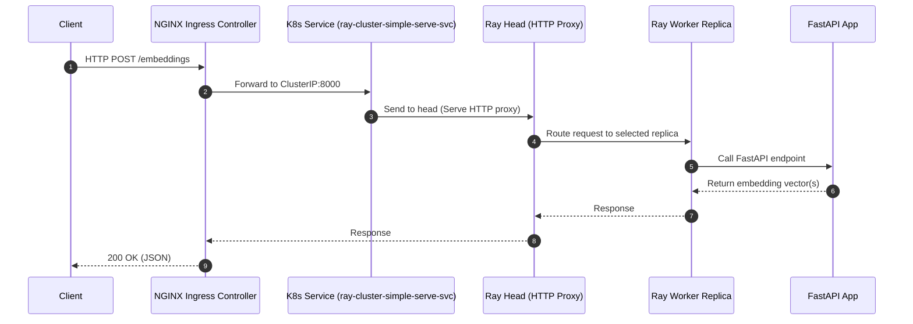

# Standalone NGINX Ingress for EmbeddingService

This guide shows how to install a standalone NGINX Ingress Controller on Kubernetes and expose the Ray Serve HTTP service externally without port-forwarding. It includes tested commands, manifests, and request examples.

- Target backend: `ray-cluster-simple-serve-svc:8000` (ClusterIP)
- Objective: Reach the API from outside the cluster via `http(s)://<host>/...`

Who is this for
- Teams running KubeRay/RayService that want a stable, external HTTP endpoint
- Bare-metal or single-node K8s users who don’t have a cloud LoadBalancer

What you’ll get
- A running NGINX Ingress Controller
- An Ingress resource pointing to your Serve Service
- Copy-pasteable curl examples that work immediately (using nip.io)

Success criteria
- External curl to `/health` returns JSON with `{ "status": "healthy" }`
- POST to `/embeddings` returns an embedding shape and processing time


## Architecture



Explanation
- The Ingress Controller terminates HTTP(S) at the cluster edge and routes based on Host/Path to the correct K8s Service.
- KubeRay creates a dedicated ClusterIP service for Ray Serve HTTP: `*-serve-svc` (port 8000). Point your Ingress to this service.
- The head node runs the Serve HTTP proxy; it routes your request to an appropriate worker replica where your FastAPI app executes.
- For the Ray dashboard (8265), use a separate, restricted Ingress that targets the head service; keep it isolated from the API.


## Prerequisites

- A working Kubernetes cluster (bare metal or cloud)
- KubeRay operator and your `RayService` deployed (so `ray-cluster-simple-serve-svc` exists)
- kubectl access with cluster-admin permissions

Helpful checks
- Namespace: examples here use `default`. Adjust if you deployed into another namespace.
- Verify service: `kubectl get svc ray-cluster-simple-serve-svc -o wide`
- Pods ready: `kubectl get pods -l ray.io/cluster=<your-cluster>`


## Option 1: Install NGINX Ingress (Bare Metal manifest)

This is the fastest path for single-node or bare-metal clusters.

```bash
# Install the controller (official manifest)
kubectl apply -f \
  https://raw.githubusercontent.com/kubernetes/ingress-nginx/controller-v1.11.1/deploy/static/provider/baremetal/deploy.yaml

# Wait for rollout
kubectl -n ingress-nginx rollout status deploy/ingress-nginx-controller --timeout=120s

# Confirm IngressClass is registered
kubectl get ingressclass

# Inspect the controller service (NodePort by default on bare metal)
kubectl -n ingress-nginx get svc -o wide
```

Expected output (example):

```
NAME                        TYPE       PORT(S)
ingress-nginx-controller    NodePort   80:30333/TCP,443:30278/TCP
```

If your cluster provides LoadBalancer (e.g., with MetalLB), you may see `EXTERNAL-IP` assigned. In that case, you won’t need NodePort.

Choose this if
- You’re on bare metal or kind/minikube without a managed LoadBalancer
- You want the simplest possible setup with minimal dependencies

What this creates
- Namespace `ingress-nginx`
- Deployment `ingress-nginx-controller`
- Service `ingress-nginx-controller` (NodePort by default)
- IngressClass `nginx`

Security note
- NodePort opens a high TCP port on cluster nodes; ensure your firewall allows only the sources you expect.


## Option 2: Install via Helm (Alternative)

```bash
helm repo add ingress-nginx https://kubernetes.github.io/ingress-nginx
helm repo update

# Basic install (may become LoadBalancer on cloud; NodePort on bare metal)
helm upgrade --install ingress-nginx ingress-nginx/ingress-nginx \
  --namespace ingress-nginx --create-namespace
```

You can set a specific Service type with Helm values if needed:
Choose this if
- You prefer Helm lifecycle management and easier upgrades/values overrides
- You’re on cloud K8s and want `LoadBalancer` with an external IP

```bash
helm upgrade --install ingress-nginx ingress-nginx/ingress-nginx \
  --namespace ingress-nginx --create-namespace \
  --set controller.service.type=NodePort
```


## Ingress resource (HTTP)

Create an Ingress that points to the Ray Serve service (`ray-cluster-simple-serve-svc:8000`). You can use a DNS name or a nip.io host that maps back to your node IP.

- A copy lives in the repo at `k8s/ingress-nginx.yaml`.
- Replace `CHANGE_ME` with your dashed IP or domain.

```yaml
apiVersion: networking.k8s.io/v1
kind: Ingress
metadata:
  name: embedding-service-ingress
  namespace: default
  annotations:
    nginx.ingress.kubernetes.io/proxy-body-size: "10m"
    nginx.ingress.kubernetes.io/proxy-read-timeout: "300"
    nginx.ingress.kubernetes.io/proxy-send-timeout: "300"
spec:
  ingressClassName: nginx
  rules:
  - host: embeddings.CHANGE_ME.nip.io   # e.g., embeddings.192-168-1-3.nip.io
    http:
      paths:
      - path: /
        pathType: Prefix
        backend:
          service:
            name: ray-cluster-simple-serve-svc
            port:
              number: 8000
```

Apply it:

```bash
kubectl apply -f k8s/ingress-nginx.yaml
kubectl get ingress embedding-service-ingress -o wide
```


## Quick test with nip.io

Define convenience variables for testing:

```bash
# Node IP of the machine running the cluster
export NODE_IP=$(hostname -I | awk '{print $1}')
# NodePort of HTTP (80) on the ingress controller
export NODE_PORT=$(kubectl -n ingress-nginx get svc ingress-nginx-controller \
  -o jsonpath='{.spec.ports[?(@.port==80)].nodePort}')
# Transform 192.168.1.3 -> 192-168-1-3
export HOST_DASH=${NODE_IP//./-}
export HOST="embeddings.${HOST_DASH}.nip.io"
# Single endpoint string (handy for scripts)
export ENDPOINT="http://${HOST}:${NODE_PORT}"

echo NODE_IP=$NODE_IP
echo NODE_PORT=$NODE_PORT
echo HOST=$HOST
echo ENDPOINT=$ENDPOINT
```

Sanity-check the API through the Ingress:

```bash
# Health
curl -sS -H "Host: $HOST" $ENDPOINT/health | jq .

# Embeddings
curl -sS -H "Host: $HOST" -H "Content-Type: application/json" \
  -X POST $ENDPOINT/embeddings \
  -d '{"texts":["hello from ingress"],"batch_size":32}' | jq '{shape,processing_time}'

# Stats
curl -sS -H "Host: $HOST" $ENDPOINT/embeddings/stats | jq '{semaphore_status, gpu_stats}'
```

If you configured a real domain and DNS, you won’t need the Host header. Just call `http(s)://your.domain/...` directly.

Expected outputs
- Health: `{ "status": "healthy", "timestamp": "..." }`
- Embeddings: `{ "shape": [N, 384], "processing_time": <seconds> }`
- Stats: shows semaphore availability and GPU info; useful to confirm the request truly hit your app through the Ingress path.

When to use nip.io vs. DNS
- nip.io is perfect for quick tests on bare metal—no DNS change required
- For production, create an A record pointing to your Ingress external IP (or node IP/MetalLB VIP)


## Optional: HTTPS with cert-manager

To enable TLS with Let’s Encrypt:

1) Install cert-manager

```bash
kubectl apply -f https://github.com/cert-manager/cert-manager/releases/download/v1.15.3/cert-manager.yaml
```

2) Create a ClusterIssuer (Let’s Encrypt)

```yaml
apiVersion: cert-manager.io/v1
kind: ClusterIssuer
metadata:
  name: letsencrypt-prod
spec:
  acme:
    server: https://acme-v02.api.letsencrypt.org/directory
    email: you@example.com
    privateKeySecretRef:
      name: letsencrypt-prod
    solvers:
    - http01:
        ingress:
          class: nginx
```

3) Update the Ingress

```yaml
metadata:
  annotations:
    cert-manager.io/cluster-issuer: "letsencrypt-prod"
spec:
  tls:
  - hosts:
    - embeddings.example.com
    secretName: embeddings-tls
```

Re-apply the Ingress and wait for the certificate to be issued.

Tip: start with Let’s Encrypt staging to avoid rate limits
```yaml
apiVersion: cert-manager.io/v1
kind: ClusterIssuer
metadata:
  name: letsencrypt-staging
spec:
  acme:
    server: https://acme-staging-v02.api.letsencrypt.org/directory
    email: you@example.com
    privateKeySecretRef:
      name: letsencrypt-staging
    solvers:
    - http01:
        ingress:
          class: nginx
```
Once verified, switch the Ingress annotation to `letsencrypt-prod`.


## Production recommendations

- Timeouts & body sizes: tune via NGINX annotations based on typical request sizes and latency
- Security: consider IP allowlists, WAF, mTLS, or auth at the edge; always validate in FastAPI
- Observability: enable NGINX access logs and Prometheus metrics; scrape your app `/metrics`
- Ray dashboard: expose separately (different host) and restrict access
- LoadBalancer: on bare metal, pair with MetalLB for a stable external IP

Forwarded headers
- NGINX adds `X-Forwarded-For`, `X-Real-IP`, `X-Forwarded-Proto` by default
- Your app can read these to log client IPs correctly (this repo already checks `X-Real-IP`)

CORS
- Prefer handling CORS in FastAPI for clarity and testability
- If you need to enforce at the edge, use NGINX annotations or a snippet to set CORS headers


## Troubleshooting

- 404 Not Found:
  - Host header doesn’t match the Ingress host
  - Wrong path or missing pathType: Prefix
- 502/504 Gateway:
  - Service/pods not ready; check `kubectl get pods` and app logs
  - Increase `proxy-read-timeout`/`proxy-send-timeout`
- 413 Request Entity Too Large:
  - Increase `nginx.ingress.kubernetes.io/proxy-body-size`
- Can’t reach NodePort:
  - Firewalls (UFW/iptables) may block the NodePort; allow traffic
  - On multi-node clusters, target the node where the controller is running or expose via LoadBalancer

Deep dive commands
- Describe resources for events:
  - `kubectl describe ingress embedding-service-ingress`
  - `kubectl -n ingress-nginx describe svc ingress-nginx-controller`
- Controller logs (filter by host):
  - `kubectl -n ingress-nginx logs deploy/ingress-nginx-controller -f | grep embeddings`
- Verify Service endpoints:
  - `kubectl get endpoints ray-cluster-simple-serve-svc -o wide`
- Test in-cluster path end-to-end:
  - `kubectl run -it tmp --rm --image=curlimages/curl -- sh`
  - `curl -s http://ray-cluster-simple-serve-svc:8000/health`
- Host/network
  - Ensure `NODE_PORT` is open on your firewall, e.g., `sudo ufw allow 30333/tcp`

FAQ
- Why not point Ingress to the head service? The `*-serve-svc` is the dedicated HTTP entry for Ray Serve (port 8000). The head service bundles multiple ports and is better reserved for internal cluster comms and the dashboard.
- How do I expose the dashboard? Create a separate Ingress routing to port 8265 on the head service, and restrict access with auth/IP allowlists.
- Can I use a path prefix (e.g., `/api`)? Yes—set the Ingress path to `/api` and ensure your app routes match. If you need to rewrite paths, add an appropriate NGINX rewrite annotation.


## Reference

- `k8s/ingress-nginx.yaml` in this repo (ready-to-use template)
- NGINX Ingress Controller docs: https://kubernetes.github.io/ingress-nginx/
- KubeRay + Ray Serve on K8s docs: https://docs.ray.io/en/latest/serve/production-guide/kubernetes.html
