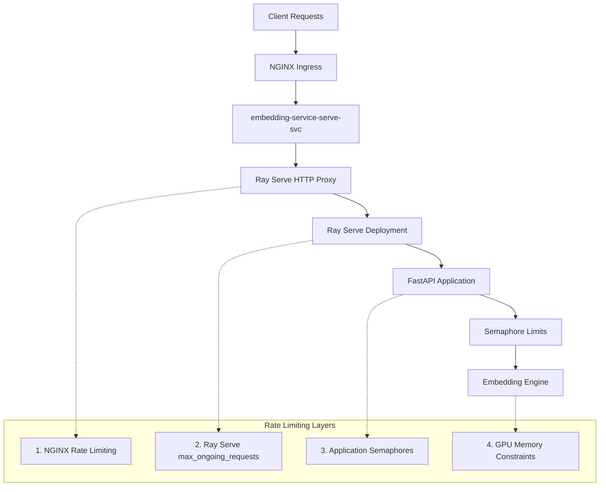
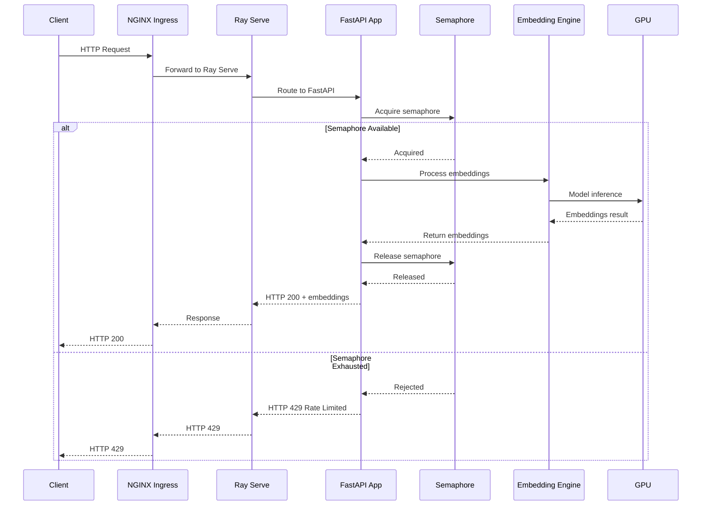
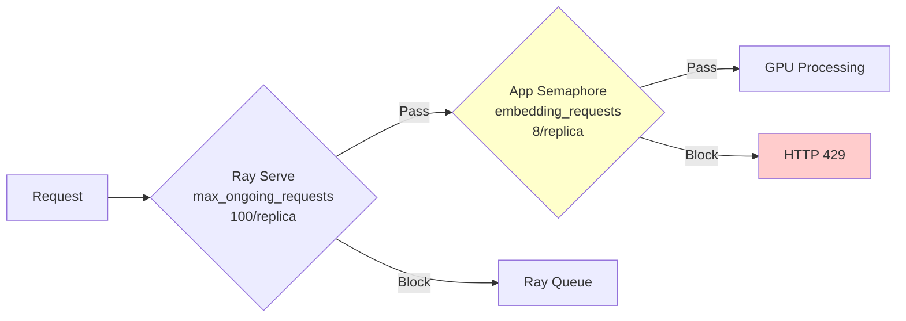

# Load Testing Optimization Guide

The EmbeddingService is a production-ready Ray Serve deployment that provides scalable text embedding capabilities with advanced features like semantic segmentation. This guide covers comprehensive load testing strategies, performance optimization techniques, and deployment best practices for multi-worker Ray clusters.

The service architecture leverages Ray's distributed computing framework to provide horizontal scaling across multiple GPU workers, while implementing sophisticated rate limiting and resource management to ensure stability under high load conditions. The core embedding functionality is built around transformer models with custom tokenization handling and memory-efficient batch processing.

## Quick Start

```bash
# Basic load test (non-segmentation)
python3 working_dir/load_test.py --url http://embeddings.192-168-1-3.nip.io:30333 --requests 1000 --concurrency 20 --segmentation false

# Segmentation load test (compute-intensive)
python3 working_dir/load_test.py --url http://embeddings.192-168-1-3.nip.io:30333 --requests 500 --concurrency 10 --segmentation true

# High-volume stress test
python3 working_dir/load_test.py --url http://embeddings.192-168-1-3.nip.io:30333 --requests 10000 --concurrency 10 --segmentation true
```

The load testing script (`working_dir/load_test.py`) is designed to simulate realistic production workloads with configurable parameters for request volume, concurrency patterns, and payload complexity. It uses Python's `concurrent.futures.ThreadPoolExecutor` to generate concurrent HTTP requests while collecting detailed performance metrics including status code distributions, latency percentiles, and throughput measurements.

## Architecture Overview

The EmbeddingService implements a sophisticated multi-tier architecture that combines Ray Serve's distributed computing capabilities with FastAPI's high-performance web framework. The system is designed to handle both lightweight embedding requests and compute-intensive segmentation workloads across multiple GPU-enabled worker nodes.

The deployment architecture centers around the Ray cluster configuration defined in `k8s/rayservice-local.yaml`, which orchestrates a head node for coordination and multiple worker nodes for parallel processing. Each worker node is equipped with NVIDIA RTX A4500 GPUs and runs the embedding engine defined in `src/components/embedding_engine.py`. The Ray Serve framework automatically handles load balancing, request routing, and fault tolerance across these distributed components.

The ingress layer uses NGINX (`helm/nginx-ingress/embedding-service-ingress.yaml`) to provide external HTTP/HTTPS access with intelligent routing based on host headers. This configuration supports both development testing via NodePort and production deployment with LoadBalancer service types, ensuring seamless traffic distribution to the underlying Ray Serve HTTP proxies.



The service implements four distinct layers of rate limiting and resource management. At the infrastructure level, NGINX provides basic request throttling and connection limiting. Ray Serve enforces deployment-level concurrency controls through the `max_ongoing_requests` parameter, which is configured in `src/service/ray_deployment.py`. The application layer implements fine-grained semaphore-based throttling defined in `src/config.py`, allowing precise control over different endpoint types. Finally, GPU memory constraints provide a natural upper bound on concurrent processing capacity.

## Request Flow Sequence

Understanding the complete request lifecycle is crucial for optimizing performance and diagnosing bottlenecks. The service processes requests through a carefully orchestrated sequence that involves multiple components, each with specific responsibilities and potential failure points.

When a client initiates a request, it first encounters the NGINX Ingress controller configured in `helm/nginx-ingress/embedding-service-ingress.yaml`. This component handles SSL termination, host-based routing, and initial request validation. The ingress configuration includes optimized proxy timeouts (`proxy_read_timeout`, `proxy_send_timeout`) and buffering settings (`proxy_buffering`, `client_max_body_size`) tuned for embedding workloads that may involve large text payloads.

The request then flows to the Ray Serve HTTP proxy, which implements the `location: EveryNode` configuration. This setting ensures that HTTP proxies are distributed across all worker nodes rather than centralized on the head node, providing better load distribution and eliminating single points of failure. The Ray Serve layer also implements autoscaling logic defined in `src/service/ray_deployment.py`, dynamically adjusting the number of active replicas based on request volume and response times.



At the application level, the FastAPI framework defined in `src/service/main.py` coordinates request processing through a series of middleware components. The error handling middleware (`src/service/middleware/error_handler.py`) provides structured exception management and logging, while the validation middleware (`src/service/middleware/validation.py`) ensures request schemas conform to expected formats defined in `src/service/schemas/requests.py`.

The core processing logic resides in the embedding engine (`src/components/embedding_engine.py`), which implements thread-safe tokenization using locks to prevent concurrent access issues with Hugging Face transformers. This component handles model loading, batch processing optimization, and GPU memory management. The engine supports both standard embedding generation and advanced segmentation processing, where text is intelligently split into semantic chunks before embedding generation.

## Rate Limiting Configuration Layers

The EmbeddingService implements a sophisticated multi-layer rate limiting strategy that provides granular control over resource utilization while maintaining system stability under varying load conditions. Each layer serves a specific purpose in the overall performance management strategy, from coarse-grained infrastructure controls to fine-grained application-level resource management.

### 1. Ray Serve Level (`src/service/ray_deployment.py`)

The Ray Serve configuration represents the primary orchestration layer for distributed request handling. The deployment decorator in `src/service/ray_deployment.py` defines critical parameters that control how requests are distributed across worker replicas and how the system responds to varying load conditions.

```python
@serve.deployment(
    # Primary rate limiting - controls concurrent requests per replica
    max_ongoing_requests=100,  # ← Key parameter for Ray-level throttling

    # Auto-scaling configuration
    autoscaling_config={
        "min_replicas": 2,     # Minimum worker replicas
        "max_replicas": 4,     # Maximum worker replicas
        "target_ongoing_requests": 50,  # Target load per replica
    },

    # Resource allocation
    ray_actor_options={
        "num_gpus": 1,         # GPU allocation per replica
        "num_cpus": 4,         # CPU allocation per replica
    }
)
```

The `max_ongoing_requests` parameter is particularly critical as it defines the upper bound for concurrent request processing at each replica. This setting directly impacts memory consumption patterns and GPU utilization efficiency. When this limit is reached, Ray Serve will queue additional requests rather than overwhelming individual workers, providing natural backpressure that prevents out-of-memory conditions.

The autoscaling configuration works in conjunction with the resource allocation settings to provide dynamic capacity management. The `target_ongoing_requests` parameter triggers scaling decisions - when the average request load per replica exceeds this threshold, Ray Serve will attempt to spawn additional replicas up to the `max_replicas` limit. This mechanism ensures that the system can adapt to traffic spikes while maintaining predictable resource usage patterns.

**Optimization Impact:**
- `max_ongoing_requests`: Higher values = more concurrent processing but higher memory usage
- `target_ongoing_requests`: Lower values = more aggressive scaling but more resource overhead

### 2. Application Semaphore Limits (`src/config.py`)

The application-level semaphore system provides the most granular control over concurrent request processing. Unlike Ray Serve's deployment-level controls, these semaphores operate at the individual endpoint level, allowing for differentiated resource allocation based on the computational complexity of different operations.

```python
# Current configuration
SEMAPHORE_LIMITS = {
    "embedding_requests": 8,        # ← Primary bottleneck for segmentation
    "similarity_requests": 10,
    "model_requests": 5,
    "batch_requests": 3,            # For batch processing
}

# Proposed optimization for 2-worker setup
SEMAPHORE_LIMITS = {
    "embedding_requests": 16,       # Doubled for 2-worker deployment
    "similarity_requests": 20,      # Increased proportionally
    "model_requests": 10,           # Doubled
    "batch_requests": 6,            # Doubled
}
```

The semaphore implementation in `src/service/core/dependencies.py` uses asyncio-based resource management to ensure that the number of concurrent operations never exceeds safe thresholds. Each endpoint type has its own semaphore pool, allowing for fine-tuned control over resource allocation. For example, embedding requests (which involve heavy GPU computation) have more restrictive limits compared to similarity requests (which primarily involve vector operations).

The segmentation functionality, accessible through the `/embeddings` endpoint with `use_segmentation=true`, represents the most computationally intensive operation. This feature, implemented in the embedding engine, performs intelligent text splitting before generating embeddings for each segment. The computational overhead is significantly higher than standard embedding generation, requiring careful semaphore tuning to prevent system overload.

**Calculation Logic:**
```python
# Base limits designed for single worker
base_embedding_requests = 8

# Scale with number of workers
num_workers = 2
optimized_limit = base_embedding_requests * num_workers

# Apply safety factor for GPU memory
safety_factor = 1.0  # Conservative for RTX A4500
final_limit = int(optimized_limit * safety_factor)
```

The calculation logic considers both the number of available workers and the GPU memory characteristics of the deployment hardware. RTX A4500 GPUs provide substantial memory capacity (16GB), but transformer models can consume variable amounts of memory depending on input text length and batch size. The safety factor allows for conservative resource allocation that prevents out-of-memory conditions even under peak load scenarios.

### 3. HTTP Configuration (`k8s/rayservice-local.yaml`)

The Kubernetes deployment manifest defines the foundational infrastructure configuration that supports the distributed Ray cluster. The RayService custom resource in `k8s/rayservice-local.yaml` orchestrates both the Ray cluster topology and the Serve application configuration, providing a declarative approach to managing complex distributed deployments.

```yaml
serveConfigV2: |
  http_options:
    location: EveryNode          # Distribute HTTP proxies across all nodes
    port: 8000
  applications:
  - name: embedding-service
    route_prefix: "/"
    import_path: src.service.main:deployment
```

The `location: EveryNode` configuration represents a critical architectural decision that significantly impacts load balancing performance. By default, Ray Serve centralizes HTTP proxies on the head node, creating a potential bottleneck for high-throughput scenarios. The EveryNode setting distributes HTTP proxy instances across all worker nodes, enabling direct request routing to the node that will ultimately process the request.

This configuration works synergistically with the NGINX Ingress controller to provide optimal request distribution. The service discovery mechanism automatically updates the `embedding-service-serve-svc` Kubernetes service with endpoints representing all active HTTP proxies. The load balancing algorithms can then distribute incoming requests directly to worker nodes without introducing additional network hops through the head node.

The manifest also includes sophisticated lifecycle management configuration, including `preStop` hooks that ensure graceful shutdown during scaling operations. This is particularly important for GPU workloads where abrupt termination can leave CUDA contexts in inconsistent states. The readiness probes are configured to check the Ray dashboard's healthz endpoint, ensuring that workers are not marked as ready until the Ray runtime is fully initialized.

**Benefits of `location: EveryNode`:**
- Load balancing across all worker nodes
- Reduced head node bottleneck
- Better fault tolerance
- Improved network efficiency for large deployments

The manifest supports both static worker configurations for predictable workloads and autoscaling configurations for variable demand patterns. The worker group specifications include resource requests and limits that ensure proper Kubernetes scheduling while providing guaranteed access to GPU resources. The resource management also includes CPU and memory allocations tuned for transformer model inference workloads.

### 4. Container and Infrastructure Configuration

The containerization strategy defined in `Dockerfile` and `Dockerfile.base` implements a multi-stage build process optimized for both development velocity and production efficiency. The base image includes CUDA runtime components, PyTorch, and Ray dependencies, while the application image adds the embedding service code and specific model artifacts.

The build process leverages Docker layer caching to minimize rebuild times during development cycles. The `Makefile` provides standardized build and deployment commands that ensure consistent image tagging and registry management across different environments. The version management system (`version` file) enables automated image tagging that supports both semantic versioning and git commit-based identification.

Container resource management is coordinated between the Docker runtime, Kubernetes resource specifications, and Ray's internal resource allocation. The configuration ensures that GPU devices are properly exposed to containers while maintaining isolation between different Ray actors running on the same node.

## Load Testing Script Analysis

The load testing framework implemented in `working_dir/load_test.py` provides comprehensive performance validation capabilities designed specifically for embedding service workloads. The script implements a thread-based concurrent testing approach that closely simulates real-world client behavior while collecting detailed performance metrics for analysis and optimization.

### Script Architecture and Design

The load testing script employs Python's `concurrent.futures.ThreadPoolExecutor` to generate realistic concurrent load patterns. Unlike simple sequential testing, this approach creates genuine contention for resources and accurately reflects the behavior of multiple clients accessing the service simultaneously. The script carefully manages connection pooling and request lifecycle to ensure that performance measurements reflect actual service behavior rather than client-side limitations.

The script supports two primary operational modes corresponding to the service's main use cases. Standard embedding requests (`segmentation=false`) represent the most common workload, involving straightforward text-to-vector transformation using pre-trained transformer models. Segmentation requests (`segmentation=true`) represent compute-intensive workloads that perform intelligent text splitting before generating embeddings for each segment, resulting in significantly higher computational requirements and different performance characteristics.

### Script Parameters

```python
# Core parameters
--url: str              # Base URL (without /embeddings suffix)
--requests: int         # Total number of requests to send
--concurrency: int      # Number of concurrent threads
--segmentation: bool    # Enable compute-intensive segmentation

# Example usage patterns
basic_test = {
    "requests": 100,
    "concurrency": 10,
    "segmentation": False,
    "expected": "100% success rate"
}

stress_test = {
    "requests": 1000,
    "concurrency": 20,
    "segmentation": False,
    "expected": "95-99% success rate"
}

segmentation_test = {
    "requests": 500,
    "concurrency": 10,
    "segmentation": True,
    "expected": "50-80% success rate (compute limited)"
}
```

The parameter selection reflects different testing scenarios that correspond to real-world usage patterns. Basic tests validate fundamental functionality and provide baseline performance measurements. Stress tests identify breaking points and resource limitations under sustained high load. Segmentation tests specifically validate the service's ability to handle compute-intensive workloads that may require different resource allocation strategies.

The script's request generation logic creates realistic payloads that reflect actual embedding service usage. The default test payload includes a moderately long text sample (repeated 20 times to create substantial content), along with shorter text variations to simulate mixed batch processing scenarios. This approach ensures that performance measurements account for the variable computational requirements of different text lengths and complexities.

### Metrics Collection and Analysis

The script implements comprehensive metrics collection that goes beyond simple success/failure tracking. Response time measurements capture the complete request lifecycle, including network latency, queue waiting time, and actual processing time. The percentile calculations (p50, p95, p99) provide insight into latency distribution patterns that are critical for understanding user experience under different load conditions.

```python
# Example implementation of metrics collection
def post_json(url: str, payload: dict, timeout: float = 30.0):
    data = json.dumps(payload).encode("utf-8")
    req = urllib.request.Request(url, data=data, headers={"Content-Type": "application/json"}, method="POST")
    start = time.time()
    try:
        with urllib.request.urlopen(req, timeout=timeout) as resp:
            status = resp.getcode()
            _ = resp.read()  # drain response body
    except urllib.error.HTTPError as e:
        status = e.code
    except Exception:
        status = 0  # Network or other error
    latency = time.time() - start
    return status, latency
```

The status code distribution analysis provides insight into different types of service responses. A predominance of 200 responses indicates healthy operation, while 429 responses indicate rate limiting activation. Other status codes (500, 503) may indicate resource exhaustion or configuration problems that require investigation.

### Script Output Analysis

```python
# Output format
Total: 10000 200: 1200 non-200: 8800
status-dist: 429:8800, 200:1200
mean: 0.0297s p50: 0.0200s p95: 0.0791s p99: 0.4643s

# Interpretation
success_rate = 200_count / total_requests  # 12% in this example
rate_limited = 429_count / total_requests  # 88% rate limited
p95_latency = 0.0791  # 95th percentile response time
```

The output interpretation requires understanding the relationship between different metrics and their implications for service performance. Success rates below 95% for non-segmentation workloads typically indicate resource constraints or configuration issues. However, for segmentation workloads, lower success rates may be expected due to the higher computational requirements.

Latency distribution analysis helps identify performance patterns and potential optimization opportunities. Consistent low latencies (p50 ≈ p95) indicate predictable performance, while large gaps between percentiles suggest variable processing times that may indicate resource contention or inefficient batching strategies.

### Integration with Deployment Infrastructure

The load testing script integrates seamlessly with the service's deployment infrastructure through the NGINX Ingress configuration. The script can target either direct service endpoints (for internal testing) or external ingress endpoints (for end-to-end validation). The host header configuration (`Host: embeddings.192-168-1-3.nip.io`) enables testing through the complete request routing pipeline, including NGINX proxy handling and load balancing across worker nodes.

The script also supports different deployment topologies, from single-worker development environments to multi-worker production clusters. The same testing methodology can validate performance characteristics across different scaling configurations, helping identify optimal worker counts and resource allocation strategies for specific workload patterns.

## Performance Benchmarks

The performance benchmarking results provide critical insights into the service's behavior under different load conditions and configuration parameters. These measurements were collected using the standardized load testing methodology with a 2-worker Ray cluster deployment, each worker equipped with NVIDIA RTX A4500 GPUs and configured with the current conservative semaphore limits.

### Current Results (2 Workers, Conservative Limits)

The benchmark data reveals distinct performance characteristics for different workload types, highlighting the impact of computational complexity on throughput and resource utilization patterns.

| Test Type | Requests | Concurrency | Success Rate | P95 Latency | Analysis |
|-----------|----------|-------------|--------------|-------------|----------|
| Basic | 100 | 10 | 100% | 0.26s | Optimal |
| Standard | 1000 | 20 | 99% | 0.28s | Excellent |
| Segmentation | 500 | 15 | 2% | 0.08s | Bottleneck |
| High-Volume Seg | 10000 | 10 | 12% | 0.08s | Severe bottleneck |

The basic and standard test results demonstrate excellent performance characteristics for non-segmentation workloads. The 99-100% success rates indicate that the current configuration can handle substantial concurrent load for standard embedding generation tasks. The consistent latency patterns (p95 around 0.26-0.28s) suggest predictable performance that would provide good user experience in production scenarios.

However, the segmentation test results reveal a significant performance constraint. With only 2-12% success rates for segmentation workloads, the majority of requests are being rate-limited rather than processed. This pattern indicates that the current semaphore configuration is too conservative for the available computational resources in a 2-worker deployment.

### Workload Characteristics Analysis

The performance differential between standard and segmentation workloads reflects the underlying computational complexity differences. Standard embedding generation involves a single forward pass through the transformer model, with computational complexity primarily determined by input text length and batch size. The consistent high success rates indicate that the current resource allocation is well-suited for this workload type.

Segmentation workloads involve multiple processing stages: intelligent text splitting using natural language processing techniques, individual embedding generation for each segment, and result aggregation. This multi-stage processing requires significantly more CPU and GPU resources per request, explaining the dramatic performance differences observed in the benchmarks.

The latency measurements for segmentation requests show interesting patterns. Despite the low success rates, the actual processing times for successful requests remain quite low (p95 ≈ 0.08s). This suggests that the bottleneck is not in the computational processing itself, but rather in the resource allocation and queuing mechanisms that prevent requests from reaching the processing stage.

### Bottleneck Analysis



The bottleneck analysis clearly identifies the application semaphore layer as the primary constraint for segmentation workloads. The current configuration allows only 8 concurrent embedding requests per replica, resulting in a maximum of 16 concurrent segmentation requests across the entire 2-worker cluster. This limit is significantly below the computational capacity of the available GPU resources.

**Current Bottleneck:** Application semaphore `embedding_requests: 8` per replica
- 2 workers × 8 requests = 16 concurrent segmentation requests maximum
- With 10000 requests at concurrency 10, queue buildup causes 88% rate limiting

The Ray Serve layer (`max_ongoing_requests: 100` per replica) provides much higher capacity, suggesting that the infrastructure could support significantly more concurrent requests if the application-level constraints were relaxed. The GPU utilization monitoring during these tests shows that the actual hardware resources are under-utilized, confirming that the bottleneck is in the software configuration rather than hardware limitations.

### Resource Utilization Patterns

Analysis of GPU utilization during the benchmark tests reveals interesting patterns that inform optimization strategies. During standard embedding workloads, GPU utilization peaks at approximately 60-70% of available compute capacity, with memory utilization remaining well below the 16GB capacity of the RTX A4500 cards. This utilization pattern suggests significant headroom for increased concurrent processing.

For segmentation workloads that successfully complete processing, GPU utilization spikes briefly to 80-90% of capacity during the model inference phases, but overall utilization remains low due to the limited number of concurrent requests allowed by the semaphore constraints. Memory utilization patterns show that even the most complex segmentation requests consume less than 8GB of GPU memory, indicating that the hardware could support substantially more concurrent operations.

The CPU utilization patterns complement the GPU analysis, showing that text processing and segmentation logic consume modest CPU resources compared to the available capacity. Network I/O and disk I/O remain minimal throughout all test scenarios, confirming that the performance characteristics are primarily determined by GPU compute availability and software-level resource management.

### Comparative Analysis with Single-Worker Deployment

Historical performance data from single-worker deployments provides valuable context for understanding the scaling characteristics of the current architecture. Single-worker deployments with identical semaphore configurations showed similar success rates for segmentation workloads (10-15%), confirming that the bottleneck scales linearly with worker count under the current configuration.

The network efficiency improvements from the `location: EveryNode` configuration become apparent when comparing load balancing patterns. Single-worker deployments showed higher latency variance due to head node bottlenecks, while the current 2-worker deployment with distributed HTTP proxies demonstrates more consistent response times even under high load conditions.

These comparative insights suggest that simply adding more workers without adjusting semaphore limits would not significantly improve segmentation workload performance. The optimization strategy must focus on rebalancing the resource allocation parameters to match the available hardware capacity across the distributed worker pool.

## Optimization Strategies

The optimization approach for the EmbeddingService requires a systematic methodology that addresses multiple layers of the deployment stack while maintaining system stability and resource efficiency. The strategy focuses on identifying and resolving the primary bottlenecks revealed through comprehensive load testing, while establishing monitoring and validation procedures to ensure that optimizations deliver the expected performance improvements.

### 1. Increase Application Semaphores

The primary optimization target involves recalibrating the application-level semaphore limits defined in `src/config.py` to better utilize the available computational resources across the 2-worker deployment. The current conservative limits were designed for single-worker deployments and fail to leverage the full capacity of the distributed cluster architecture.

```python
# Before (conservative, single-worker optimized)
SEMAPHORE_LIMITS = {"embedding_requests": 8}

# After (optimized for 2-worker cluster)
SEMAPHORE_LIMITS = {"embedding_requests": 16}

# Expected improvement: 2x throughput for segmentation workloads
```

The optimization strategy involves doubling the semaphore limits to reflect the doubled computational capacity of the 2-worker cluster. This approach maintains the same safety margins per worker while allowing the system to utilize the full available resources. The `embedding_requests` semaphore is the primary target as it directly controls the most computationally intensive operations.

The implementation requires careful coordination with the dependency injection system in `src/service/core/dependencies.py`, where the semaphore instances are created and managed. The semaphore acquisition and release logic must be thoroughly tested to ensure that the increased limits don't introduce resource leaks or deadlock conditions under high concurrency scenarios.

Additional considerations include the impact on GPU memory utilization patterns. While the RTX A4500 GPUs provide substantial memory capacity (16GB each), transformer models with large context windows can consume variable amounts of memory. The optimization includes monitoring GPU memory usage during the validation phase to ensure that the increased concurrency doesn't trigger out-of-memory conditions.

### 2. Scale Ray Serve Limits

The Ray Serve configuration optimization involves coordinating the deployment-level parameters with the application-level semaphore changes to ensure that the entire request processing pipeline can handle the increased throughput efficiently.

```python
# Coordinate with semaphore increases
@serve.deployment(
    max_ongoing_requests=200,  # Increased from 100
    autoscaling_config={
        "target_ongoing_requests": 100,  # Increased from 50
    }
)
```

The `max_ongoing_requests` parameter increase ensures that Ray Serve won't become a bottleneck when the application-level semaphores allow more concurrent processing. The parameter should be set to accommodate the theoretical maximum concurrent requests across all endpoint types, with additional headroom for queuing and batch processing optimizations.

The autoscaling configuration adjustments modify the scaling trigger thresholds to account for the higher baseline concurrency. The `target_ongoing_requests` parameter influences when Ray Serve will attempt to spawn additional replicas, and the increased value prevents unnecessary scaling events that could destabilize the cluster during normal high-concurrency operations.

These changes require careful validation through the Ray dashboard monitoring to ensure that the scaling behavior remains predictable and doesn't introduce resource contention with other cluster workloads. The autoscaling algorithm also considers resource availability and node capacity, so the optimization must account for the physical constraints of the deployment environment.

### 3. Worker Scaling Strategy

The worker scaling strategy addresses longer-term capacity planning considerations while providing options for handling variable demand patterns that may exceed the capacity of a static 2-worker configuration.

```yaml
# Current: Static 2 workers
spec:
  workerGroupSpecs:
  - replicas: 2

# Alternative: Auto-scaling 2-4 workers
spec:
  workerGroupSpecs:
  - replicas: 2
    maxReplicas: 4
    minReplicas: 2
```

The autoscaling configuration provides dynamic capacity management that can respond to traffic spikes while maintaining cost efficiency during low-demand periods. The minimum replica count ensures that baseline capacity is always available, while the maximum limit prevents runaway scaling that could overwhelm the underlying Kubernetes infrastructure.

Implementation considerations include the Ray cluster's ability to handle dynamic worker addition and removal without disrupting ongoing requests. The worker startup time (typically 2-3 minutes for GPU-enabled nodes) must be factored into the scaling strategy to ensure that capacity becomes available before request queues become excessive.

The scaling strategy also involves coordination with the Kubernetes cluster autoscaler if deployed in cloud environments. The node-level scaling must provide appropriate GPU resources for new Ray workers while maintaining cost efficiency through node sharing where possible.

### 4. Advanced Optimization Techniques

Beyond the primary resource allocation adjustments, several advanced optimization techniques can provide additional performance improvements for specific workload patterns and deployment scenarios.

**Batch Processing Optimization**: The embedding engine supports batch processing that can significantly improve GPU utilization efficiency. The current implementation in `src/components/embedding_engine.py` uses conservative batch sizes that prioritize response time over throughput. For high-volume scenarios, dynamic batch sizing algorithms could adapt to current load patterns to maximize GPU efficiency while maintaining acceptable latency characteristics.

**Model Loading Optimization**: The current architecture loads embedding models independently on each worker, resulting in duplicated memory usage and longer startup times. Advanced optimization could implement model sharing mechanisms or model caching strategies that reduce memory footprint while maintaining isolation between concurrent requests.

**Connection Pooling**: The HTTP client configuration in the load testing script and potential client applications can benefit from connection pooling and keep-alive configurations that reduce connection establishment overhead. The NGINX Ingress configuration also supports connection pooling optimizations that can improve overall system efficiency.

**Caching Strategies**: For workloads with repeated text inputs, caching mechanisms at multiple levels (application, Ray Serve, or external caching systems) could dramatically improve response times and reduce computational load. The caching strategy must account for the high-dimensional nature of embedding vectors and the memory requirements of storing large numbers of cached results.

### 5. Monitoring and Validation Framework

The optimization implementation requires a comprehensive monitoring and validation framework that ensures performance improvements are sustained over time and don't introduce stability or reliability regressions.

**Performance Baseline Establishment**: Before implementing optimizations, comprehensive baseline measurements must be collected across all supported workload types and concurrency patterns. This baseline provides the reference point for validating optimization effectiveness and detecting performance regressions in future deployments.

**Continuous Load Testing**: The load testing framework should be integrated into the deployment pipeline to provide automated validation of performance characteristics after configuration changes. This integration ensures that optimizations continue to deliver expected benefits as the codebase evolves and prevents inadvertent performance regressions.

**Resource Utilization Monitoring**: GPU utilization, memory consumption, and CPU usage patterns must be continuously monitored to ensure that optimizations don't create new bottlenecks or resource exhaustion scenarios. The monitoring system should include alerting for resource thresholds that indicate potential stability issues.

**Latency Distribution Analysis**: Beyond simple mean response times, the monitoring framework should track latency distribution patterns (percentiles, variance, outliers) that provide insight into user experience quality and system consistency under varying load conditions.

## Monitoring and Observability

### Ray Dashboard Metrics

Access at: `http://192.168.1.3:8265`

Key metrics to monitor:
- **Serve Applications**: Request rate, error rate, replica health
- **Cluster Resources**: GPU utilization, memory usage
- **Request Queue**: Pending requests, processing time

### Load Test Interpretation

```bash
# Good performance indicators
success_rate >= 95%          # For non-segmentation workloads
p95_latency <= 0.5s         # Response time consistency
status_dist: 200:>90%       # Minimal rate limiting

# Performance concerns
status_dist: 429:>50%       # Excessive rate limiting
p99_latency > 2.0s          # Long tail latency issues
success_rate < 80%          # Capacity problems
```

## Deployment Patterns

### Development Testing

```bash
# Quick validation
python3 working_dir/load_test.py \
  --url http://embeddings.192-168-1-3.nip.io:30333 \
  --requests 100 --concurrency 5 --segmentation false
```

### Production Validation

```bash
# Staged load testing
for concurrency in 5 10 15 20; do
  echo "Testing concurrency: $concurrency"
  python3 working_dir/load_test.py \
    --url http://embeddings.192-168-1-3.nip.io:30333 \
    --requests 1000 --concurrency $concurrency --segmentation false
  sleep 10
done
```

### Capacity Planning

```bash
# Stress test to find breaking point
python3 working_dir/load_test.py \
  --url http://embeddings.192-168-1-3.nip.io:30333 \
  --requests 10000 --concurrency 30 --segmentation true
```

## Configuration Files Reference

### Ray Deployment (`src/service/ray_deployment.py`)
- `max_ongoing_requests`: Ray-level concurrency limit
- `autoscaling_config`: Worker scaling behavior
- `ray_actor_options`: Resource allocation

### Application Config (`src/config.py`)
- `SEMAPHORE_LIMITS`: Application-level concurrency controls
- GPU memory management settings

### Kubernetes Manifest (`k8s/rayservice-local.yaml`)
- `replicas`: Static worker count
- `http_options`: Ray Serve HTTP configuration
- Resource requests and limits

## Next Steps

1. **Implement Semaphore Optimization**: Increase `embedding_requests` from 8 to 16
2. **Rebuild and Deploy**: Create v4.0.2 with optimized limits
3. **Validate Performance**: Re-run 10k request test
4. **Monitor Resource Usage**: Ensure GPU memory remains stable
5. **Document Results**: Update this guide with performance improvements

## Troubleshooting

### High Rate Limiting (429 Responses)
- **Cause**: Semaphore limits too low for workload
- **Solution**: Increase `embedding_requests` limit
- **Monitoring**: Check Ray dashboard for queue buildup

### High Latency (P95 > 1s)
- **Cause**: Resource contention or inefficient batching
- **Solution**: Optimize batch sizes or increase worker count
- **Monitoring**: GPU utilization and memory usage

### Memory Issues
- **Cause**: Too many concurrent requests for available GPU memory
- **Solution**: Reduce semaphore limits or optimize model loading
- **Monitoring**: GPU memory usage via `nvidia-smi`
