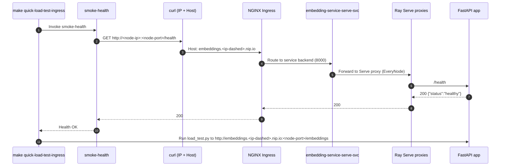
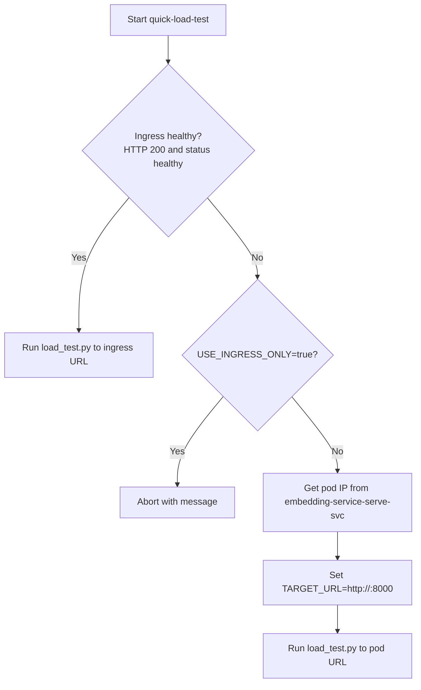

# Makefile test and optimisation guide

This guide explains how the Makefile drives deploy, health checks, and load tests for the Embedding Service, and how to tune workflows for reliable, repeatable ingress tests. It includes process diagrams, code snippets, and troubleshooting tips.


## Overview

Key targets referenced in this guide:

- smoke-health: Probes the service via NGINX Ingress using an IP-based connection and Host routing, and validates both HTTP status and JSON body.
- quick-load-test-ingress: Preferred. Runs a load test strictly through ingress after smoke-health passes.
- quick-load-test: Flexible. Prefers ingress but can fall back to a pod IP if allowed.
- redeploy, redeploy-and-test: Automate cleanup, apply manifests, verify health, and optionally run a quick test.


## Health check design

To avoid DNS flakiness while still exercising Ingress routing rules, the health checks:

- Connect to the Node IP on the NodePort
- Send the Host: embeddings.<node-ip-dashed>.nip.io header
- Require HTTP 200 and a JSON body reporting {"status":"healthy"}

This ensures the request enters NGINX via the correct vhost while avoiding unpredictable nip.io DNS resolution at curl time.

### Health check snippet

```bash
# Pseudocode excerpt used by smoke-health and internal waits
HOST="embeddings.${NODE_IP//./-}.nip.io"
HEALTH_URL="http://${NODE_IP}:${NODE_PORT}/health"

CODE=$(curl -s -o /dev/null -w "%{http_code}" -H "Host: $HOST" "$HEALTH_URL")
BODY=$(curl -s -H "Host: $HOST" "$HEALTH_URL")

if [ "$CODE" = "200" ] && echo "$BODY" | grep -qi '"status"\s*:\s*"healthy"'; then
  echo "Ingress healthy"
else
  echo "Ingress not healthy (code=$CODE)"
fi
```


## Process flows

### Ingress-only quick test (recommended path)



### Fallback logic (general quick-load-test)




## Deep dive: Makefile architecture and variables

The Makefile is organized into a few functional sections. Key variables and targets are designed to be overridden on the command line.

### Core variables (override at invocation)

- Kubernetes/Ray:
  - SERVICE_NAME (default: embedding-service)
  - RAYSERVICE_FILE (default: k8s/rayservice-local.yaml)
  - NAMESPACE (default: default)
- Ingress and tests:
  - NODE_PORT (default: 30333)
  - TEST_REQUESTS (default: 200)
  - TEST_CONCURRENCY (default: 10)
  - TEST_SEGMENTATION (default: false)
  - USE_INGRESS_ONLY (default: true for ingress-only run)
  - INGRESS_WAIT_SECS (default: 60)
  - SKIP_HEALTH_WAIT (internal; used to bypass redundant waits in quick-load-test-ingress)

Examples:

```bash
# Smaller ingress run
make quick-load-test-ingress TEST_REQUESTS=50 TEST_CONCURRENCY=5

# Heavier run with segmentation
make quick-load-test-ingress TEST_REQUESTS=1000 TEST_CONCURRENCY=20 TEST_SEGMENTATION=true

# General load test that can fall back to a pod IP
make quick-load-test TEST_REQUESTS=200 TEST_CONCURRENCY=10 USE_INGRESS_ONLY=false INGRESS_WAIT_SECS=30
```

### Build and image variables

These back the Docker build/push targets:

- REGISTRY (default: 192.168.1.3:5000)
- IMAGE_NAME (default: embedding-service)
- VERSION_FILE (default: version)
- VERSION (read from version file, default latest)
- FULL_IMAGE_TAG = $(REGISTRY)/$(IMAGE_NAME):$(VERSION)

Targets: version-bump, docker-build, docker-push, build-and-push-optimized.

```bash
# Build and push with version bump
make build-and-push-optimized
```


## Target walkthroughs with references

Below, we reference exact target names and the logic found in Makefile.

### 1) redeploy-clean

- Deletes the RayService and force-deletes lingering pods with label ray.io/is-ray-node=yes.
- If nvidia-smi exists, prints GPU process table for sanity (ensures GPUs are free before a fresh rollout).

### 2) deploy-apply

- Applies $(RAYSERVICE_FILE) and waits for Ray pods Ready (timeout 10m).
- Waits for Serve endpoints in $(SERVICE_NAME)-serve-svc.
- Prints pods with kubectl get pods -o wide for quick visibility.

### 3) smoke-health

- Builds HOST = embeddings.<NODE_IP dashed>.nip.io and requests http://<NODE_IP>:<NODE_PORT>/health with Host: <HOST>.
- Pass criteria: HTTP 200 and JSON body containing "status":"healthy".
- Falls back to a direct pod IP health check if the ingress path fails, and errors if both fail.

### 4) quick-load-test-ingress

- Depends on smoke-health (so ingress is validated first).
- Computes http://embeddings.<NODE_IP dashed>.nip.io:$(NODE_PORT) and calls the Python client (working_dir/load_test.py) directly.
- This path avoids duplicate health loops to reduce flakiness.

### 5) quick-load-test

- General-purpose target.
- Optionally waits for ingress health (same contract as smoke-health).
- If ingress isn’t healthy:
  - With USE_INGRESS_ONLY=true it aborts early.
  - Otherwise, it fetches a pod IP from $(SERVICE_NAME)-serve-svc and re-targets the client to http://<pod-ip>:8000.

### 6) redeploy and redeploy-and-test

- redeploy: redeploy-clean → deploy-apply → smoke-health.
- redeploy-and-test: runs redeploy, then quick-load-test (ingress preferred, with fallback depending on flags).


## The load test client: working_dir/load_test.py

The client is intentionally minimal and dependency-free, built on Python’s standard library.

- Endpoint: POST /embeddings
- Payload shape:

```json
{
  "texts": ["...", "...", "..."],
  "use_segmentation": true,
  "include_segment_embeddings": false,
  "show_progress": false
}
```

- Concurrency: uses ThreadPoolExecutor with max_workers = TEST_CONCURRENCY.
- Errors: HTTPError yields the HTTP status (e.g., 429, 500). Non-HTTP exceptions yield status 0.
- Reporting: total requests, per-status distribution, mean, p50, p95, p99 based on wall-clock latencies.

Excerpt:

```python
with ThreadPoolExecutor(max_workers=workers) as ex:
    futs = [ex.submit(post_json, url, payload) for _ in range(total)]
    for f in as_completed(futs):
        s, l = f.result()
        statuses.append(s)
        latencies.append(l)
```


## Health contract: detailed

The service health is considered OK IFF both conditions are true:

1) HTTP 200 from /health via ingress path (IP + Host header)
2) Response body contains "status":"healthy"

Why both? HTTP 200 alone can come from an upstream placeholder or default backend; the JSON body proves the request reached the application and not an error handler.

Debugging tips:

```bash
# Verify Host resolution vs Node IP (informational)
getent hosts embeddings.<ip-dashed>.nip.io

# Direct health probe with ingress routing
curl -si -H "Host: embeddings.<ip-dashed>.nip.io" \
  http://<node-ip>:<node-port>/health
```


## DNS and nip.io

- The Makefile probes ingress using an IP-based URL with the Host header set. This decouples test success from external DNS and still exercises NGINX vhost routing.
- A warning is printed if getent hosts returns an IP different from the NODE_IP, but health still passes because the TCP connection goes to NODE_IP.


## Performance methodology and tuning

Where to tune:

- App-level semaphores and limits: see src/config.py for embedding_concurrency_limit, similarity_concurrency_limit, and other caps.
- Ray Serve deployment parameters: see deployment wrapper (e.g., max_ongoing_requests, autoscaling target per replica). Ensure HTTP proxies run on EveryNode.
- Ingress warm-up: allow a short warm-up before heavy bursts. Use INGRESS_WAIT_SECS or run a small quick-load-test-ingress first.

Suggested steps:

1) Prove routing with R=50, C=5.
2) Increase to R=200, C=10.
3) For segmentation-heavy tests, adjust concurrency cautiously and watch for 429/500.
4) Monitor p95/p99 under sustained load; consider adding autoscaling slack or lowering per-replica targets.


## Troubleshooting cookbook

Common symptoms and suggested checks:

- HTTP 000 in health checks:
  - Connection or listener issue. Confirm NodePort, NGINX status, and that nothing is blocking the port.
  - Try curl -v with the Host header to see connection-level errors.

- 503 during warm-up:
  - Give more warm-up time; check that Serve deployments are ready.
  - Confirm readiness probes in your RayService manifest are passing.

- 429 under segmentation:
  - Indicates capacity or rate limit thresholds. Increase app concurrency or Serve max_ongoing_requests gradually.

- Ingress healthy but app errors persist:
  - Use quick-load-test with USE_INGRESS_ONLY=false to isolate app behavior via pod IP.
  - Inspect logs from Ray head/worker pods and NGINX controller.

- DNS mismatch (nip.io vs NODE_IP):
  - Informational only due to IP+Host probing. For public DNS, consider a stable hostname or a LoadBalancer ingress.


## CI/CD examples

You can wire a basic validation stage that fails fast on ingress health, then runs a short ingress-only load test:

```bash
make smoke-health
make quick-load-test-ingress TEST_REQUESTS=50 TEST_CONCURRENCY=5
```

Optionally add a pod-level fallback check (do not fail the pipeline if ingress is flaky, but capture signal):

```bash
make quick-load-test TEST_REQUESTS=50 TEST_CONCURRENCY=5 USE_INGRESS_ONLY=false || true
```

You can assert on the output (e.g., grep for "non-200: 0") to enforce SLAs.


## Appendix: Selected Makefile excerpts

Health check core (appears in smoke-health):

```make
CODE=$$(curl -s -o /dev/null -w "%{http_code}" -H "Host: $$HOST" $$ENDPOINT_IP/health || true)
RES=$$(curl -s -H "Host: $$HOST" $$ENDPOINT_IP/health || true)
if [ "$$CODE" != "200" ] || ! echo "$$RES" | grep -qi '"status"\s*:\s*"healthy"'; then ... fi
```

Ingress-only runner (after smoke-health succeeds):

```make
@set -euo pipefail; \
. ./.make.cached.env; \
IP_DASH=$${NODE_IP//./-}; HOST=embeddings.$$IP_DASH.nip.io; \
URL=http://$$HOST:$(NODE_PORT); \
python3 working_dir/load_test.py --url $$URL \
  --requests $(TEST_REQUESTS) --concurrency $(TEST_CONCURRENCY) \
  --segmentation $(TEST_SEGMENTATION)
```

General quick-load-test fallback (pod IP path):

```make
POD_IP=$$(kubectl get endpoints $(SERVICE_NAME)-serve-svc -n $(NAMESPACE) -o jsonpath='{.subsets[0].addresses[0].ip}')
TARGET_URL=http://$$POD_IP:8000
python3 working_dir/load_test.py --url $$TARGET_URL \
  --requests $(TEST_REQUESTS) --concurrency $(TEST_CONCURRENCY) \
  --segmentation $(TEST_SEGMENTATION)
```


## Variable cheat sheet

- NODE_PORT: Ingress HTTP port (NodePort)
- TEST_REQUESTS: Total number of requests
- TEST_CONCURRENCY: Number of worker threads in the client
- TEST_SEGMENTATION: Toggle segmentation workload (true/false)
- USE_INGRESS_ONLY: Abort if ingress isn’t healthy (used by quick-load-test)
- INGRESS_WAIT_SECS: Max wait for ingress health
- SERVICE_NAME, NAMESPACE, RAYSERVICE_FILE: Kubernetes/Ray deployment parameters


---

With this flow, ingress health and load testing use the same contract (HTTP 200 + {"status":"healthy"}), removing inconsistent outcomes and making test runs reliable and reproducible. If you need this guide mirrored under docs/, we can move it and cross-link from the top-level README.md alongside deployment and optimisation docs.